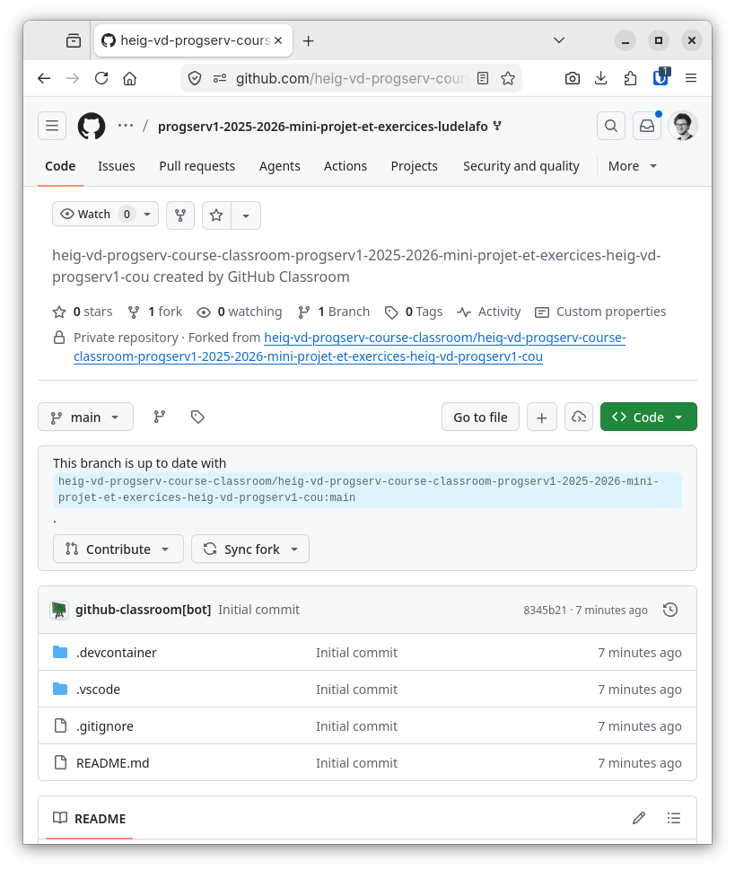
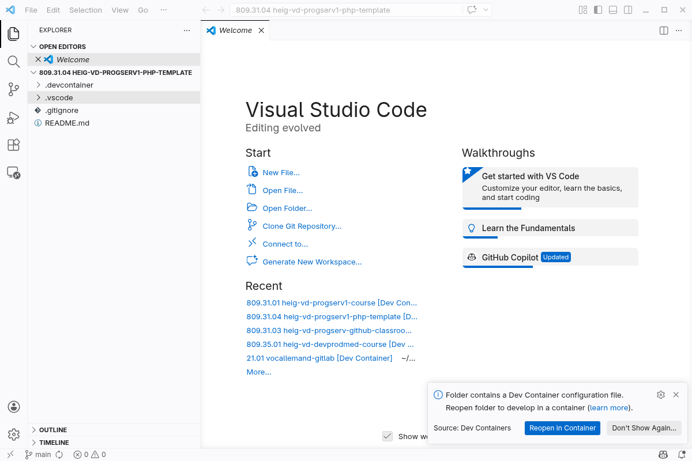

# Introduction à PHP - Mini-projet

L. Delafontaine, avec l'aide de
[GitHub Copilot](https://github.com/features/copilot).

Ce travail est sous licence [CC BY-SA 4.0][licence].

> [!TIP]
>
> Toutes les informations relatives à ce contenu sont décrites dans le
> [contenu principal](../README.md).

## Table des matières

- [Table des matières](#table-des-matières)
- [Objectifs](#objectifs)
- [Introduction à votre première séance de mini-projet](#introduction-à-votre-première-séance-de-mini-projet)
- [Installer et configurer l'environnement de développement local](#installer-et-configurer-lenvironnement-de-développement-local)
  - [Prérequis](#prérequis)
  - [Valider l'installation et la configuration de l'environnement de développement local](#valider-linstallation-et-la-configuration-de-lenvironnement-de-développement-local)
- [Créer votre dépôt GitHub pour le mini-projet et les exercices](#créer-votre-dépôt-github-pour-le-mini-projet-et-les-exercices)
  - [Accepter l'invitation à rejoindre l'organisation Classroom dédié au cours](#accepter-linvitation-à-rejoindre-lorganisation-classroom-dédié-au-cours)
  - [Accéder à Classroom 50](#accéder-à-classroom-50)
  - [Créer le dépôt GitHub pour le mini-projet et les exercices](#créer-le-dépôt-github-pour-le-mini-projet-et-les-exercices)
- [Cloner votre dépôt GitHub localement](#cloner-votre-dépôt-github-localement)
- [Ouvrir le projet localement](#ouvrir-le-projet-localement)
  - [Ouvrir votre dépôt GitHub dans Visual Studio Code](#ouvrir-votre-dépôt-github-dans-visual-studio-code)
  - [Ouvrir le projet dans un conteneur de développement](#ouvrir-le-projet-dans-un-conteneur-de-développement)
  - [Découvrir la structure du projet](#découvrir-la-structure-du-projet)
  - [Désactiver GitHub Copilot dans Visual Studio Code](#désactiver-github-copilot-dans-visual-studio-code)
- [Démarrer le projet](#démarrer-le-projet)
  - [Ouvrir un terminal intégré](#ouvrir-un-terminal-intégré)
  - [Valider l'installation de PHP](#valider-linstallation-de-php)
  - [Démarrer le serveur serveur web Apache](#démarrer-le-serveur-serveur-web-apache)
  - [Créer la structure de base du projet](#créer-la-structure-de-base-du-projet)
  - [Créer et tester les fichiers de base du projet](#créer-et-tester-les-fichiers-de-base-du-projet)
  - [Ajouter un logo à la page d'accueil](#ajouter-un-logo-à-la-page-daccueil)
  - [Ajouter des styles CSS personnalisés](#ajouter-des-styles-css-personnalisés)
  - [Tester la page d'accueil](#tester-la-page-daccueil)
  - [Arrêter le serveur web Apache](#arrêter-le-serveur-web-apache)
- [Ajouter les fichiers au contrôle de version avec Git](#ajouter-les-fichiers-au-contrôle-de-version-avec-git)
  - [Visualiser les changements avec Git](#visualiser-les-changements-avec-git)
  - [Ajouter les fichiers au suivi avec Git](#ajouter-les-fichiers-au-suivi-avec-git)
  - [Commiter les changements avec Git](#commiter-les-changements-avec-git)
  - [Pousser les changements vers GitHub](#pousser-les-changements-vers-github)
- [Conclusion](#conclusion)
- [Solution](#solution)

## Objectifs

Bienvenue dans la première séance du mini-projet qui va vous accompagner durant
toute la durée du cours "Programmation serveur 1 (ProgServ1)" !

Cette séance de mini-projet est conçue pour vous permettre de mettre en place un
environnement de développement local pour PHP, de créer un projet PHP pour le
mini-projet, et de déployer ce projet en ligne.

À l'issue de cette séance, les personnes qui étudient devraient avoir pu :

- Installer et configurer un environnement de développement local pour PHP.
- Initialiser un projet PHP pour le mini-projet avec Git et GitHub.
- Créer les pages de base du projet PHP pour le mini-projet.

## Introduction à votre première séance de mini-projet

En lisant les contenus préparés pour les séances de mini-projet, vous trouverez
peut-être ce que l'on appelle des "avertissements" ou des "alertes".

Elles se présentent comme suit :

> [!NOTE]
>
> Hé ! Je suis une note ! Merci de m'avoir lue !

Elles sont là pour mettre en évidence des informations importantes dont vous
devez tenir compte.

Voici les différents types d'alertes que vous pourriez trouver et leur
signification :

> [!NOTE]
>
> Informations mises en évidence que vous devriez prendre en compte.

> [!TIP]
>
> Informations facultatives pour vous aider à mieux réussir avec des conseils,
> des astuces, ou encore des suggestions.

> [!IMPORTANT]
>
> Informations cruciales nécessaires à la réussite des actions que vous devriez
> effectuer.

> [!WARNING]
>
> Informations critiques exigeant votre attention immédiate en raison des
> risques potentiels.

> [!CAUTION]
>
> Conséquences négatives potentielles d'une action que vous devriez éviter.

Nous pourrions vous rediriger vers de la documentation officielle ou des
ressources externes à suivre pour configurer votre environnement ou en savoir
plus sur un sujet spécifique.

Ces ressources externes sont là pour vous aider. Nous vous redirigeons vers
elles pour éviter de répéter ce qui est déjà bien maintenu et expliqué ailleurs.

Ce que vous voyez et faites dans une séance actuelle peut être utilisé dans une
séance future.

C'est pourquoi il est important de suivre les étapes et de comprendre ce que
vous faites. Vous devez conserver le code que vous écrivez pour les séances
futures.

Cependant, si _quoi que ce soit_ n'est pas clair, ne fonctionne pas ou nécessite
une amélioration, n'hésitez pas à poser des questions ou nous le signaler.

L'équipe pédagogique considère qu'il n'y a pas de question bête : vous êtes ici
pour apprendre et nous sommes là pour vous aider ! Travaillons en équipe pour
que vous puissiez réussir !

C'est parti !

> [!TIP]
>
> Le [support de cours](../README.md) est disponible pour vous aider à
> comprendre les concepts théoriques abordés dans ce mini-projet si besoin !

## Installer et configurer l'environnement de développement local

Un environnement de développement local est un ensemble d'outils et de logiciels
nécessaires pour écrire, tester et déboguer des applications logicielles sur
votre propre ordinateur. Il permet aux développeur.euses de créer et de tester
leur code dans un environnement contrôlé avant de le déployer sur un serveur de
production en ligne.

Dans cette section, nous allons installer et configurer un environnement de
développement local pour développer des applications web en PHP.

### Prérequis

Avant de commencer, assurez-vous d'avoir les éléments suivants installés et
configurés sur votre ordinateur :

> [!NOTE]
>
> Pour les personnes qui auraient déjà suivi l'unité préparatoire d'informatique
> (UPInfo) avant la rentrée, vous devriez déjà avoir votre environnement de
> développement local installé et configuré correctement.
>
> **Note pour la rentrée 2026-2027** : une nouvelle section
> [Ajouter votre adresse e-mail HEIG-VD à votre compte GitHub](https://heig-vd-upinfo-course.github.io/heig-vd-upinfo-course/05-configurer-son-systeme-dexploitation-et-ses-applications/19-git-et-github/#ajouter-votre-adresse-e-mail-heig-vd-%C3%A0-votre-compte-github)
> dans le contenu
> [Git et GitHub](https://heig-vd-upinfo-course.github.io/heig-vd-upinfo-course/05-configurer-son-systeme-dexploitation-et-ses-applications/19-git-et-github/)
> a été ajoutée depuis la rentrée 2026-2027 de septembre. Merci de suivre les
> instructions de cette section pour vous assurer que votre compte GitHub est
> correctement configuré avec votre adresse e-mail HEIG-VD.

- Un ordinateur avec un système d'exploitation compatible avec les outils que
  nous allons utiliser (Windows, macOS ou Linux).
- Une connexion Internet pour télécharger les outils nécessaires et accéder aux
  ressources en ligne.
- Un IDE tel que
  [Visual Studio Code](https://heig-vd-upinfo-course.github.io/heig-vd-upinfo-course/05-configurer-son-systeme-dexploitation-et-ses-applications/17-visual-studio-code/).
- [Secure Shell (SSH)](https://heig-vd-upinfo-course.github.io/heig-vd-upinfo-course/05-configurer-son-systeme-dexploitation-et-ses-applications/18-secure-shell-ssh/)
  installé et configuré pour s'authentifier auprès de GitHub.
- [Git et GitHub](https://heig-vd-upinfo-course.github.io/heig-vd-upinfo-course/05-configurer-son-systeme-dexploitation-et-ses-applications/19-git-et-github/)
  pour la gestion de version et le dépôt de code.
- [Docker](https://heig-vd-upinfo-course.github.io/heig-vd-upinfo-course/05-configurer-son-systeme-dexploitation-et-ses-applications/20-docker/)
  pour démarrer l'environnement de développement local dans un conteneur.

### Valider l'installation et la configuration de l'environnement de développement local

- [x] Visual Studio Code est installé et fonctionne correctement.
- [x] SSH est installé et fonctionne correctement.
- [x] Git est installé et fonctionnent correctement.
- [x] Le compte GitHub est correctement configuré avec votre adresse e-mail
      HEIG-VD.
- [x] Docker et Docker Compose sont installés et fonctionnent correctement.

## Créer votre dépôt GitHub pour le mini-projet et les exercices

Dans cette section, nous allons créer un dépôt GitHub pour votre mini-projet et
vos exercices. Ce dépôt sera utilisé pour stocker et gérer le code source de
votre projet, ainsi que pour suivre les modifications apportées au fil du temps.

Pour cela, nous allons utiliser un outil appelé
[Classroom 50](https://classroom50.org/) (un outil de gestion de projets
Git/GitHub pour le monde de l'enseignement), qui permet de créer des dépôts
GitHub privés pour les étudiant·s et permettre aux enseignant·es de facilement
pouvoir suivre l'avancement des projets et vous aider en cas de besoin.

### Accepter l'invitation à rejoindre l'organisation Classroom dédié au cours

Vous devriez avoir reçu une invitation sur votre adresse e-mail HEIG-VD pour
rejoindre l'organisation GitHub
[HEIG-VD ProgServ Classroom](https://github.com/heig-vd-progserv-classroom).

Cette organisation, différente de celle officielle du cours
[HEIG-VD ProgServ Course](https://github.com/heig-vd-progserv-course), contient
tous les dépôts GitHub privés pour le mini-projet et les exercices.

Les deux organisations sont nécessaires pour le cours, car l'organisation
officielle contient le contenu du cours et les dépôts GitHub publics pour les
exercices, tandis que l'organisation Classroom contient les dépôts GitHub privés
pour le mini-projet et les exercices.

Acceptez l'invitation pour rejoindre l'organisation Classroom dédiée au cours.

### Accéder à Classroom 50

Une fois l'invitation acceptée, vous pouvez accéder à Classroom 50 en suivant le
lien suivant : <https://classroom50.org/>.

Connectez-vous avec votre compte GitHub et vous devriez voir le cours
"Programmation serveur 1 (ProgServ1)" dans la liste des cours disponibles.

### Créer le dépôt GitHub pour le mini-projet et les exercices

Dans Classroom 50, cliquez sur le cours "Programmation serveur 1 (ProgServ1)"
pour accéder à la liste des devoirs disponibles.

Suivez les instructions pour rejoindre le devoir GitHub pour le mini-projet et
les exercices. Cela créera un dépôt GitHub privé pour vous, nommé
`progserv1-<annee>-<annee>-mini-projet-et-exercices-<github-username>`.

Vous devriez maintenant avoir accès à votre dépôt GitHub privé pour le cours
"Programmation serveur 1 (ProgServ1)" sur une page similaire à celle-ci :



Nous prendrons quelques instants pour explorer le dépôt GitHub et comprendre sa
structure dans les prochaines étapes.

## Cloner votre dépôt GitHub localement

Maintenant que vous avez créé votre dépôt GitHub privé pour le mini-projet et
les exercices, nous allons le cloner localement sur votre ordinateur pour
pouvoir travailler dessus.

Choisissez un emplacement sur votre ordinateur où vous souhaitez cloner le dépôt
GitHub pour le mini-projet et les exercices. Par exemple, vous pouvez choisir de
le cloner dans votre dossier `Documents` ou `Projects`.

> [!CAUTION]
>
> Ne clonez pas le dépôt GitHub dans un dossier qui est synchronisé avec un
> service de stockage en ligne (comme OneDrive, iCloud, Google Drive, Dropbox,
> etc.) !
>
> Créez un dossier spécifique pour vos projets de cours, par exemple
> `C:\Users\<votre-nom>\heig-vd/progserv1` sur Windows,
> `/Users/<votre-nom>/heig-vd/progserv1` sur macOS ou encore
> `/home/<votre-nom>/heig-vd/progserv1` sur Linux.
>
> Ceci vous permettra d'éviter des problèmes de synchronisation et de conflits
> de fichiers qui pourraient survenir si vous clonez le dépôt dans un dossier
> synchronisé avec un service de stockage en ligne.
>
> Comme vos projets seront stockés dans un dépôt GitHub privé, vous n'avez pas
> besoin de les sauvegarder dans un service de stockage en ligne pour les
> protéger contre la perte de données.
>
> De plus, cela vous permettra de mieux organiser vos projets de cours et de les
> gérer plus facilement.

Une fois que vous avez choisi l'emplacement où vous souhaitez cloner le dépôt
GitHub, suivez les étapes suivantes pour le cloner localement sur votre
ordinateur :

1. Ouvrez l'emplacement choisi dans un terminal.
   - Pour Windows : clique-droit dans le dossier → _"Open in Windows Terminal"_.
   - Pour macOS : Suivez la section
     _"[Open new Terminal windows or tabs from the Finder](https://support.apple.com/guide/terminal/open-new-terminal-windows-and-tabs-trmlb20c7888/mac)"_
     issue du site de support Apple ou ouvrez le terminal et utilisez la
     commande `cd` pour naviguer jusqu'à l'emplacement choisi.
   - Pour Linux : clique-droit dans le dossier → _"Open in Terminal"_. ou ouvrez
     le terminal et utilisez la commande `cd` pour naviguer jusqu'à
     l'emplacement choisi.
2. Clonez le dépôt GitHub en utilisant la commande suivante, en remplaçant le
   dépôt par l'URL de votre dépôt GitHub privé (que vous pouvez trouver sur la
   page de votre dépôt GitHub en cliquant sur le bouton vert _"Code"_ et en
   copiant l'URL SSH) :

   ```bash
   git clone <url-ssh-du-dépôt-github>
   ```

   Remplacez `<url-ssh-du-dépôt-github>` par l'URL SSH de votre dépôt GitHub
   privé.

3. Le dépôt GitHub sera cloné localement sur votre ordinateur dans un dossier
   portant le même nom que votre dépôt GitHub (par exemple,
   `progserv1-2026-2027-mini-projet-et-exercices-<github-username>`).

## Ouvrir le projet localement

### Ouvrir votre dépôt GitHub dans Visual Studio Code

Maintenant que le dépôt GitHub est cloné localement sur votre ordinateur, vous
devez l'ouvrir dans Visual Studio Code pour pouvoir travailler sur votre projet
PHP.

1. Ouvrez Visual Studio Code.
2. Cliquez sur le menu **File > Open Folder...** et sélectionnez le dossier du
   projet cloné localement sur votre ordinateur (par exemple,
   `progserv1-2026-2027-mini-projet-et-exercices-<github-username>`).
3. Visual Studio Code ouvrira le dossier du projet. Un avertissement de sécurité
   pourrait vous demander si vous faites confiance aux auteurs du dossier.
   Cliquez sur le bouton **Yes, I trust the authors** pour continuer.
4. Visual Studio Code affichera tous les fichiers et dossiers du projet dans
   l'explorateur de fichiers situé à gauche de la fenêtre.

Votre projet est maintenant ouvert dans Visual Studio Code. Vous pouvez fermer
le terminal précédemment ouvert, car nous allons utiliser le terminal intégré de
Visual Studio pour exécuter les commandes nécessaires à la suite du cours.

### Ouvrir le projet dans un conteneur de développement

> [!NOTE]
>
> Toutes les instructions ci-dessous sont également disponibles dans le fichier
> README.md du projet cloné localement sur votre ordinateur. Vous pouvez le
> consulter à tout moment pour vous aider à suivre les étapes de la séance.

Le projet fourni pour le mini-projet et les exercices est configuré pour être
exécuté dans un conteneur de développement.

Un conteneur de développement (Dev Container) est un environnement isolé qui
contient tous les outils nécessaires pour développer une application. Il permet
aux personnes qui développent (vous) de travailler dans un environnement
cohérent, quel que soit le système d'exploitation ou la configuration de leur
ordinateur.

De plus, un conteneur de développement permet de s'assurer que tout le monde
utilise la même configuration et les mêmes extensions pour le projet, ce qui
facilite la collaboration et le partage de code entre les membres de l'équipe.

Il n'est pas nécessaire de comprendre en détail ce qu'est un conteneur de
développement pour suivre ce cours, mais nous allons parcourir les éléments de
base pour vous permettre de l'utiliser correctement.

Lorsque le projet est ouvert dans Visual Studio Code, vous devriez voir une
notification en bas à droite de la fenêtre vous proposant d'ouvrir le projet
dans un conteneur de développement. Cliquez sur le bouton **Reopen in
Container** pour ouvrir le projet dans le conteneur de développement.

<details>
<summary>Afficher la capture d'écran illustrant l'étape</summary>



</details>

Visual Studio Code va maintenant construire le conteneur de développement en
utilisant les fichiers de configuration fournis dans le projet décrits dans le
dossier `.devcontainer`. Cela peut prendre quelques minutes, surtout lors de la
première ouverture du projet.

Une fois que le conteneur de développement est construit et que Visual Studio
Code s'y est connecté, vous êtes maintenant dans un environnement de
développement isolé avec tous les outils nécessaires pour développer votre
application PHP.

Le conteneur de développement est configuré à l'aide des fichiers
`.devcontainer/devcontainer.json` et `.vscode/settings.json`.

Le fichier `.devcontainer/devcontainer.json` contient la configuration du
conteneur de développement, y compris les extensions Visual Studio Code à
installer, les paramètres de l'environnement de développement, les commandes à
exécuter lors de l'ouverture du conteneur, etc. Pour cela, il utilise une image
Docker de base qui contient PHP et les outils nécessaires pour le développement
PHP.

Dans le contexte de ce cours, le conteneur de développement est configuré pour
installer les extensions suivantes dans Visual Studio Code :

- [PHP Intelephense](https://marketplace.visualstudio.com/items?itemName=bmewburn.vscode-intelephense-client)
  : une extension pour le développement PHP qui fournit des fonctionnalités
  telles que l'autocomplétion, la navigation dans le code, la validation de
  syntaxe, etc.
- [Prettier](https://marketplace.visualstudio.com/items?itemName=esbenp.prettier-vscode)
  : une extension pour le formatage du code qui permet de maintenir un style de
  code cohérent dans votre projet.
- [SQLite Viewer](https://marketplace.visualstudio.com/items?itemName=alexcuvsenov.sqlite-viewer)
  : une extension pour Visual Studio Code qui permet de visualiser les données
  des bases de données SQLite directement depuis l'éditeur de de code.
- [Database Client](https://marketplace.visualstudio.com/items?itemName=cweijan.vscode-database-client2)
  : une extension pour Visual Studio Code qui permet de se connecter à
  différentes bases de données et d'exécuter des requêtes SQL directement depuis
  l'éditeur de code.

Le fichier `.vscode/settings.json` contient les paramètres de Visual Studio Code
spécifiques au projet, tels que les paramètres de formatage du code, les
paramètres de l'éditeur, les paramètres de l'extension, etc.

Grâce à cette configuration, vous avez un environnement de développement prêt à
l'emploi avec les extensions nécessaires pour développer votre application PHP
sans avoir à les installer manuellement.

A l'avenir, lorsque vous voudrez travailler sur votre projet, ouvrez simplement
le projet dans Visual Studio Code et cliquez sur le bouton **Reopen in
Container** pour vous connecter au conteneur de développement et commencer à
travailler sur votre application PHP.

> [!TIP]
>
> Vous pouvez également ouvrir le projet dans un conteneur de développement
> directement depuis le menu de Visual Studio Code en allant dans les projets
> récents (File > Open Recent) et en sélectionnant le projet qui porte le nom de
> votre dépôt GitHub privé pour le mini-projet et les exercices avec la notation
> _"[Dev Container]"_ (par exemple,
> `progserv1-2026-2027-mini-projet-et-exercices-<github-username> [Dev Container]`).

### Découvrir la structure du projet

Maintenant que le projet est ouvert dans Visual Studio Code, prenons un moment
pour explorer la structure du projet et comprendre les différents fichiers et
dossiers qui le composent.

- `.devcontainer/`: Contient la configuration pour le développement dans un
  conteneur Docker.
- `.vscode/`: Contient les paramètres recommandés pour Visual Studio Code.
- `.gitignore`: Fichier de configuration pour Git, spécifiant les fichiers et
  dossiers à ignorer. Cette configuration par défaut est adaptée pour un projet
  PHP avec une base de données SQLite. Il n'est pas nécessaire de modifier ce
  fichier.
- `README.md`: Un fichier de documentation contenant des informations sur le
  projet.

### Désactiver GitHub Copilot dans Visual Studio Code

Si vous avez accès à GitHub Copilot, nous vous recommandons de le désactiver
dans Visual Studio Code pour éviter d'avoir des suggestions de code qui
pourraient interférer avec votre apprentissage et votre compréhension du code
que vous écrivez.

Pour cela, vous pouvez décommenter les lignes correspondantes dans le fichier
`.vscode/settings.json` de Visual Studio Code :

```json
...

	// (Un)comment to disable inline suggestions, which can be distracting for learning purposes
	// "editor.inlineSuggest.enabled": false,

...

	// (Un)comment to disable GitHub Copilot, which can be distracting for learning purposes
	// "github.copilot.enable": {
	// 	"*": false
	// },

...
```

Vous avez maintenant un environnement de développement local prêt à l'emploi
pour développer votre application PHP pour le mini-projet et les exercices.

## Démarrer le projet

Maintenant que nous avons configuré notre environnement de développement local
et que nous avons ouvert le projet dans Visual Studio Code, nous allons
initialiser le projet PHP pour le mini-projet.

### Ouvrir un terminal intégré

Afin de ne pas avoir à basculer entre notre éditeur de code et une fenêtre de
terminal, nous allons utiliser le terminal intégré de Visual Studio Code.

1. Ouvrez le terminal intégré en allant dans le menu **Terminal > New
   Terminal**.
2. Le terminal devrait s'ouvrir en bas de la fenêtre de Visual Studio Code.

Ce terminal devrait être ouvert dans le dossier de votre projet PHP
automatiquement, directement dans le conteneur de développement.

Nous vous recommandons d'avoir ce terminal intégré ouvert en permanence pendant
que vous travaillez sur votre projet PHP, car cela vous permettra d'exécuter les
commandes nécessaires pour développer votre application sans avoir à basculer
entre différentes fenêtres.

### Valider l'installation de PHP

Pour vérifier que PHP est installé et fonctionne correctement dans le conteneur
de développement, exécutez la commande suivante dans le terminal intégré de
Visual Studio Code :

```bash
php --version
```

Le résultat devrait être similaire à ceci :

```text
PHP 8.5.3 (cli) (built: Feb 24 2026 19:07:16) (NTS)
Copyright (c) The PHP Group
Built by https://github.com/docker-library/php
Zend Engine v4.5.3, Copyright (c) Zend Technologies
    with Xdebug v3.5.0, Copyright (c) 2002-2025, by Derick Rethans
    with Zend OPcache v8.5.3, Copyright (c), by Zend Technologies
```

Cela signifie que PHP est installé et fonctionne correctement dans le conteneur
de développement. Vous pouvez maintenant utiliser PHP pour développer votre
application web.

### Démarrer le serveur serveur web Apache

Pour démarrer le serveur serveur web Apache, exécutez la commande suivante dans
le terminal intégré de Visual Studio Code :

```bash
docker compose up
```

Cette commande démarre un serveur serveur web Apache sur le port 8080 accessible
depuis votre navigateur web.

Une fois que le serveur serveur web Apache est démarré, vous devriez voir un
message similaire à celui-ci dans le terminal :

```text
apache  | [Wed Nov 18 21:10:32.484866 2026] [mpm_prefork:notice] [pid 1:tid 1] AH00163: Apache/2.4.69 (Debian) PHP/8.5.12 configured -- resuming normal operations
```

Cela signifie que le serveur serveur web Apache est maintenant en cours
d'exécution. Vous pouvez laisser ce terminal ouvert pendant que vous travaillez
sur votre projet PHP.

> [!NOTE]
>
> Vous remarquerez peut-être qu'il n'est plus possible d'exécuter d'autres
> commandes dans ce terminal tant que le serveur serveur web Apache est en cours
> d'exécution. C'est normal, car le serveur serveur web Apache tourne en
> arrière-plan afin de pouvoir répondre aux requêtes HTTP envoyées depuis votre
> navigateur web.

Essayez d'accéder à votre application PHP en ouvrant votre navigateur web à
l'adresse suivante : <http://localhost:8080>.

Par le simple fait d'avoir essayé d'accéder à cette adresse, le serveur web
Apache a effectué les tâches suivantes :

1. Une requête HTTP a été envoyée à l'adresse <http://localhost:8080> depuis
   votre navigateur web.
2. Le serveur Apache a reçu la requête et a tenté de trouver un fichier
   correspondant à la requête dans le dossier racine de votre projet PHP :
   - Par défaut, Apache recherche un fichier `index.php` ou `index.html` à la
     racine du projet pour répondre à la requête.
   - Si aucun fichier correspondant n'est trouvé, Apache affiche les fichiers
     disponibles dans le dossier.
3. Si un fichier correspondant est trouvé, le serveur Apache exécute ce fichier
   et renvoie le résultat de son exécution au navigateur web pour être affiché.
4. Le navigateur web reçoit la réponse du serveur Apache et affiche le résultat
   à l'utilisateur·trice.

> [!NOTE]
>
> Lorsque nous parlons du "dossier racine du projet", nous faisons référence au
> dossier qui contient tous les fichiers et dossiers de votre projet PHP. C'est
> le dossier que vous avez cloné depuis GitHub Classroom et qui porte le nom de
> votre dépôt GitHub privé pour le mini-projet et les exercices (par exemple,
> `progserv1-2026-2027-mini-projet-et-exercices-<github-username>`).
>
> A l'avenir, lorsque nous parlerons du "dossier racine du projet", nous ferons
> référence à ce dossier qui contient tous les fichiers et dossiers de votre
> projet PHP.

Comme il n'existe pas (encore) de fichier `index.php` ou `index.html` à la
racine du projet dans la structure de fichiers de notre projet, le serveur web
Apache vous affiche la liste des fichiers disponibles.

Pour arrêter le serveur web Apache, vous pouvez simplement appuyer sur
<kbd>Ctrl</kbd> + <kbd>C</kbd> dans le terminal intégré de Visual Studio Code.
Cela arrêtera le serveur web Apache et vous pourrez redémarrer le serveur plus
tard en exécutant à nouveau la commande précédente.

Pour la suite de ce contenu, assurez-vous d'avoir le serveur web Apache démarré
et le terminal intégré ouvert dans Visual Studio Code.

### Créer la structure de base du projet

Nous allons maintenant créer la structure de fichiers et de dossiers qui nous
permettra d'organiser le mini-projet et les exercices tout au long du cours.
Cette structure va évoluer au fur et à mesure que nous ajouterons de nouvelles
fonctionnalités à l'application web que nous allons construire.

Commencez par créer les dossiers `exercices` et `mini-projet` dans le dossier
racine du projet.

La structure de votre projet devrait maintenant ressembler à ceci :

```text
./
├── .devcontainer/
│   └── ...
├── exercices/
├── mini-projet/
├── .vscode/
│   └── ...
├── .gitignore
└── README.md
```

Le dossier `exercices` contiendra tous les exercices réalisés durant le cours
"Programmation serveur 1 (ProgServ1)". Vous pourrez l'utiliser pour stocker les
exercices de chaque séance et faire des tests et expérimentations.

Le dossier `mini-projet` contiendra tous les fichiers et dossiers nécessaires
pour le mini-projet du cours "Programmation serveur 1 (ProgServ1)". C'est dans
ce dossier que vous allez construire l'application web pour gérer une liste de
tâches à réaliser.

Les autres fichiers et dossiers du projet (comme `.devcontainer`, `.vscode`,
`.gitignore`, `README.md`, etc.) sont les fichiers fournis de base pour le
projet.

A l'avenir, par souci de breveté, nous ne mentionnerons plus les fichiers de
base du projet mais ceux-ci ne doivent pas être modifiés ou supprimés. Ils sont
nécessaires pour la configuration du conteneur de développement, les paramètres
de Visual Studio Code, la gestion des fichiers avec Git, et la documentation du
projet.

### Créer et tester les fichiers de base du projet

Créez maintenant les fichiers suivants dans les différents dossiers du projet :

```text
./
├── exercices/
├── mini-projet/
│   └── public/
│       ├── index.php
│       └── view.php
├── demo.php
└── exception.php
```

#### Fichier `exception.php`

Dans le fichier `exception.php`, ajoutez le code suivant :

```php
<?php

throw new Exception("This is an exception message.");
```

Ce fichier est utilisé pour tester la gestion des erreurs en PHP.

Cela permet de valider que la gestion des erreurs fonctionne correctement dans
votre environnement de développement et que ceux-ci sont bien affichés dans le
navigateur web.

Sauvegardez le fichier et accédez à l'adresse
<http://localhost:8080/exception.php> dans votre navigateur web pour voir le
message d'exception.

Commencez par observer le terminal intégré de Visual Studio Code. Vous devriez
voir un message similaire à celui-ci dans le terminal :

```text
apache  | 172.19.0.1 - - [18/Nov/2026:21:31:10 +0000] "GET /exception.php HTTP/1.1" 200 434 "-" "Mozilla/5.0 (X11; Linux x86_64; rv:159.0) Gecko/20100101 Firefox/159.0"
```

Vous remarquez que le terminal intégré de Visual Studio Code affiche les détails
de la requête HTTP envoyée par le navigateur web pour accéder au fichier
`exception.php`. Nous pouvons voir ici que le serveur web Apache a reçu une
requête HTTP GET pour le fichier `exception.php` de la part d'un navigateur web
Mozilla (Firefox) et a renvoyé une réponse réussie (code de statut HTTP 200) au
navigateur web.

Regarder ce qu'il se passe dans le serveur web Apache est une compétence
essentielle pour comprendre comment votre application PHP fonctionne et pour
diagnostiquer les problèmes qui pourraient survenir lors du développement de
votre application. Prêtez-y attention à l'avenir lorsque vous testerez votre
code dans le navigateur web.

Regardez maintenant le navigateur web. Vous devriez voir un message d'erreur
similaire à celui-ci dans le navigateur web :

```text
Fatal error: Uncaught Exception: This is an exception message. in /workspace/exception.php:3 Stack trace: #0 {main} thrown in /workspace/exception.php on line 3
```

Prenez quelques instants pour comprendre ce message d'erreur et ce qu'il
signifie et répondez aux questions suivantes :

- Dans quel fichier l'erreur est-elle survenue ?
- A quelle ligne du fichier l'erreur est-elle survenue ?
- Quel est le message d'erreur ?

<details>
<summary>Afficher la réponse</summary>

- L'erreur est survenue dans le fichier `/workspace/exception.php`.
- L'erreur a été levée à la ligne 3.
- Le message d'erreur est "This is an exception message.".

</details>

Durant le cours, il se peut que vous rencontriez des erreurs similaires à
celle-ci lorsque vous testez votre code dans le navigateur web. Il est important
de comprendre les messages d'erreur et de savoir comment les interpréter pour
pouvoir corriger les erreurs dans votre code. Ces informations sont précieuses
pour localiser rapidement l'erreur dans votre code et la corriger efficacement.

#### Fichier `demo.php`

Dans le fichier `demo.php`, ajoutez le code suivant :

```php
<?php
const APP_NAME = "Page de démonstration";
?>

<!DOCTYPE html>
<html lang="fr">

<head>
    <meta charset="utf-8">

    <title><?= APP_NAME; ?></title>
    <meta name="description" content="Une page de démonstration.">
</head>

<body>
    <h1><?= APP_NAME; ?></h1>

    <p>Bienvenue sur la page de démonstration. Cette page est utilisée pour illustrer le fonctionnement de PHP.</p>
</body>

</html>
```

Sauvegardez le fichier et accédez à l'adresse <http://localhost:8080/demo.php>
dans votre navigateur web pour voir la page de démonstration.

Vous devriez voir une page web avec le titre "Page de démonstration" et un
message de bienvenue. Cela signifie que votre environnement de développement
local est correctement configuré et que vous pouvez exécuter des fichiers PHP
dans votre navigateur web.

Vous remarquez que le code PHP (contenant une constante) est exécuté sur le
serveur web Apache et que le résultat est renvoyé au navigateur web pour être
affiché : l'interpréteur PHP transforme le code PHP en HTML, qui est ensuite
envoyé au navigateur web qui a simplement pour rôle d'afficher le contenu HTML.

Inspectez le code source de la page web dans votre navigateur web (clic droit
sur la page → _"View Page Source"_ ou _"Inspect Element"_ selon le navigateur
web que vous utilisez) et vous verrez que le code PHP n'est pas présent dans le
code source de la page web, uniquement le code HTML généré.

Cela illustre le fonctionnement de base d'une application web PHP.

Vous remarquez peut-être l'utilisation de la notation `<?= ... ?>` dans le code
PHP. Cette notation est une forme abrégée de `<?php echo ... ?>` et est utilisée
pour afficher rapidement des valeurs dans le code HTML. Par exemple,
`<?= APP_NAME; ?>` est équivalent à `<?php echo APP_NAME; ?>` et affichera la
valeur de la constante `APP_NAME` dans le code HTML généré.

Nous utiliserons cette notation abrégée dans le code PHP pour simplifier
l'affichage des valeurs dans le code HTML.

Vous pouvez imaginer que PHP permet d'insérer de façon chirurgical du code
dynamique dans le code HTML, ce qui permet de créer des pages web interactives
et personnalisées en fonction des besoins de l'utilisateur·trice.

#### Présentation de µCSS

La page de démonstration est un peu triste et sans style.

Nous pourrions ajouter du CSS pour améliorer l'apparence de la page, mais pour
gagner du temps, nous allons utiliser un framework CSS léger et simple à
utiliser appelé [µCSS](https://mucss.org/).

µCSS (prononcé "mu-css") est un framework CSS minimaliste qui fournit des
classes CSS prêtes à l'emploi pour styliser rapidement les éléments HTML. Il est
conçu pour être léger, rapide et facile à utiliser, ce qui le rend idéal pour
les projets web simples comme notre mini-projet.

Ainsi, nous n'aurons que très peu de CSS à écrire nous-mêmes, car nous allons
utiliser les classes CSS fournies par µCSS pour styliser notre application web.

Nous n'allons pas modifier la page de démonstration pour l'instant, mais les
prochaines pages que nous allons créer pour le mini-projet utiliseront µCSS pour
améliorer leur apparence.

#### Fichier `mini-projet/public/index.php`

Dans le fichier `mini-projet/public/index.php`, ajoutez le code suivant :

```php
<?php
const APP_NAME = "Liste de tâches de";
const APP_AUTHOR = "Ludovic";
?>

<!DOCTYPE html>
<html lang="fr">

<head>
    <meta charset="utf-8">
    <meta name="viewport" content="width=device-width, initial-scale=1">
    <meta name="color-scheme" content="light dark">
    <link rel="stylesheet" href="https://unpkg.com/@digicreon/mucss/dist/mu.css">

    <title>Page d'accueil | <?= APP_NAME; ?> <?= APP_AUTHOR; ?></title>
    <meta name="description" content="La liste de tâches de <?= APP_AUTHOR; ?>.">
</head>

<body class="container">
    <header>
        <nav>
            <ul>
                <li><strong><?= APP_NAME; ?> <?= APP_AUTHOR; ?></strong></li>
            </ul>
            <ul>
                <li><a href="./index.php">Accueil</a></li>
            </ul>
        </nav>
    </header>
    <main>
        <h1><?= APP_NAME; ?> <?= APP_AUTHOR; ?></h1>

        <p>Cette application web permet de gérer une liste de tâches pour <?= APP_AUTHOR; ?>. Vous pouvez créer, visualiser, modifier et supprimer des tâches.</p>

        <article>
            <h2>Exemple de tâche 1</h2>

            <p>
                <span class="badge badge-contrast">Haute</span>
                <span class="badge badge-secondary">2027-01-24</span>
            </p>

            <p>Description de la tâche 1.</p>

            <footer>
                <a class="btn btn-primary btn-sm" href="./view.php">
                    Visualiser la tâche
                </a>
            </footer>
        </article>

        <article>
            <h2>Exemple de tâche 2</h2>

            <p>
                <span class="badge badge-contrast">Moyenne</span>
                <span class="badge badge-secondary">2027-04-01</span>
            </p>

            <footer>
                <a class="btn btn-primary btn-sm" href="./view.php">
                    Visualiser la tâche
                </a>
            </footer>
        </article>

        <article>
            <h2>Exemple de tâche 3</h2>

            <p>
                <span class="badge badge-contrast">Haute</span>
                <span class="badge badge-secondary">2027-10-10</span>
            </p>

            <p>Description de la tâche 3.</p>

            <footer>
                <a class="btn btn-primary btn-sm" href="./view.php">
                    Visualiser la tâche
                </a>
            </footer>
        </article>

        <article>
            <h2>Exemple de tâche 4</h2>

            <p>
                <span class="badge badge-contrast">Basse</span>
            </p>

            <footer>
                <a class="btn btn-primary btn-sm" href="./view.php">
                    Visualiser la tâche
                </a>
            </footer>
        </article>
    </main>
    <footer>
        <center>
            <small>
                Un projet réalisé dans le cadre du cours <a href="https://github.com/heig-vd-progserv-course/heig-vd-progserv1-course">ProgServ1</a> enseigné à la <a href="https://heig-vd.ch">HEIG-VD</a>.
            </small>
        </center>
    </footer>
</body>

</html>
```

Sauvegardez le fichier et accédez à l'adresse
<http://localhost:8080/mini-projet/public/index.php> dans votre navigateur web
pour voir la page d'accueil de l'application web.

Pour le moment, la page d'accueil affiche une liste de tâches avec des
informations de base écrites en dur. Il n'y a, pour le moment, que très peu de
code PHP mais nous pouvons déjà noter l'utilisation de constantes pour stocker
le nom de l'application et le nom de l'auteur·trice.

Ces constantes sont utilisées pour générer dynamiquement le titre de la page et
le contenu de la page d'accueil. Cela permet de centraliser les informations
importantes et de les réutiliser facilement dans différentes parties de
l'application web.

Nous allons continuer à construire cette page et ajouter des fonctionnalités
supplémentaires lors des prochaines séances du cours.

#### Fichier `mini-projet/public/view.php`

Dans le fichier `mini-projet/public/view.php`, ajoutez le code suivant :

> [!NOTE]
>
> Changez le nom de l'auteur·trice par le vôtre. Le mini-projet que nous
> réalisons dans ce cours vous appartient et vous pourrez l'utiliser comme bon
> vous semble dans le futur.

```php
<?php
const APP_NAME = "Liste de tâches de";
const APP_AUTHOR = "Ludovic";
?>

<!DOCTYPE html>
<html lang="fr">

<head>
    <meta charset="utf-8">
    <meta name="viewport" content="width=device-width, initial-scale=1">
    <meta name="color-scheme" content="light dark">
    <link rel="stylesheet" href="https://unpkg.com/@digicreon/mucss/dist/mu.css">

    <title>Visualiser la tâche | <?= APP_NAME; ?> <?= APP_AUTHOR; ?></title>
    <meta name="description" content="Visualiser une tâche pour <?= APP_AUTHOR; ?>.">
</head>

<body class="container">
    <header>
        <nav>
            <ul>
                <li><strong><?= APP_NAME; ?> <?= APP_AUTHOR; ?></strong></li>
            </ul>
            <ul>
                <li><a href="./index.php">Accueil</a></li>
            </ul>
        </nav>
        <nav aria-label="breadcrumb">
            <ul>
                <li><a href="./index.php">Accueil</a></li>
                <li>Exemple de tâche 1</li>
            </ul>
        </nav>
    </header>
    <main>
        <article>
            <h1>Exemple de tâche 1</h1>

            <p>
                <span class="badge badge-contrast">Haute</span>
                <span class="badge badge-secondary">2027-01-24</span>
            </p>

            <p>Description de la tâche 1.</p>
        </article>
    </main>
    <footer>
        <center>
            <small>
                Un projet réalisé dans le cadre du cours <a href="https://github.com/heig-vd-progserv-course/heig-vd-progserv1-course">ProgServ1</a> enseigné à la <a href="https://heig-vd.ch">HEIG-VD</a>.
            </small>
        </center>
    </footer>
</body>

</html>
```

Sauvegardez le fichier et accédez à l'adresse
<http://localhost:8080/mini-projet/public/view.php> dans votre navigateur web
pour voir la page de visualisation d'une tâche.

A nouveau, pour le moment, la page de visualisation d'une tâche affiche des
informations de base écrites en dur. Il n'y a, pour le moment, que très peu de
code PHP mais nous pouvons déjà noter l'utilisation de constantes pour stocker
le nom de l'application et le nom de l'auteur·trice, ainsi que l'utilisation de
la notation abrégée `<?= ... ?>` pour afficher dynamiquement ces informations
dans le code HTML.

Nous avons maintenant les fichiers de base de notre application web pour le
mini-projet.

### Ajouter un logo à la page d'accueil

Pour rendre la page d'accueil de notre application de gestion de tâches plus
attractive, nous pouvons ajouter un logo à la page d'accueil.

Pour cela, cette étape doit être réalisée en trois parties :

1. Trouver et ajouter une image de logo dans la structure de votre application.
2. Inclure cette image dans la page d'accueil.
3. Ajouter des styles CSS personnalisés pour améliorer l'affichage du logo.

#### Trouver et ajouter une image de logo dans la structure de votre application

Vous pouvez trouver une image de logo pour votre application de gestion de
tâches en effectuant une recherche d'images sur Internet, ou en créant votre
propre logo à l'aide d'un outil de création graphique.

Nous vous proposons d'utiliser le logo suivant pour votre application de gestion
de tâches :
<https://unsplash.com/illustrations/three-highlighters-with-orange-blue-and-yellow-ink-Ov8B9ol4h7k>.

Ce logo peut être utilisé librement dans votre projet. La personne qui a créé ce
logo est
[Public domain vectors](https://unsplash.com/@publicdomainvectors/illustrations)
sur [Unsplash](https://unsplash.com/).

Téléchargez ce logo au format SVG et ajoutez-le dans un dossier `images/` de
manière à ce que la structure de votre projet ressemble à ceci :

```text
├── exercices/
├── mini-projet/
│   └── public/
│       ├── images/
│       │   └── logo.svg
│       ├── index.php
│       └── view.php
├── demo.php
└── exception.php
```

#### Inclure cette image dans la page d'accueil

Pour inclure cette image dans la page d'accueil, vous pouvez utiliser la balise
`` dans la section `<main>` de votre fichier `index.php` pour afficher le
logo.

Voici comment inclure le logo dans la page d'accueil (dans le fichier
`mini-projet/src/index.php`) :

> [!TIP]
>
> Cet affichage est ce qu'on appelle un "diff" (différence) entre la version
> précédente du fichier et la nouvelle version du fichier après les
> modifications.
>
> Le diff met en évidence les lignes qui ont été ajoutées, modifiées ou
> supprimées dans le fichier.
>
> Les premières lignes sont un entête indiquant les fichiers concernés par le
> diff, ainsi que les numéros de version des fichiers avant et après les
> modifications. Vous pouvez les ignorer pour le moment.
>
> Ensuite vient le corps du diff. Les lignes précédées d'un signe `+` sont les
> lignes ajoutées, les lignes précédées d'un signe `-` sont les lignes
> supprimées, et les lignes sans signe sont les lignes qui n'ont pas été
> modifiées. Cela permet de visualiser rapidement les changements apportés au
> fichier.
>
> Il s'agit d'une des multiples fonctionnalités de Git pour suivre les
> modifications dans les fichiers à l'aide de la commande `git diff`.
>
> La documentation officielle de Git sur la commande `git diff` est disponible à
> l'adresse suivante : <https://git-scm.com/docs/git-diff>.

```diff
diff --git a/mini-projet/public/index.php b/mini-projet/public/index.php
index a1f5b4c..bd64f6f 100644
--- a/mini-projet/public/index.php
+++ b/mini-projet/public/index.php
@@ -29,6 +29,12 @@ const APP_AUTHOR = "Ludovic";
         </nav>
     </header>
     <main>
+        <center>
+            <div class="logo">
+                
+            </div>
+        </center>
+
         <h1><?= APP_NAME; ?> <?= APP_AUTHOR; ?></h1>

         <p>Cette application web permet de gérer une liste d
e tâches pour <?= APP_AUTHOR; ?>. Vous pouvez créer, visualis
er, modifier et supprimer des tâches.</p>
```

Sauvegardez le fichier et accédez à l'adresse
<http://localhost:8080/mini-projet/public/index.php> dans votre navigateur web
pour voir la page d'accueil de votre application de gestion de tâches avec le
logo affiché.

Vous devriez maintenant voir le logo affiché dans la page d'accueil de votre
application de gestion de tâches.

Pour le moment, la mise en page du logo est assez basique, nous allons ajouter
des styles CSS personnalisés pour améliorer l'apparence du logo dans la page
d'accueil dans la section suivante.

### Ajouter des styles CSS personnalisés

Dans l'état actuel, certains aspects de l'application de gestion de tâches ne
sont pas encore optimisés pour une bonne expérience utilisateur :

- Le logo n'est pas parfaitement adapté à l'affichage dans la page d'accueil.
- Si le contenu de la page ne prend pas toute la place disponible, le pied de
  page peut être affiché au milieu de la page au lieu d'être collé en bas de la
  page.

Dans cette section, nous allons ajouter des styles CSS personnalisés pour
résoudre ces problèmes.

#### Ajuster l'apparence du logo dans la page d'accueil

Sans doute que cette image de logo n'est pas parfaitement adaptée à l'affichage
dans la page d'accueil de votre application de gestion de tâches, et que vous
souhaitez ajuster sa taille ou son positionnement pour améliorer l'apparence de
la page d'accueil.

Pour cela, nous allons ajouter un style CSS personnalisé dans la section
`<head>` de votre fichier `index.php` pour ajuster l'apparence du logo.

Commençons par créer un dossier `css/` à la racine de votre mini-projet, et y
créer un fichier `styles.css` pour stocker les styles CSS personnalisés de votre
application :

```text
├── exercices/
├── mini-projet/
│   └── public/
│       ├── css/
│       │   └── styles.css
│       ├── images/
│       │   └── logo.svg
│       ├── index.php
│       └── view.php
├── demo.php
└── exception.php
```

Ajoutez les styles CSS suivants dans le fichier `css/styles.css` pour ajuster
l'apparence du logo dans la page d'accueil :

```css
/* Classe personnalisée pour le logo */
.logo {
	margin-bottom: 10px;
	width: 200px;
	padding: 20px;
	border-radius: 100%;
	background-color: #0172ad;
}
```

La classe `logo` est déjà utilisée dans la balise `<div>` qui enveloppe l'image
du logo dans le fichier `index.php`, ce qui permet d'appliquer ces styles CSS
personnalisés à l'image du logo.

Ensuite, ajoutez un lien vers ce fichier CSS personnalisé dans la section
`<head>` de votre fichier `index.php` :

```diff
diff --git a/mini-projet/public/index.php b/mini-projet/public/index.php
index bd64f6f..9987494 100644
--- a/mini-projet/public/index.php
+++ b/mini-projet/public/index.php
@@ -11,6 +11,7 @@ const APP_AUTHOR = "Ludovic";
     <meta name="viewport" content="width=device-width, initial-scale=1">
     <meta name="color-scheme" content="light dark">
     <link rel="stylesheet" href="https://unpkg.com/@digicreon/mucss/dist/mu.css">
+    <link rel="stylesheet" href="./css/styles.css">

     <title>Page d'accueil | <?= APP_NAME; ?> <?= APP_AUTHOR;
 ?></title>
     <meta name="description" content="La liste de tâches de
<?= APP_AUTHOR; ?>.">
```

Répétez cette étape pour le fichier `mini-projet/public/view.php` pour avoir un
style CSS cohérent dans toutes les pages de votre application.

Sauvegardez tous les fichiers rafraîchissez la page d'accueil dans votre
navigateur.

Le logo devrait maintenant être mieux adapté à l'affichage dans la page
d'accueil de votre application de gestion de tâches, avec une taille ajustée et
un style plus attrayant.

#### Coller le pied de page en bas de la page

Dans l'état actuel, si le contenu de la page d'accueil de votre application de
gestion de tâches ne prend pas toute la place disponible, le pied de page peut
être affiché au milieu de la page au lieu d'être collé en bas de la page.

Pour résoudre ce problème, nous allons ajouter des styles CSS personnalisés pour
coller le pied de page en bas de la page, même si le contenu de la page n'occupe
pas toute la place disponible.

Pour cela, ajoutez les styles CSS suivants dans le fichier
`mini-projet/public/css/styles.css` pour coller le pied de page en bas de la
page :

```css
/* Styles pour que l'élément principal de la page prenne toute la hauteur disponible */
body {
	display: flex;
	flex-direction: column;
	min-height: 100vh;
}

main {
	flex: 1;
}
```

Ces styles CSS utilisent Flexbox pour faire en sorte que le contenu principal de
la page prenne toute la place disponible, ce qui permet de coller le pied de
page en bas de la page même si le contenu de la page n'occupe pas toute la place
disponible.

Sauvegardez tous les fichiers et rafraîchissez la page d'accueil dans votre
navigateur.

Le pied de page devrait maintenant être collé en bas de la page, même si le
contenu de la page n'occupe pas toute la place disponible, ce qui améliore
l'apparence de la page d'accueil de votre application.

### Tester la page d'accueil

Afin de tester la page d'accueil de votre application de gestion de tâches,
accédez à la page d'accueil de votre application à l'adresse suivante :
<http://localhost:8080/mini-projet/index.php>.

Vous devriez voir une page d'accueil avec un menu de navigation, un logo, et la
liste de tâches pré-définies.

Pour tester quelques fonctionnalités de base de votre application, ouvrez les
outils de développement de votre navigateur (généralement accessibles avec la
touche F12 ou en faisant un clic droit sur la page et en sélectionnant
"Inspecter").

Si besoin, les instructions suivantes peuvent vous aider à ouvrir les outils de
développement dans différents navigateurs :

- **Google Chrome** (et autres navigateurs basés sur Chromium, comme Microsoft
  Edge) :
  - Ouvrez le menu (trois points verticaux en haut à droite).
  - Allez dans "Plus d'outils" > "Outils de développement" ou appuyez sur
    <kbd>Ctrl</kbd>+<kbd>Shift</kbd>+<kbd>I</kbd> (Windows/Linux) ou
    <kbd>Cmd</kbd>+<kbd>Option</kbd>+<kbd>I</kbd> (Mac).
- **Mozilla Firefox** :
  - Ouvrez le menu (trois lignes horizontales en haut à droite).
  - Allez dans "Développement web" > "Outils de développement" ou appuyez sur
    <kbd>Ctrl</kbd>+<kbd>Shift</kbd>+<kbd>I</kbd> (Windows/Linux) ou
    <kbd>Cmd</kbd>+<kbd>Option</kbd>+<kbd>I</kbd> (Mac).
- **Safari** :
  - Allez dans "Safari" > "Préférences" > "Avancé".
  - Cochez la case "Afficher le menu Développement dans la barre de menus".
  - Allez dans "Développement" > "Afficher l'inspecteur Web" ou appuyez sur
    <kbd>Cmd</kbd>+<kbd>Option</kbd>+<kbd>I</kbd>.

Tester ensuite les fonctionnalités suivantes de votre application de gestion de
tâches :

- Essayez de passer l'application en mode sombre pour vérifier que les styles
  CSS de Pico CSS s'adaptent correctement au thème sombre.
- Essayez de redimensionner la fenêtre du navigateur pour vérifier que les
  styles CSS de Pico CSS s'adaptent correctement à différentes tailles d'écran
  (responsive design).

### Arrêter le serveur web Apache

Pour le moment, nous nous arrêterons là pour la création de la structure de base
du projet et des fichiers nécessaires pour le mini-projet et les exercices. Nous
allons continuer à construire cette structure au fur et à mesure du cours dans
de futures séances.

Vous pouvez maintenant arrêter Apache en appuyant sur <kbd>Ctrl</kbd> +
<kbd>C</kbd> dans le terminal intégré de Visual Studio Code.

Le résultat devrait être similaire à celui-ci dans le terminal :

```text
Gracefully Stopping... press Ctrl+C again to force
Container apache Stopping
apache  | [Wed Nov 18 22:07:18.699553 2026] [mpm_prefork:notice] [pid 1:tid1] AH00170: caught SIGWINCH, shutting down gracefully
Container apache Stopped
apache exited with code 0
```

Le serveur web Apache a été arrêté avec succès, ce qui signifie que vous
reprenez le contrôle de votre terminal intégré dans Visual Studio Code et que
vous pouvez exécuter d'autres commandes ou redémarrer le serveur webApache plus
tard en exécutant à nouveau la commande nécessaire.

## Ajouter les fichiers au contrôle de version avec Git

Maintenant que nous avons créé la structure de base du projet et les fichiers
nécessaires pour le mini-projet et les exercices, nous allons ajouter ces
fichiers au contrôle de version avec Git pour pouvoir les suivre et les gérer
dans notre dépôt GitHub.

### Visualiser les changements avec Git

Dans le terminal intégré de Visual Studio Code, exécutez la commande suivante
pour visualiser les changements dans votre projet avec Git :

> [!WARNING]
>
> Ne copiez-collez pas ce qui est demandé ci-dessous sans comprendre ce que vous
> faites. Prenez le temps de lire et de comprendre chaque ligne demandée avant
> de passer à la suite.
>
> Il est important de comprendre ce que vous écrivez pour pouvoir le maîtriser
> et l'utiliser efficacement dans vos projets.
>
> Il est inutile de vouloir aller vite juste pour finir plus rapidement.

```bash
git status
```

Le résultat devrait être similaire à celui-ci :

```text
On branch main
Your branch is up to date with 'origin/main'.

Untracked files:
  (use "git add <file>..." to include in what will be committed)
        demo.php
        exception.php
        mini-projet/

nothing added to commit but untracked files present (use "git add" to track)
```

Les fichiers sous la section "Untracked files" sont les fichiers que nous avons
créés, mais qui ne sont pas encore suivis par Git. Cela signifie que Git ne les
inclura pas dans les prochains commits tant que nous ne les aurons pas ajoutés
au suivi.

### Ajouter les fichiers au suivi avec Git

Pour ajouter les fichiers au suivi avec Git, exécutez la commande suivante dans
le terminal intégré de Visual Studio Code :

> [!WARNING]
>
> Ne copiez-collez pas ce qui est demandé ci-dessous sans comprendre ce que vous
> faites. Prenez le temps de lire et de comprendre chaque ligne demandée avant
> de passer à la suite.
>
> Il est important de comprendre ce que vous écrivez pour pouvoir le maîtriser
> et l'utiliser efficacement dans vos projets.
>
> Il est inutile de vouloir aller vite juste pour finir plus rapidement.

```bash
git add .
```

Cette commande ajoute tous les fichiers du projet au suivi avec Git, ce qui
signifie que Git commencera à suivre les changements dans ces fichiers et les
inclura dans les prochains commits.

Après avoir exécuté la commande `git add .`, vous pouvez exécuter à nouveau la
commande `git status` pour vérifier que les fichiers ont été ajoutés au suivi
avec Git. Le résultat devrait être similaire à celui-ci :

```text
On branch main
Your branch is up to date with 'origin/main'.

Changes to be committed:
  (use "git restore --staged <file>..." to unstage)
        new file:   mini-projet/public/css/styles.css
        new file:   mini-projet/public/images/logo.svg
        new file:   mini-projet/public/index.php
        new file:   mini-projet/public/view.php
```

Les fichiers sous la section "Changes to be committed" sont les fichiers qui ont
été ajoutés au suivi avec Git et qui seront inclus dans le prochain commit.

### Commiter les changements avec Git

Maintenant que les fichiers ont été ajoutés au suivi avec Git, nous allons
commiter ces changements pour les enregistrer dans l'historique de Git.

Pour commiter les changements, exécutez la commande suivante dans le terminal
intégré de Visual Studio Code :

> [!WARNING]
>
> Ne copiez-collez pas ce qui est demandé ci-dessous sans comprendre ce que vous
> faites. Prenez le temps de lire et de comprendre chaque ligne demandée avant
> de passer à la suite.
>
> Il est important de comprendre ce que vous écrivez pour pouvoir le maîtriser
> et l'utiliser efficacement dans vos projets.
>
> Il est inutile de vouloir aller vite juste pour finir plus rapidement.

```bash
git commit -m "Ajout des fichiers de base pour le cours de Programmation serveur 1 (ProgServ1)"
```

Cette commande crée un nouveau commit avec les changements que nous avons
ajoutés au suivi avec Git, et le message de commit _"Ajout des fichiers de base
pour le cours de Programmation serveur 1 (ProgServ1)"_ décrit les changements
que nous avons effectués dans ce commit.

Après avoir exécuté la commande `git commit`, vous devriez voir un message
similaire à celui-ci :

```text
[main d3c39b8] Ajout des fichiers de base pour le cours de Programmation serveur 1 (ProgServ1)
 Date: Thu Nov 19 10:22:21 2026 +0000
 4 files changed, 491 insertions(+)
 create mode 100644 mini-projet/public/css/styles.css
 create mode 100644 mini-projet/public/images/logo.svg
 create mode 100644 mini-projet/public/index.php
 create mode 100644 mini-projet/public/view.php
```

Cela signifie que le commit a été créé avec succès, et les fichiers que nous
avons ajoutés au suivi avec Git sont maintenant enregistrés dans l'historique de
Git dans notre dépôt Git local.

### Pousser les changements vers GitHub

Maintenant que nous avons commité les changements dans notre dépôt Git local,
nous allons pousser ces changements vers notre dépôt GitHub privé pour le
mini-projet et les exercices.

Pour pousser les changements vers GitHub, exécutez la commande suivante dans le
terminal intégré de Visual Studio Code :

> [!WARNING]
>
> Ne copiez-collez pas ce qui est demandé ci-dessous sans comprendre ce que vous
> faites. Prenez le temps de lire et de comprendre chaque ligne demandée avant
> de passer à la suite.
>
> Il est important de comprendre ce que vous écrivez pour pouvoir le maîtriser
> et l'utiliser efficacement dans vos projets.
>
> Il est inutile de vouloir aller vite juste pour finir plus rapidement.

```bash
git push
```

Cette commande pousse les commits que nous avons créés dans notre dépôt Git
local vers le dépôt GitHub distant, ce qui permet de synchroniser les
changements entre notre dépôt local et le dépôt GitHub. Une autre forme de faire
la même chose est d'exécuter la commande `git push origin main`, qui spécifie
explicitement que nous voulons pousser les changements vers la branche `main` du
dépôt GitHub distant, mais ce n'est pas nécessaire ici.

Après avoir exécuté la commande `git push`, vous devriez voir un message
similaire à celui-ci :

```text
Enumerating objects: 8, done.
Counting objects: 100% (8/8), done.
Delta compression using up to 16 threads
Compressing objects: 100% (5/5), done.
Writing objects: 100% (7/7), 1.40 KiB | 1.40 MiB/s, done.
Total 7 (delta 0), reused 0 (delta 0), pack-reused 0 (from 0)
To github.com:heig-vd-progserv-course-classroom/progserv1-2026-2027-mini-projet-et-exercices-ludelafo.git
   145a17e..d3c39b8  main -> main
```

Cela signifie que les changements ont été poussés avec succès vers le dépôt
GitHub distant, et que votre dépôt GitHub privé pour le mini-projet et les
exercices est maintenant à jour avec les changements que vous avez effectués
localement. Vous pouvez aller sur GitHub pour vérifier que les fichiers que vous
avez ajoutés et commité sont bien présents dans votre dépôt GitHub privé pour le
mini-projet et les exercices.

Nous avons maintenant une base solide pour commencer à développer notre
application web pour le mini-projet, et nous avons également appris à utiliser
Git pour suivre les changements dans notre projet et à pousser ces changements
vers GitHub pour les partager avec les autres.

## Conclusion

Dans cette première séance de mini-projet, vous avez installé et configuré un
environnement de développement pour PHP. Grâce à Visual Studio Code et au
conteneur de développement, vous avez mis en place un environnement de
développement complet pour écrire, tester et déboguer des applications PHP qui
vous sera utile pour les séances et les cours à venir.

Vous avez maintenant le nécessaire pour construire l'application web pour gérer
des tâches dans les prochaines séances du mini-projet !

Nous vous invitons maintenant à passer aux exemples de code et aux exercices de
la séance comme indiqué dans le [contenu principal](../README.md).

## Solution

> [!NOTE]
>
> La solution est fournie à titre indicatif uniquement. Il est fortement
> recommandé de développer votre propre version du mini-projet avant de
> consulter la solution.

La solution du mini-projet est accessible dans un dépôt GitHub dédié à l'adresse
suivante :
<https://github.com/heig-vd-progserv-course/heig-vd-progserv1-course-mini-project-solution>.

Afin d'utiliser cette solution de manière efficace pour votre apprentissage,
nous vous recommandons de suivre les étapes suivantes :

1. Essayez de développer votre propre version du mini-projet en suivant les
   instructions et les étapes décrites dans ce contenu avant de consulter la
   solution. Cela vous permettra de mettre en pratique les concepts et les
   compétences que vous avez appris et de mieux comprendre les différentes
   étapes du développement d'une application PHP.
2. Clonez le dépôt GitHub de la solution localement sur votre ordinateur en
   utilisant la commande `git clone` avec l'URL du dépôt de la solution.
3. Explorez le code de la solution pour comprendre comment les différentes
   fonctionnalités ont été implémentées et comment les concepts appris ont été
   appliqués dans la solution.
4. Comparez votre propre version du mini-projet avec la solution pour identifier
   les différences et les similitudes, et pour comprendre les différentes
   approches possibles pour résoudre les problèmes rencontrés lors du
   développement de votre application PHP.

<!-- URLs -->

[licence]:
	https://github.com/heig-vd-progserv-course/heig-vd-progserv1-course/blob/main/LICENSE.md
