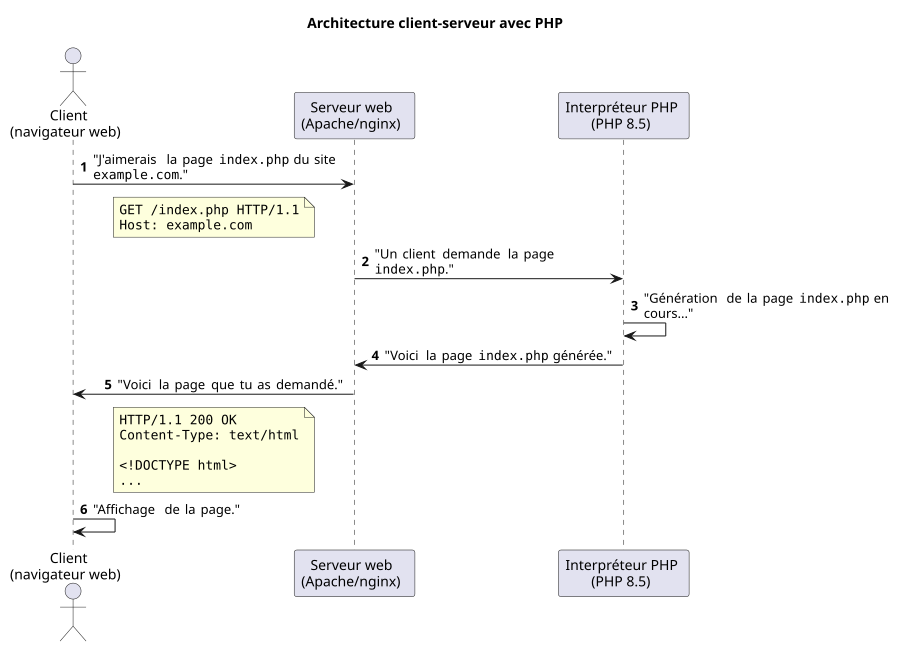

# Introduction à PHP

<!--
_class: lead
_paginate: false
-->

[ `github.com/heig-vd-progserv-course/heig-vd-progserv1-course`](https://github.com/heig-vd-progserv-course/heig-vd-progserv1-course)

[Visualiser le contenu complet sur GitHub][contenu-complet].

<small>L. Delafontaine, avec l'aide de
[GitHub Copilot](https://github.com/features/copilot).</small>

<small>Ce travail est sous licence [CC BY-SA 4.0][license].</small>

![bg brightness:2 opacity:0.05][illustration-principale]

## Exploration du mini-projet

Avant de commencer, explorez le mini-project à l'aide du document [Activités en
classe][impressions] et du site web déployé pour le mini-projet :
<https://progserv1.heig-vd-progserv-course.ch>.

![bg right:40%][illustration-mini-projet]

## Retrouvez le contenu complet de cette présentation sur GitHub

<!-- _class: lead -->

_Cette présentation est un résumé du contenu complet disponible sur GitHub._

_Pour plus de détails, retrouvez le contenu complet [ici][contenu-complet] ou en
cliquant sur l'en-tête de ce document._

## Objectifs (1)

- Expliquer le concept d'architecture client-serveur.
- Lister les outils nécessaires pour écrire et exécuter du code PHP.
- Expliquer comment PHP fonctionne dans un environnement web.
- Expliquer la syntaxe de base de PHP.
- Expliquer les variables en PHP.

![bg right:40%][illustration-objectifs]

## Objectifs (2)

- Expliquer les constantes en PHP.
- Expliquer la nature dynamique des variables et constantes en PHP.
- Expliquer les opérateurs en PHP.
- Expliquer les structures conditionnelles en PHP.
- Rédiger du code PHP simple.

![bg right:40%][illustration-objectifs]

## Qu'est-ce que PHP (1)

- Jusqu'ici, vous avez développé des applications Java qui s'exécutent sur une
  seule machine.
- Avec PHP, plusieurs personnes vont pouvoir accéder à une application depuis
  leur navigateur web.
- Le mini-projet que vous avez exploré est une application web (simple)
  développée en PHP.

![bg right:40%][illustration-quest-ce-php]

## Qu'est-ce que PHP (2)

- PHP est un language de programmation datant de 1994.
- Très utilisé pour le développement web.
- Basé sur une architecture client-serveur.
- Actuellement à la version 8.5.
- Un des languages les plus utilisés pour le développement web.

![bg right:40%][illustration-principale]

## Applications web et architecture client-serveur

- La plupart des applications web modernes reposent sur une architecture dite
  _"client-serveur"_ :
  1. Un client (navigateur web) envoie une requête à un serveur.
  2. Le serveur répond aux requêtes des différents clients.
  3. Le client affiche le résultat de la requête.
- PHP repose sur cette même architecture et est exécuté côté serveur pour
  générer du contenu dynamique qui est ensuite envoyé au client.

## Comment fonctionne PHP (1)

PHP fonctionne grâce aux outils suivants :

- Un serveur web.
- PHP installé sur le serveur web.
- Un navigateur web.
- Un éditeur de code (pour le développement).


---



## Comment écrire du code PHP (1)

- Code PHP dans un fichier `.php`.
- Le code PHP est écrit entre des balises `<?php` et `?>`.
- Le code PHP peut être mélangé avec du HTML (tout ce que vous avez appris en
  HTML s'applique).
- Uniquement `<?php` s'il n'y a que du code PHP.

![bg right:40%][illustration-comment-ecrire-du-code-php]

## Comment écrire du code PHP (2)

```php
<?php
// Code PHP, dans un fichier `.php`
// Ici, il n'y a pas de balise de fermeture PHP
echo "Hello, World!";
```

```java
// Équivalent en Java
public class Main {
    public static void main(String[] args) {
        System.out.println("Hello, World!");
    }
}
```

## Comment écrire du code PHP (3)

```php
<!-- Code PHP, dans un fichier `.php` avec de l'HTML -->
<!-- Il y a la balise de fermeture PHP -->
<!DOCTYPE html>
<html>
<head>
    <title>PHP Test</title>
</head>
<body>
    <h1><?php echo "Hello, World!"; ?></h1>
</body>
</html>
```

---

```php
// Résultat de l'exécution
<!DOCTYPE html>
<html>

<head>
    <title>PHP Test</title>
</head>

<body>
    <h1>Hello, World!</h1>
</body>

</html>
```

---

Votre navigateur va recevoir ce code HTML et l'afficher comme suit :

```text
Hello, World!
```

## Comment exécuter du code PHP (1)

- Il faut avoir un serveur web avec PHP installé sur votre machine.
- Heureusement, il existe des solutions toutes faites pour cela :
  - [WampServer](https://www.wampserver.com/), [MAMP](https://www.mamp.info/) ou
    [XAMPP](https://www.apachefriends.org/index.html) (relativement old-school).
  - [Docker](https://docs.docker.com/compose/) (moderne et recommandé).

![bg right:40%][illustration-comment-executer-du-code-php]

## Comment exécuter du code PHP (2)

- Avec Docker et Visual Studio Code, vous pouvez utiliser un conteneur de
  développement préconfiguré.
- Un conteneur de développement est un environnement de développement isolé qui
  contient tous les outils nécessaires pour développer et exécuter du code PHP.
- Les extensions nécessaires sont automatiquement installées et configurées dans
  le conteneur de développement.
- Ainsi, l'environnement est commun à toutes les personnes qui travaillent sur
  le projet, limitant les soucis qui pourraient survenir.

## Où trouver des ressources d'aide et de documentation sur PHP

Si vous avez besoin d'aide ou de documentation sur PHP, voici quelques
ressources utiles :

- [Documentation officielle de PHP](https://www.php.net/docs.php).
- [W3Schools PHP Tutorial](https://www.w3schools.com/php/).
- [PHP: The Right Way](https://phptherightway.com/).
- [Stack Overflow](https://stackoverflow.com/questions/tagged/php).

## Syntaxe de base de PHP

- Similaire à Java et d'autres languages de programmation.
- Comme n'importe quelle langue ou language de programmation, PHP a ses propres
  règles de syntaxe.
- Il s'agit de les apprendre et de les comprendre pour lire et écrire du code
  PHP de manière efficace.

![bg right:40%][illustration-comment-ecrire-du-code-php]

### Les commentaires

- Comme dans Java, `//` pour un commentaire sur une seule ligne.
- Comme dans Java, `/* ... */` pour un commentaire sur plusieurs lignes.

```php
<?php
// Ceci est un commentaire sur une seule ligne

/*
Ceci est un commentaire
sur plusieurs lignes
*/
```

### Les variables (1)

- Les variables sont des conteneurs pour stocker des données.
- Les variables sont déclarées avec le signe `$`.
- Les variables peuvent contenir des chaînes de caractères, des nombres, des
  booléens, des tableaux, etc.

![bg right:40%][illustration-les-variables]

### Les variables (2)

<small>

```php
<?php
// Déclaration d'une variable - une variable commence par le signe `$`
$variable = "Hello, World!";

// Affichage de la variable
echo $variable;

// Affiche une nouvelle ligne dans le navigateur
echo "<br>";

// Modification de la variable
$variable = "Goodbye, World!";

// Affichage de la variable modifiée
echo $variable;
```

</small>

---

La fonction `echo` est utilisée pour générer du contenu qui sera retourné au
navigateur web. Dans ce cas, elle affiche la valeur de la variable `$variable`.

```php
// Résultat de l'exécution
Hello, World!<br>Goodbye, World!
```

Votre navigateur va recevoir ce code HTML et l'afficher comme suit :

```text
Hello, World!
Goodbye, World!
```

### Les variables (3)

```java
// Équivalent en Java
public static void main(String[] args) {
    // Déclaration d'une variable
    String variable = "Hello, World!";

    // Affichage de la variable
    System.out.print(variable);

    // Modification de la variable
    variable = "Goodbye, World!";

    // Affichage de la variable modifiée
    System.out.print(variable);
}
```

#### Type de données et typage dynamique (1)

- PHP est un language de programmation à typage dynamique.
- Il n'y a pas besoin de déclarer le type de données d'une variable.
- Le type de données d'une variable est déterminé par la valeur qui lui est
  assignée.

![bg right:40%][illustration-type-de-donnees-et-typage-dynamique]

#### Type de données et typage dynamique (2)

```php
<?php
// Variable de type chaîne de caractères
$variable = "Hello, World!";

// Variable de type nombre
$variable = 42;

// Variable de type nombre flottant
$variable = 3.14;

// Variable de type booléen
$variable = true;
```

#### Type de données et typage dynamique (3)

```java
// Équivalent en Java
public static void main(String[] args) {
    // Variable de type chaîne de caractères
    String variable1 = "Hello, World!";

    // Variable de type nombre
    int variable2 = 42;

    // Variable de type nombre flottant
    double variable3 = 3.14;

    // Variable de type booléen
    boolean variable4 = true;
}
```

#### Les chaînes de caractères (1)

- Les chaînes de caractères sont déclarées entre des guillemets simples (`'`) ou
  doubles (`"`).
- Permettent de créer des mots ou des phrases.
- Pour concaténer des chaînes de caractères, on utilise le point (`.`).

![bg right:40%][illustration-les-chaines-de-caracteres]

#### Les chaînes de caractères (2)

```php
<?php
$string = "Hello, World!";

echo $string;
```

```php
// Résultat de l'exécution
Hello, World!
```

#### Les chaînes de caractères (3)

```java
// Équivalent en Java
public static void main(String[] args) {
    String string = "Hello, World!";

    System.out.print(string);
}
```

#### Les chaînes de caractères (4)

```php
<?php
$first = "Hello, ";
$second = "World!";

echo $first . $second;
```

```php
// Résultat de l'exécution
Hello, World!
```

#### Les chaînes de caractères (5)

```java
// Équivalent en Java
public static void main(String[] args) {
    String first = "Hello, ";
    String second = "World!";

    System.out.print(first + second);
}
```

#### Les chaînes de caractères (6)

```php
<?php
$greetings = "Hello";
$name = "World";

echo "$greetings, $name!";
```

```php
// Résultat de l'exécution
Hello, World!
```

#### Les chaînes de caractères (7)

```php
<?php
$string = 'Hello, World!';

echo $string;
```

```php
// Résultat de l'exécution
Hello, World!
```

#### Les chaînes de caractères (8)

```php
<?php
$greetings = 'Hello';
$name = 'World';

// La ligne suivante affichera littéralement "$greetings, $name!"
echo '$greetings, $name!';

// Retour à la ligne HTML
echo "<br>";

// La ligne suivante affichera "Hello, World!"
echo "$greetings, $name!";
```

---

```php
// Résultat de l'exécution
$greetings, $name!<br>Hello, World!
```

Votre navigateur va recevoir ce code HTML et l'afficher comme suit :

```text
$greetings, $name!
Hello, World!
```

#### Les chaînes de caractères (9)

Il est possible d'échapper des caractères spéciaux dans les chaînes de
caractères en utilisant le caractère d'échappement `\`.

```php
<?php
$string = "Hello, \"World\"!";

echo "\$string contains $string";
```

```php
// Résultat de l'exécution
$string contains "Hello, World!"
```

#### Les nombres (1)

- Les nombres sont déclarés sans guillemets.
- Il existe deux types de nombres en PHP : les entiers et les flottants.
- Les entiers sont des nombres entiers positifs ou négatifs.
- Les flottants sont des nombres à virgule, eux aussi, positifs ou négatifs.

![bg right:40%][illustration-les-nombres]

#### Les nombres (2)

```php
<?php
// Entier
$integer = 42;

// Flottant
$float = 3.14;

// Affichage des nombres
echo "\$integer contains $integer<br>";
echo "\$float contains $float";
```

---

```php
// Résultat de l'exécution
myInteger contains 42<br>myFloat contains 3.14
```

Votre navigateur va recevoir ce code HTML et l'afficher comme suit :

```text
myInteger contains 42
myFloat contains 3.14
```

#### Les nombres (3)

```java
// Équivalent en Java
public static void main(String[] args) {
    // Entier
    int myInteger = 42;

    // Flottant
    double myFloat = 3.14;

    // Affichage des nombres
    System.out.println("myInteger contains " + myInteger);
    System.out.print("myFloat contains " + myFloat);
}
```

#### Les booléens (1)

- Les booléens sont des valeurs qui peuvent être soit vraies (`true`) soit
  fausses (`false`).
- Les booléens sont déclarés en PHP avec les mots-clés `true` et `false`.
- Les booléens sont souvent utilisés pour des conditions dans les structures de
  contrôle conditionnelles.

![bg right:40%][illustration-les-booleens]

#### Les booléens (2)

```php
<?php
// Vrai
$doILikeDogs = true;

// Faux
$doILikeHomework = false;

// Affichage des booléens - `false` est affiché comme une chaîne vide
echo "\$doILikeDogs contains $doILikeDogs<br>";
echo "\$doILikeHomework contains $doILikeHomework";
```

---

```php
// Résultat de l'exécution
doILikeDogs contains 1<br>doILikeHomework contains
```

Votre navigateur va recevoir ce code HTML et l'afficher comme suit :

```text
doILikeDogs contains 1
doILikeHomework contains
```

Remarquez que la valeur `true` est affichée comme `1` et la valeur `false` est
affichée comme une chaîne vide.

#### Les booléens (3)

```java
// Équivalent en Java
public static void main(String[] args) {
    // Vrai
    boolean doILikeDogs = true;

    // Faux
    boolean doILikeHomework = false;

    // Affichage des booléens
    System.out.println("doILikeDogs contains " + doILikeDogs);
    System.out.print("doILikeHomework contains " + doILikeHomework);
}
```

#### Les tableaux (1)

- Les tableaux sont des collections de valeurs.
- Les tableaux sont déclarés entre des crochets (`[]`) ou avec la fonction
  `array()`.
- Les valeurs d'un tableau sont indexées à partir de 0.
- Nous les étudierons plus en détails dans une prochaine séance.

![bg right:40%][illustration-les-tableaux]

#### Les tableaux (2)

```php
<?php
// Déclaration d'un tableau
$array = ["apple", "banana", "cherry"];

// Affichage de la première valeur du tableau
// Les tableaux sont indexés à partir de 0
echo "$array[0]<br>";

// Déclaration d'un tableau (alternative)
$array = array("apple", "banana", "cherry");

// Affichage de la troisième valeur du tableau
echo "$array[2]";
```

---

```php
// Résultat de l'exécution
apple<br>cherry
```

Votre navigateur va recevoir ce code HTML et l'afficher comme suit :

```text
apple
cherry
```

#### Les tableaux (3)

```java
// Équivalent en Java
public static void main(String[] args) {
    // Déclaration d'un tableau
    String[] array = {"apple", "banana", "cherry"};

    // Affichage de la première valeur du tableau
    System.out.println(array[0]);

    // Affichage de la troisième valeur du tableau
    System.out.println(array[2]);
}
```

### Les constantes (1)

- Les constantes sont des valeurs qui ne peuvent pas être modifiées.
- Les constantes sont déclarées avec le mot-clé `const` ou avec la fonction
  `define()`.
- La convention veut que les constantes soient écrites en majuscules.

![bg right:40%][illustration-les-constantes]

### Les constantes (2)

<small>

```php
<?php
// Définition d'une constante
const CONSTANT = "Hello, World!";

// Affichage de la constante
echo CONSTANT;

// Affichage d'une nouvelle ligne dans le navigateur
echo "<br>";

// Tentative de modification de la constante (erreur)
CONSTANT = "Goodbye, World!";

// Définition d'une constante (alternative)
define("CONSTANT", "Hello, World!");
```

</small>

---

```php
// Résultat de l'exécution
Hello, World!<br>
Parse error: syntax error, unexpected token "=" in file.php on line 9
```

Votre navigateur va recevoir ce code HTML et l'afficher comme suit :

```text
Hello, World!
Parse error: syntax error, unexpected token "=" in file.php on line 9
```

La tentative de modification de la constante a généré une erreur, car les
constantes ne peuvent pas être modifiées après leur définition.

### Les constantes (3)

```java
// Équivalent en Java
public static void main(String[] args) {
    // Définition d'une constante
    final String CONSTANT = "Hello, World!";

    // Affichage de la constante
    System.out.println(CONSTANT);

    // Tentative de modification de la constante (erreur)
    CONSTANT = "Goodbye, World!";
}
```

### Les opérateurs (1)

- Permet d'effectuer des opérations sur des variables et des valeurs.
- Opérateurs d'affectation : `=` (affectation), `??` (affectation par
  coalescence nulle).
- Opérateurs arithmétiques : `+`, `-`, `*`, `/`, `%` (modulo).
- Opérateurs de comparaison : `===` (égal), `!==` (différent), `>` (supérieur),
  `<` (inférieur).
- Opérateurs logiques : `&&` (et), `||` (ou), `!` (non/inversion).

### Les opérateurs (2)

```php
<?php
$sum = 1 + 1; // `$sum` contiendra 2
$difference = $sum - 1; // `$difference` contiendra 1
$product = 2 * 2; // `$product` contiendra 4
$quotient = $product / 2; // `$quotient` contiendra 2

echo "Sum: $sum<br>";
echo "Difference: $difference<br>";
echo "Product: $product<br>";
echo "Quotient: $quotient";
```

---

```php
// Résultat de l'exécution
Sum: 2<br>Difference: 1<br>Product: 4<br>Quotient: 2
```

Votre navigateur va recevoir ce code HTML et l'afficher comme suit :

```text
Sum: 2
Difference: 1
Product: 4
Quotient: 2
```

### Les opérateurs (3)

```java
// Équivalent en Java
public static void main(String[] args) {
    int sum = 1 + 1; // `sum` contiendra 2
    int difference = 2 - 1; // `difference` contiendra 1
    int product = 2 * 2; // `product` contiendra 4
    int quotient = 4 / 2; // `quotient` contiendra 2

    System.out.println("Sum: " + sum);
    System.out.println("Difference: " + difference);
    System.out.println("Product: " + product);
    System.out.print("Quotient: " + quotient);
}
```

### Les opérateurs (4)

```php
<?php
// `$modulo` contiendra 1
// Il reste 1 après la division de 5 par 2, 5 n'est donc pas pair.
$modulo = 5 % 2;

echo "Modulo: $modulo<br>";

// `$modulo` contiendra 0
// Il ne reste rien après la division de 6 par 2, 6 est donc pair.
$modulo = 6 % 2;

echo "Modulo: $modulo";
```

---

```php
// Résultat de l'exécution
Modulo: 1<br>Modulo: 0
```

Votre navigateur va recevoir ce code HTML et l'afficher comme suit :

```text
Modulo: 1
Modulo: 0
```

### Les opérateurs (5)

```java
// Équivalent en Java
public static void main(String[] args) {
    // `modulo` contiendra 1
    // Il reste 1 après la division de 5 par 2, 5 n'est donc pas pair.
    int modulo = 5 % 2;

    System.out.println("Modulo: " + modulo);

    // `modulo` contiendra 0
    // Il ne reste rien après la division de 6 par 2, 6 est donc pair.
    modulo = 6 % 2;

    System.out.print("Modulo: " + modulo);
}
```

### Les opérateurs (6)

```php
<?php
// `$variable` n'est pas (encore) définie, donc elle sera affectée à "Default value"
$variable = $variable ?? "Default value";

echo "Variable: $variable<br>";

$variable = "New value";

// `$variable` est déjà définie, donc elle ne sera pas affectée à "Default value"
$variable = $variable ?? "Default value";

echo "Variable: $variable";
```

---

```php
// Résultat de l'exécution
Variable: Default value<br>Variable: New value
```

Votre navigateur va recevoir ce code HTML et l'afficher comme suit :

```text
Variable: Default value
Variable: New value
```

### Les opérateurs (7)

Il n'existe pas d'équivalent direct à l'opérateur `??` en Java, mais nous
pouvons obtenir un comportement similaire en utilisant une structure
conditionnelle `if` ou un `if` ternaire (voir ci-dessous).

### Les structures conditionnelles

- Appelées parfois _"structures de contrôle conditionnelles"_.
- Permettent de contrôler le flux d'exécution d'un programme.
- Utilisent les opérateurs de comparaison et logiques.
- Elles se composent de `if`, `else`, `elseif` et `switch`.

![bg right:40%][illustration-les-structures-de-controle-conditionnelles]

#### Les structures `if`, `else` et `elseif` (1)

```php
<?php
$a = 1;
$b = 2;

if ($a < $b) {
    echo "a is less than b";
} elseif ($a === $b) {
    echo "a is equal to b";
} else {
    echo "a is greater than b";
}
```

---

```php
// Résultat de l'exécution
a is less than b
```

#### Les structures `if`, `else` et `elseif` (2)

```java
// Équivalent en Java
public static void main(String[] args) {
    int a = 1;
    int b = 2;

    if (a < b) {
        System.out.print("a is less than b");
    } else if (a == b) {
        System.out.print("a is equal to b");
    } else {
        System.out.print("a is greater than b");
    }
}
```

#### Les structures `if`, `else` et `elseif` (3)

```php
<?php
// Déclaration de deux variables
$age = 18;
$country = "Switzerland";

// Vérification si `$age` est supérieur ou égal à 18
// et si `$country` est égal à "Switzerland"
if ($age >= 18 && $country === "Switzerland") {
    echo "You are allowed to vote in Switzerland.";
}
```

---

```php
// Résultat de l'exécution
You are allowed to vote in Switzerland.
```

#### Les structures `if`, `else` et `elseif` (4)

```java
// Équivalent en Java
public static void main(String[] args) {
    // Déclaration de deux variables
    int age = 18;
    String country = "Switzerland";

    // Vérification si `$age` est supérieur ou égal à 18
    // et si `$country` est égal à "Switzerland"
    if (age >= 18 && country.equals("Switzerland")) {
        System.out.print("You are allowed to vote in Switzerland.");
    }
}
```

#### Les opérateurs `==` et `===` (1)

- Deux formes d'opérateurs de comparaison en PHP :
  - `==` : vérifie l'égalité des valeurs (type non pris en compte).
  - `===` : vérifie l'égalité des valeurs et des types.
- Préférer l'utilisation de `===` pour éviter des erreurs inattendues.

![bg right:40%][illustration-les-structures-de-controle-conditionnelles]

#### Les opérateurs `==` et `===` (2)

```php
<?php
// Déclaration de deux variables numériques
$a = 0;
$b = 0;
$c = "0";

// Vérification si `$a` est égal à `$b`)
if ($a == $b) {
    echo "a is equal to b (same value)";
}

// Vérification si `$a` est égal à `$c`)
if ($a == $c) {
    echo "a is equal to c (same value)";
}
```

---

```php
// Vérification si `$a` est égal (identique) à `$b`
if ($a === $b) {
    echo "a is identical to b (same value and type)";
}

// Vérification si `$a` est égal (identique) à `$c`
if ($a === $c) {
    echo "a is identical to c (same value and type)";
} else {
    echo "a is not identical to c (different type)";
}
```

---

```php
// Résultat de l'exécution
a is equal to b (same value)<br>a is equal to c (same value)<br>a is identical to b (same value and type)<br>a is not identical to c (different type)
```

Votre navigateur va recevoir ce code HTML et l'afficher comme suit :

```text
a is equal to b (same value)
a is equal to c (same value)
a is identical to b (same value and type)
a is not identical to c (different type)
```

Utilisez toujours `===`/`!==` sauf si vous avez une bonne raison de faire
autrement pour garantir un bon fonctionnement de votre code et éviter des
erreurs difficiles à détecter.

#### Les opérateurs `==` et `===` (3)

Il n'existe pas d'équivalent direct en Java pour les opérateurs `==` et `===` de
PHP mais vous retrouverez un comportement similaire en JavaScript dans un futur
cours.

#### Les `if` ternaires (1)

L'opérateur ternaire ("shorthand if" en anglais) est une forme abrégée de la
structure conditionnelle `if` :

```php
<?php
// Déclaration d'une variable
$age = 18;

// Vérification si `$age` est supérieur ou égal à 18
// Si c'est le cas, la variable `$message` contiendra "You are an adult."
// Sinon, la variable `$message` contiendra "You are a minor."
$message = ($age >= 18) ? "You are an adult." : "You are a minor.";

echo $message;
```

---

```php
// Résultat de l'exécution
You are an adult.
```

#### Les `if` ternaires (2)

Le code ci-dessus est équivalent à :

```php
<?php
// Déclaration d'une variable
$age = 18;

// Vérification si `$age` est supérieur ou égal à 18
if ($age >= 18) {
    $message = "You are an adult.";
} else {
    $message = "You are a minor.";
}

echo $message;
```

A utiliser avec parcimonie, car cela peut rendre le code moins lisible.

#### Les structures conditionnelles `switch` (1)

```php
<?php
// Déclaration d'une variable
$color = "red";

// Vérification de la variable `$color`
switch ($color) {
    // Si la variable `$color` est égale à "red"
    case "red":
        echo "The color is red.";
        break;
```

---

```php
    // Si la variable `$color` est égale à "blue"
    case "blue":
        echo "The color is blue.";
        break;
    // Par défaut
    default:
        echo "The color is neither red nor blue.";
}
```

```php
// Résultat de l'exécution
The color is red.
```

#### Les structures conditionnelles `switch` (2)

```java
// Équivalent en Java
public static void main(String[] args) {
    // Déclaration d'une variable
    String color = "red";

    // Vérification de la variable `$color`
    switch (color) {
        // Si la variable `$color` est égale à "red"
        case "red":
            System.out.println("The color is red.");
            break;
```

---

```java
        // Si la variable `$color` est égale à "blue"
        case "blue":
            System.out.println("The color is blue.");
            break;
        // Par défaut
        default:
            System.out.println("The color is neither red nor blue.");
    }
}
```

## Conclusion

- PHP est un language de programmation très utilisé pour le développement web.
- PHP repose sur une architecture client-serveur.
- PHP est un language de programmation simple à prendre en main (il suffit de
  modifier le code, rafraîchir la page et le tour est joué).

![bg right:40%][illustration-principale]

## Questions

<!-- _class: lead -->

Est-ce que vous avez des questions ?

## À vous de jouer !

- Réaliser le [mini-projet][mini-projet].
- (Re)lire le [support de cours][contenu-complet].
- Faire les [exercices][exercices].
- Explorer les [exemples de code][exemples-de-code].
- Répondre aux questions de la seconde partie du document [Activités en
  classe][impressions].
- Poser des questions si nécessaire.

![bg right:40%][illustration-a-vous-de-jouer]

## Sources (1)

- [Illustration principale][illustration-principale] par
  [Richard Jacobs](https://unsplash.com/@rj2747) sur
  [Unsplash](https://unsplash.com/photos/grayscale-photo-of-elephants-drinking-water-8oenpCXktqQ)
- [Illustration][illustration-mini-projet] par
  [Jakub Żerdzicki](https://unsplash.com/@jakubzerdzicki) sur
  [Unsplash](https://unsplash.com/photos/hand-writing-a-checklist-in-a-notebook-TB7aNN4blTQ)
- [Illustration][illustration-objectifs] par
  [Aline de Nadai](https://unsplash.com/@alinedenadai) sur
  [Unsplash](https://unsplash.com/photos/j6brni7fpvs)
- [Illustration][illustration-quest-ce-php] par
  [Michiel Leunens](https://unsplash.com/@leunesmedia) sur
  [Unsplash](https://unsplash.com/photos/white-ceramic-cup-on-silver-coffee-maker-fBB7FeS4Xas)
- [Illustration][illustration-comment-executer-du-code-php] par
  [Taylor Vick](https://unsplash.com/@tvick) sur
  [Unsplash](https://unsplash.com/photos/cable-network-M5tzZtFCOfs)
- [Illustration][illustration-comment-ecrire-du-code-php] par
  [Aaron Burden](https://unsplash.com/@aaronburden) sur
  [Unsplash](https://unsplash.com/photos/fountain-pen-on-black-lined-paper-y02jEX_B0O0)
- [Illustration][illustration-les-variables] par
  [Fejuz](https://unsplash.com/@fejuz) sur
  [Unsplash](https://unsplash.com/photos/a-large-amount-of-containers-are-stacked-on-top-of-each-other-q6j5mSRpi50)
- [Illustration][illustration-type-de-donnees-et-typage-dynamique] par
  [Jan Huber](https://unsplash.com/@jan_huber) sur
  [Unsplash](https://unsplash.com/photos/yellow-and-red-light-streaks-NjV34SrbM_g)

## Sources (2)

- [Illustration][illustration-les-chaines-de-caracteres] par
  [Kier in Sight Archives](https://unsplash.com/@kierinsightarchives) sur
  [Unsplash](https://unsplash.com/photos/white-and-black-abstract-illustration-qXA4b_dZSbQ)
- [Illustration][illustration-les-nombres] par
  [Nick Hillier](https://unsplash.com/@nhillier) sur
  [Unsplash](https://unsplash.com/photos/assorted-numbers-photography-yD5rv8_WzxA)
- [Illustration][illustration-les-booleens] par
  [Brooke Lark](https://unsplash.com/@brookelark) sur
  [Unsplash](https://unsplash.com/photos/person-holding-calendar-at-january-BRBjShcA8D4)
- [Illustration][illustration-les-tableaux] par
  [Faris Mohammed](https://unsplash.com/@pkmfaris) sur
  [Unsplash](https://unsplash.com/photos/assorted-color-marker-pens-PQinRWK1TgU)
- [Illustration][illustration-les-constantes] par
  [Kenny Eliason](https://unsplash.com/@neonbrand) sur
  [Unsplash](https://unsplash.com/photos/red-bricks-wall-XEsx2NVpqWY)
- [Illustration][illustration-les-structures-de-controle-conditionnelles] par
  [Arham Jain](https://unsplash.com/@arham_jain48) sur
  [Unsplash](https://unsplash.com/photos/a-painting-of-blue-flowers-on-a-white-background-OkiDTYxLo34)
- [Illustration][illustration-a-vous-de-jouer] par
  [Nikita Kachanovsky](https://unsplash.com/@nkachanovskyyy) sur
  [Unsplash](https://unsplash.com/photos/white-sony-ps4-dualshock-controller-over-persons-palm-FJFPuE1MAOM)

<!-- URLs -->

[license]:
	https://github.com/heig-vd-progserv-course/heig-vd-progserv1-course/blob/main/LICENSE.md
[contenu-complet]:
	https://github.com/heig-vd-progserv-course/heig-vd-progserv1-course/blob/main/01-contenus-du-cours/01.02-introduction-a-php/README.md
[impressions]:
	https://heig-vd-progserv-course.github.io/heig-vd-progserv1-course/01-contenus-du-cours/01.02-introduction-a-php/01.02-introduction-a-php-impressions.pdf
[mini-projet]:
	https://github.com/heig-vd-progserv-course/heig-vd-progserv1-course/tree/main/01-contenus-du-cours/01.02-introduction-a-php/01-mini-projet/README.md
[exemples-de-code]:
	https://github.com/heig-vd-progserv-course/heig-vd-progserv1-course/tree/main/01-contenus-du-cours/01.02-introduction-a-php/02-exemples-de-code/README.md
[exercices]:
	https://github.com/heig-vd-progserv-course/heig-vd-progserv1-course/blob/main/01-contenus-du-cours/01.02-introduction-a-php/03-exercices/README.md

<!-- Illustrations -->

[illustration-principale]:
	https://images.unsplash.com/photo-1517486430290-35657bdcef51?fit=crop&h=720
[illustration-mini-projet]:
	https://images.unsplash.com/photo-1768055104910-8c8d213835fb?fit=crop&h=720
[illustration-objectifs]:
	https://images.unsplash.com/photo-1516389573391-5620a0263801?fit=crop&h=720
[illustration-quest-ce-php]:
	https://images.unsplash.com/photo-1585332889055-059af80a9b5f?fit=crop&h=720
[illustration-comment-executer-du-code-php]:
	https://images.unsplash.com/photo-1558494949-ef010cbdcc31?fit=crop&h=720
[illustration-comment-ecrire-du-code-php]:
	https://images.unsplash.com/photo-1455390582262-044cdead277a?fit=crop&h=720
[illustration-les-variables]:
	https://images.unsplash.com/photo-1634646809203-f3b4adff9127?fit=crop&h=720
[illustration-type-de-donnees-et-typage-dynamique]:
	https://images.unsplash.com/photo-1604012164853-9bb541fe0296?fit=crop&h=720
[illustration-les-chaines-de-caracteres]:
	https://images.unsplash.com/photo-1622321786092-a3df1d448be1?fit=crop&h=720
[illustration-les-nombres]:
	https://images.unsplash.com/photo-1502570149819-b2260483d302?fit=crop&h=720
[illustration-les-booleens]:
	https://images.unsplash.com/photo-1484981184820-2e84ea0af397?fit=crop&h=720
[illustration-les-tableaux]:
	https://images.unsplash.com/photo-1561117089-3fb7c944887f?fit=crop&h=720
[illustration-les-constantes]:
	https://images.unsplash.com/photo-1495578942200-c5f5d2137def?fit=crop&h=720
[illustration-les-structures-de-controle-conditionnelles]:
	https://images.unsplash.com/photo-1590593162201-f67611a18b87?fit=crop&h=720
[illustration-a-vous-de-jouer]:
	https://images.unsplash.com/photo-1509198397868-475647b2a1e5?fit=crop&h=720
