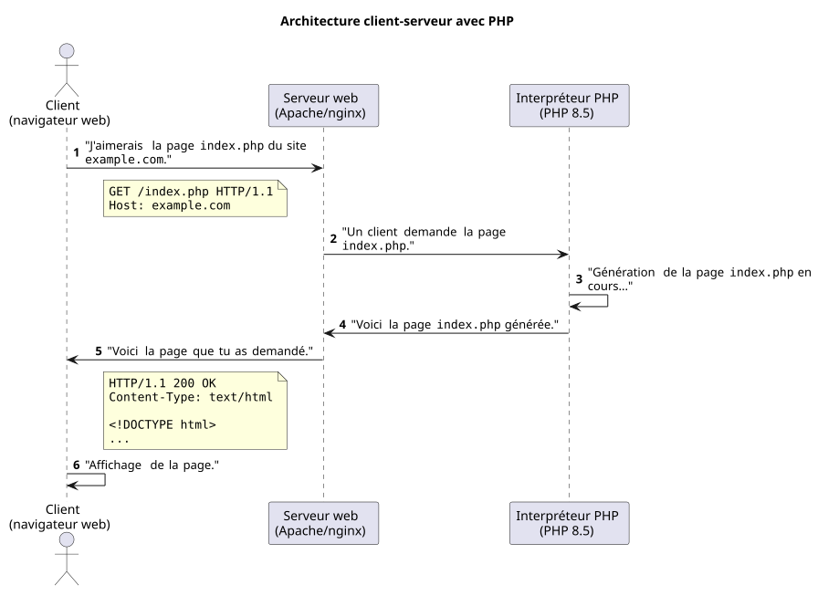

# Introduction à PHP

L. Delafontaine, avec l'aide de GitHub Copilot.

Ce travail est sous licence [CC BY-SA 4.0][license].

> [!TIP]
>
> Voici quelques informations relatives à ce contenu.
>
> **Ressources annexes**
>
> - Autres formats :
>   [Présentation (web)](https://heig-vd-progserv-course.github.io/heig-vd-progserv1-course/01-contenus-du-cours/01.02-introduction-a-php/presentation.html)
>   ·
>   [Présentation (PDF)](https://heig-vd-progserv-course.github.io/heig-vd-progserv1-course/01-contenus-du-cours/01.02-introduction-a-php/01.02-introduction-a-php-presentation.pdf).
> - Activités en classe :
>   [Impressions](https://heig-vd-progserv-course.github.io/heig-vd-progserv1-course/01-contenus-du-cours/01.02-introduction-a-php/01.02-introduction-a-php-impressions.pdf).
> - Mini-projet : [Consignes](./01-mini-projet/README.md).
> - Exemples de code : [Code source](./02-exemples-de-code/README.md).
> - Exercices : [Énoncés et solutions](./03-exercices/README.md).
>
> **Objectifs**
>
> À l'issue de ce contenu, les personnes devraient être capables de :
>
> - Expliquer le concept d'architecture client-serveur.
> - Lister les outils nécessaires pour écrire et exécuter du code PHP.
> - Expliquer comment PHP fonctionne dans un environnement web.
> - Expliquer la syntaxe de base de PHP.
> - Expliquer les variables en PHP.
> - Expliquer les constantes en PHP.
> - Expliquer la nature dynamique des variables et constantes en PHP.
> - Expliquer les opérateurs en PHP.
> - Expliquer Les structures conditionnelles en PHP.
> - Rédiger du code PHP simple.
>
> **Méthodes d'enseignement et d'apprentissage**
>
> Les méthodes d'enseignement et d'apprentissage utilisées pour animer le
> contenu sont les suivantes :
>
> - Présentation.
> - Discussions collectives.
> - Travail en autonomie.
>
> **Méthodes d'évaluation**
>
> L'évaluation du contenu prend la forme d'un mini-projet et d'exercices à
> réaliser en autonomie en classe ou à la maison.
>
> L'évaluation se fait en utilisant les critères suivants :
>
> - Capacité à répondre avec justesse.
> - Capacité à argumenter.
>
> Les retours se font de la manière suivante :
>
> - Corrigé du mini-projet.
> - Corrigé des exercices.
>
> L'évaluation ne donne pas lieu à une note.

## Table des matières

- [Table des matières](#table-des-matières)
- [Exploration du mini-projet](#exploration-du-mini-projet)
- [Objectifs](#objectifs)
- [Qu'est-ce que PHP](#quest-ce-que-php)
- [Applications web et architecture client-serveur](#applications-web-et-architecture-client-serveur)
- [Comment fonctionne PHP](#comment-fonctionne-php)
- [Comment écrire du code PHP](#comment-écrire-du-code-php)
- [Comment exécuter du code PHP](#comment-exécuter-du-code-php)
- [Où trouver des ressources d'aide et de documentation sur PHP](#où-trouver-des-ressources-daide-et-de-documentation-sur-php)
- [Syntaxe de base de PHP](#syntaxe-de-base-de-php)
  - [Les commentaires](#les-commentaires)
  - [Les variables](#les-variables)
  - [Les constantes](#les-constantes)
  - [Les opérateurs](#les-opérateurs)
  - [Les structures conditionnelles](#les-structures-conditionnelles)
- [Conclusion](#conclusion)
- [Mini-projet](#mini-projet)
- [Exemples de code](#exemples-de-code)
- [Exercices](#exercices)
- [Questions d'évaluation](#questions-dévaluation)
- [À faire pour la semaine suivante](#à-faire-pour-la-semaine-suivante)

## Exploration du mini-projet

Avant de commencer, explorez le mini-project à l'aide du document
[Activités en classe](https://heig-vd-progserv-course.github.io/heig-vd-progserv1-course/01-contenus-du-cours/01.02-introduction-a-php/01.02-introduction-a-php-impressions.pdf)
et du site web déployé pour le mini-projet :
<https://progserv1.heig-vd-progserv-course.ch>.

## Objectifs

Ce premier contenu théorique a pour but de vous donner une introduction à PHP.
Vous apprendrez les bases de PHP, y compris la syntaxe, les variables, les
constantes, les opérateurs et les structures de contrôle afin de vous préparer à
la suite du cours.

La liste complète des objectifs est disponible dans la section _"Objectifs"_ du
bloc d'information en haut de ce contenu.

## Qu'est-ce que PHP

Jusqu'à présent, vous avez appris les bases de la programmation avec Java pour
réaliser des applications/programmes qui s'exécutent sur votre machine.

Avec PHP, vous allez apprendre à réaliser des applications web qui s'exécutent
sur un serveur et sont accessibles depuis un navigateur web.

PHP (PHP: Hypertext Preprocessor) est un langage de programmation conçu pour le
développement web qui a connu sa première version en 1994. De cette manière, PHP
permet de créer des applications qui peuvent être accessibles via un navigateur
web et par plusieurs personnes en même temps.

Actuellement à la version 8.5, le language a évolué pour devenir un des langages
les plus utilisés pour le développement web, notamment pour sa simplicité, sa
flexibilité et sa compatibilité avec de nombreux serveurs web.

## Applications web et architecture client-serveur

PHP repose sur le principe de l'architecture client-serveur, qui est le modèle
de base des applications web modernes.

Le client (votre navigateur) envoie des requêtes au serveur. Ces requêtes, selon
leur nature, peuvent être traitées par le serveur pour effectuer des actions
(lecture de fichiers, accès à une base de données, etc.) et renvoyer une réponse
au client.

La plupart des applications réseau modernes utilisent cette architecture pour
fournir des services à un grand nombre d'utilisateurs (sites web, applications
mobiles, jeux vidéos, etc.) et utilise le protocole HTTP pour la communication
entre le client et le serveur.

## Comment fonctionne PHP

PHP est un langage de programmation côté serveur, ce qui signifie que le code
PHP est exécuté sur le serveur web, et non pas dans le navigateur du client.

Il utilise une architecture client-serveur pour générer du code HTML à partir du
code PHP, qui est ensuite envoyé au navigateur du client pour être affiché.

De façon plus concise, pour écrire et exécuter du code PHP, vous avez besoin de
:

- Un serveur web (Apache, nginx, etc.) pour recevoir les requêtes du client
  (votre navigateur) et envoyer les réponses (des pages HTML générées).
- PHP installé sur le serveur web.
- Un navigateur web (Chrome, Firefox, etc.). pour effectuer les requêtes et
  afficher les pages web.
- Un éditeur de code.

Le serveur web reçoit les requêtes du client, les envoie à l'interpréteur PHP
(le moteur PHP qui est capable de lire et d'exécuter du code PHP),
l'interpréteur PHP exécute le code PHP qui va générer du code HTML,
l'interpréteur le renvoie au serveur web qui enverra ensuite le résultat au
navigateur du client. Le client réceptionnera le code HTML et pourra directement
l'afficher.

PHP est exécuté sur le serveur en partenariat avec le serveur web, pour générer
du code HTML, qui est ensuite envoyé au navigateur du client qui l'affiche
simplement.



Le client (votre navigateur) envoie une requête pour demander une page web au
serveur. Ces pages web, tels que `index.php`, sont des fichiers PHP qui
contiennent du code PHP et du code HTML.

Le serveur web reçoit la requête, exécute le code PHP dans le fichier
`index.php` pour générer du code HTML, et renvoie ce code HTML au navigateur du
client, qui l'affiche sur la page web.

## Comment écrire du code PHP

Le code PHP est écrit entre les balises `<?php` et `?>`. Tout fichier avec
l'extension `.php` est traité comme un fichier PHP et le code PHP qu'il contient
est exécuté par l'interpréteur PHP.

Voici un exemple de code PHP simple :

```php
// Ici, il n'y a pas de balise de fermeture PHP
<?php
echo "Hello, World!";
```

<details>
<summary>Afficher le résultat de l'exécution du code PHP</summary>

```php
// Résultat de l'exécution
Hello, World!
```

Votre navigateur va recevoir ce code HTML et l'afficher comme suit :

```text
Hello, World!
```

</details>

Vous remarquez qu'il n'y a pas de balise de fermeture `?>` à la fin du fichier
car le fichier ne contient que du code PHP. S'il y a du code HTML après le code
PHP, il faut alors fermer le bloc de code PHP avec `?>` pour que l'interpréteur
puisse reconnaître la fin du code PHP et n'exécuter que le code PHP.

<details>
<summary>Afficher l'équivalent en Java</summary>

```java
public class Main {
    public static void main(String[] args) {
        System.out.println("Hello, World!");
    }
}
```

</details>

Ici, la fonction `echo` est utilisée pour "afficher du texte sur la page web".

Pour être exact, la fonction `echo` va être interprétée par l'interpréteur PHP.
Celui-ci va générer un document HTML avec le contenu désiré puis le transmettre
au serveur web. Le serveur web va ensuite envoyer ce document HTML au navigateur
du client, qui l'affichera sur la page web.

Ainsi, la formulation "afficher du texte sur la page web" est une simplification
pour expliquer que le résultat de l'exécution du code PHP (le document HTML
généré) sera affiché sur la page web par le navigateur du client.

De façon plus concise, le code PHP est exécuté sur le serveur web, qui génère du
HTML à partir du code PHP. Ce HTML est ensuite envoyé au navigateur du client,
qui l'affiche sur la page web.

PHP peut se mélanger avec du HTML pour générer des pages web dynamiques. Voici
un exemple :

```php
<!DOCTYPE html>
<html>

<head>
    <title>PHP Test</title>
</head>

<body>
    <h1><?php echo "Hello, World!"; ?></h1>
</body>

</html>
```

<details>
<summary>Afficher le résultat de l'exécution du code PHP</summary>

```php
// Résultat de l'exécution
<!DOCTYPE html>
<html>

<head>
    <title>PHP Test</title>
</head>

<body>
    <h1>Hello, World!</h1>
</body>

</html>
```

Votre navigateur va recevoir ce code HTML et l'afficher comme suit :

```text
Hello, World!
```

</details>

Dans cet exemple, le texte _"Hello, World!"_ est affiché dans un titre de niveau
1 (`<h1>`) sur la page web.

Lorsqu'il y a un mélange de PHP et de HTML, il faut spécifier le code PHP entre
les balises `<?php` et `?>` pour que l'interpréteur PHP puisse reconnaître la
fin du bloc de code PHP et n'exécuter que le code PHP.

## Comment exécuter du code PHP

Lorsque nous écrivons du code PHP, nous devons l'exécuter sur un serveur web
avec PHP installé. Pour ce faire, nous avons besoin d'un environnement de
développement qui comprend un serveur web (Apache, nginx, etc.) et PHP.

Heureusement pour nous, il existe des solutions clés en main qui nous permettent
de démarrer rapidement avec PHP, comme par exemple
[WampServer pour Windows](https://www.wampserver.com/),
[MAMP pour macOS](https://www.mamp.info/),
[XAMPP pour Windows, macOS et Linux](https://www.apachefriends.org/download.html)
ou encore [Docker](https://docker.com/) et
[Docker Compose](https://docs.docker.com/compose/).

Ces solutions regroupent les logiciels nécessaires pour exécuter du code PHP,
notamment un serveur web, PHP et parfois même une base de données et
fonctionnent selon le même principe d'architecture client-serveur vu
précédemment.

Dans le cadre de ce cours, nous allons utiliser Docker pour exécuter du code PHP
à l'aide d'un conteneur de développement directement dans Visual Studio Code. Il
s'agit d'une des solutions les plus modernes et efficaces pour développer des
applications web avec PHP.

Un conteneur de développement ("Dev container" en anglais -
<https://containers.dev/>) est un environnement de développement isolé qui
fonctionne à l'intérieur d'un conteneur Docker. Il permet de développer des
applications dans un environnement cohérent et reproductible, sans avoir à
installer les dépendances et les outils nécessaires sur votre machine.

De plus, grâce à une bonne intégration avec Visual Studio Code, les extensions
nécessaires au développement d'applications PHP sont automatiquement installées
dans le conteneur de développement, ce qui facilite grandement la configuration
de l'environnement de développement.

## Où trouver des ressources d'aide et de documentation sur PHP

Si vous avez besoin d'aide ou de documentation sur PHP, voici quelques
ressources utiles :

- [Documentation officielle de PHP](https://www.php.net/docs.php) : la
  documentation officielle de PHP est une ressource complète et détaillée pour
  apprendre et comprendre le langage PHP.
- [W3Schools PHP Tutorial](https://www.w3schools.com/php/) : un tutoriel
  interactif pour apprendre les bases de PHP avec des exemples de code et des
  exercices pratiques.
- [PHP: The Right Way](https://phptherightway.com/) : un guide de bonnes
  pratiques pour le développement en PHP, couvrant des sujets tels que la
  sécurité, les performances et les outils de développement.
- [Stack Overflow](https://stackoverflow.com/questions/tagged/php) : une
  communauté de développeurs où vous pouvez poser des questions et trouver des
  réponses sur PHP.

## Syntaxe de base de PHP

PHP a une syntaxe similaire à celle de Java, JavaScript et d'autres langages de
programmation.

Comme n'importe quelle langue de la vie de tous les jours (français, allemand ou
japonais) ou language de programmation, PHP a des règles pour écrire du code.

Il s'agit de les apprendre et les comprendre pour lire et écrire du code PHP de
manière efficace.

> [!TIP]
>
> Apprendre un nouveau langage de programmation peut être difficile au début,
> mais ne vous découragez pas !
>
> Une grande majorité de ce que vous avez appris en Java, HTML et CSS est
> transférable à PHP, et vous serez surpris de voir à quel point vous êtes déjà
> familier avec la syntaxe de PHP.

Voici quelques bases pour commencer.

### Les commentaires

Les commentaires sont des parties du code qui ne sont pas exécutées par
l'interpréteur PHP. Ils sont utilisés pour expliquer le code et rendre le code
plus lisible.

Comme en Java, les commentaires en PHP peuvent être sur une seule ligne avec
`//` ou sur plusieurs lignes avec `/*` et `*/`.

Voici un exemple :

```php
<?php
// Ceci est un commentaire sur une seule ligne

/*
Ceci est un commentaire
sur plusieurs lignes
*/
```

### Les variables

Les variables en PHP sont déclarées avec le symbole `$`. Voici un exemple :

```php
<?php
// Déclaration d'une variable
$variable = "Hello, World!";

// Affichage de la variable
echo $variable;

// Affiche une nouvelle ligne dans le navigateur
echo "<br>";

// Modification de la variable
$variable = "Goodbye, World!";

// Affichage de la variable modifiée
echo $variable;
```

</details>

<details>
<summary>Afficher le résultat de l'exécution du code PHP</summary>

```php
// Résultat de l'exécution
Hello, World!<br>Goodbye, World!
```

Votre navigateur va recevoir ce code HTML et l'afficher comme suit :

```text
Hello, World!
Goodbye, World!
```

</details>

<details>
<summary>Afficher l'équivalent en Java</summary>

```java
public class Main {
    public static void main(String[] args) {
        // Déclaration d'une variable
        String variable = "Hello, World!";

        // Affichage de la variable
        System.out.print(variable);

        // Modification de la variable
        variable = "Goodbye, World!";

        // Affichage de la variable modifiée
        System.out.print(variable);
    }
}
```

#### Type de données et typage dynamique

PHP est un langage à typage dynamique, ce qui signifie que vous n'avez pas
besoin de déclarer le type de données d'une variable. PHP le détermine
automatiquement en fonction de la valeur affectée à la variable.

Les types de données courants incluent les chaînes de caractères, les nombres,
les booléens et les tableaux.

Cela signifie que vous pouvez affecter une chaîne de caractères à une variable
et ensuite lui affecter un nombre sans problème, comme suit :

```php
<?php
// Variable de type chaîne de caractères
$variable = "Hello, World!";

// Variable de type nombre
$variable = 42;

// Variable de type nombre flottant
$variable = 3.14;

// Variable de type booléen
$variable = true;
```

<details>
<summary>Afficher l'équivalent en Java</summary>

```java
public class Main {
    public static void main(String[] args) {
        // Variable de type chaîne de caractères
        String variable1 = "Hello, World!";

        // Variable de type nombre
        int variable2 = 42;

        // Variable de type nombre flottant
        double variable3 = 3.14;

        // Variable de type booléen
        boolean variable4 = true;
    }
}
```

</details>

Cela peut être pratique, mais cela peut aussi entraîner des erreurs si vous ne
faites pas attention à ce que vous affectez à une variable. Nous verrons plus en
détail les types de données et le typage dynamique dans un prochain cours.

#### Les chaînes de caractères

Les chaînes de caractères sont des séquences de caractères qui peuvent former
des mots ou des phrases et sont déclarées entre des guillemets simples (`'`) ou
doubles (`"`) (nous verrons la différence juste après). Voici un exemple :

```php
<?php
$string = "Hello, World!";

echo $string;
```

<details>
<summary>Afficher le résultat de l'exécution du code PHP</summary>

```php
// Résultat de l'exécution
Hello, World!
```

</details>

<details>
<summary>Afficher l'équivalent en Java</summary>

```java
public class Main {
    public static void main(String[] args) {
        String string = "Hello, World!";

        System.out.print(string);
    }
}
```

</details>

Il est possible de concaténer des chaînes de caractères en utilisant le point
(`.`) :

```php
<?php
$first = "Hello, ";
$second = "World!";

echo $first . $second;
```

<details>
<summary>Afficher le résultat de l'exécution du code PHP</summary>

```php
// Résultat de l'exécution
Hello, World!
```

</details>

<details>
<summary>Afficher l'équivalent en Java</summary>

```java
public class Main {
    public static void main(String[] args) {
        String first = "Hello, ";
        String second = "World!";

        System.out.print(first + second);
    }
}
```

</details>

Il est aussi possible de concaténer des variables avec les guillemets doubles
(`"`) :

```php
<?php
$greetings = "Hello";
$name = "World";

echo "$greetings, $name!";
```

<details>
<summary>Afficher le résultat de l'exécution du code PHP</summary>

```php
// Résultat de l'exécution
Hello, World!
```

</details>

Il est aussi possible d'utiliser des guillemets simples (`'`) pour déclarer des
chaînes de caractères :

```php
<?php
$string = 'Hello, World!';

echo $string;
```

<details>
<summary>Afficher le résultat de l'exécution du code PHP</summary>

```php
// Résultat de l'exécution
Hello, World!
```

</details>

La différence entre les guillemets simples (`'`) et les guillemets doubles (`"`)
est que les guillemets simples ne permettent pas d'interpréter les variables.

```php
<?php
$greetings = 'Hello';
$name = 'World';

// La ligne suivante affichera littéralement "$greetings, $name!"
echo '$greetings, $name!';

// Retour à la ligne HTML
echo "<br>";

// La ligne suivante affichera "Hello, World!"
echo "$greetings, $name!";
```

<details>
<summary>Afficher le résultat de l'exécution du code PHP</summary>

```php
// Résultat de l'exécution
$greetings, $name!<br>Hello, World!
```

Votre navigateur va recevoir ce code HTML et l'afficher comme suit :

```text
$greetings, $name!
Hello, World!
```

</details>

Il est possible d'échapper des caractères spéciaux avec le caractère
d'échappement (`\`) :

```php
<?php
$string = "Hello, \"World\"!";

echo "\$string contains $string";
```

<details>
<summary>Afficher le résultat de l'exécution du code PHP</summary>

```php
// Résultat de l'exécution
$string contains "Hello, World!"
```

</details>

#### Les nombres

Les nombres peuvent être des entiers ou des flottants (= nombre à virgule).
Voici un exemple :

```php
<?php
// Entier
$integer = 42;

// Flottant
$float = 3.14;

// Affichage des nombres
echo "\$integer contains $integer<br>";
echo "\$float contains $float";
```

<details>
<summary>Afficher le résultat de l'exécution du code PHP</summary>

```php
// Résultat de l'exécution
myInteger contains 42<br>myFloat contains 3.14
```

Votre navigateur va recevoir ce code HTML et l'afficher comme suit :

```text
myInteger contains 42
myFloat contains 3.14
```

</details>

<details>
<summary>Afficher l'équivalent en Java</summary>

```java
public class Main {
    public static void main(String[] args) {
        // Entier
        int myInteger = 42;

        // Flottant
        double myFloat = 3.14;

        // Affichage des nombres
        System.out.println("myInteger contains " + myInteger);
        System.out.print("myFloat contains " + myFloat);
    }
}
```

</details>

#### Les booléens

Les booléens représentent des valeurs vraies ou fausses. PHP utilise les
mots-clés `true` et `false` pour représenter ces valeurs respectivement.

Les booléens sont souvent utilisés pour des conditions dans les structures de
contrôle conditionnelles.

Voici un exemple :

```php
<?php
// Vrai
$doILikeDogs = true;

// Faux
$doILikeHomework = false;

// Affichage des booléens - `false` est affiché comme une chaîne vide
echo "\$doILikeDogs contains $doILikeDogs<br>";
echo "\$doILikeHomework contains $doILikeHomework";
```

<details>
<summary>Afficher le résultat de l'exécution du code PHP</summary>

```php
// Résultat de l'exécution
doILikeDogs contains 1<br>doILikeHomework contains
```

Votre navigateur va recevoir ce code HTML et l'afficher comme suit :

```text
doILikeDogs contains 1
doILikeHomework contains
```

Remarquez que la valeur `true` est affichée comme `1` et la valeur `false` est
affichée comme une chaîne vide.

</details>

<details>
<summary>Afficher l'équivalent en Java</summary>

```java
public class Main {
    public static void main(String[] args) {
        // Vrai
        boolean doILikeDogs = true;

        // Faux
        boolean doILikeHomework = false;

        // Affichage des booléens
        System.out.println("doILikeDogs contains " + doILikeDogs);
        System.out.print("doILikeHomework contains " + doILikeHomework);
    }
}
```

</details>

#### Les tableaux

Les tableaux sont des collections de valeurs. Ils sont déclarés entre des
crochets (`[]`) ou avec la fonction `array()`. Les valeurs d'un tableau sont
indexées à partir de 0.

Nous les étudierons plus en détails dans un prochain cours mais voici un exemple
:

```php
<?php
// Déclaration d'un tableau
$array = ["apple", "banana", "cherry"];

// Affichage de la première valeur du tableau
// Les tableaux sont indexés à partir de 0
echo "$array[0]<br>";

// Déclaration d'un tableau (alternative)
$array = array("apple", "banana", "cherry");

// Affichage de la troisième valeur du tableau
echo "$array[2]";
```

<details>
<summary>Afficher le résultat de l'exécution du code PHP</summary>

```php
// Résultat de l'exécution
apple<br>cherry
```

Votre navigateur va recevoir ce code HTML et l'afficher comme suit :

```text
apple
cherry
```

</details>

<details>
<summary>Afficher l'équivalent en Java</summary>

```java
public class Main {
    public static void main(String[] args) {
        // Déclaration d'un tableau
        String[] array = {"apple", "banana", "cherry"};

        // Affichage de la première valeur du tableau
        System.out.println(array[0]);

        // Affichage de la troisième valeur du tableau
        System.out.println(array[2]);
    }
}
```

</details>

### Les constantes

Les constantes sont des valeurs qui ne peuvent pas être modifiées après leur
définition. Le mot-clé `const` ou la fonction `define()` sont utilisés pour
définir des constantes. La convention veut que les noms des constantes soient en
majuscules.

Voici un exemple :

```php
<?php
// Définition d'une constante
const CONSTANT = "Hello, World!";

// Affichage de la constante
echo CONSTANT;

// Affichage d'une nouvelle ligne dans le navigateur
echo "<br>";

// Tentative de modification de la constante (erreur)
CONSTANT = "Goodbye, World!";

// Définition d'une constante (alternative)
define("CONSTANT", "Hello, World!");
```

<details>
<summary>Afficher le résultat de l'exécution du code PHP</summary>

```php
// Résultat de l'exécution
Hello, World!<br>
Parse error: syntax error, unexpected token "=" in 01-contenus-du-cours/01.02-introduction-a-php/02-exemples-de-code/15-constants.php on line 9
```

Votre navigateur va recevoir ce code HTML et l'afficher comme suit :

```text
Hello, World!
Parse error: syntax error, unexpected token "=" in 01-contenus-du-cours/01.02-introduction-a-php/02-exemples-de-code/15-constants.php on line 9
```

La tentative de modification de la constante a généré une erreur, car les
constantes ne peuvent pas être modifiées après leur définition.

</details>

<details>
<summary>Afficher l'équivalent en Java</summary>

```java
public class Main {
    public static void main(String[] args) {
        // Définition d'une constante
        final String CONSTANT = "Hello, World!";

        // Affichage de la constante
        System.out.println(CONSTANT);

        // Tentative de modification de la constante (erreur)
        CONSTANT = "Goodbye, World!";
    }
}
```

</details>

### Les opérateurs

Les opérateurs sont utilisés pour effectuer des opérations sur des variables et
des valeurs. Voici quelques exemples :

- Opérateurs d'affectation : `=` (affectation), `??` (affectation par
  coalescence nulle).
- Opérateurs arithmétiques : `+` (addition), `-` (soustraction), `*`
  (multiplication), `/` (division), `%` (modulo).
- Opérateurs de comparaison : `===` (égal), `!==` (différent), `>` (supérieur),
  `<` (inférieur).
- Opérateurs logiques : `&&` (et), `||` (ou), `!` (non/inversion).

Voici quelques exemples :

```php
<?php
$sum = 1 + 1; // `$sum` contiendra 2
$difference = $sum - 1; // `$difference` contiendra 1
$product = 2 * 2; // `$product` contiendra 4
$quotient = $product / 2; // `$quotient` contiendra 2

echo "Sum: $sum<br>";
echo "Difference: $difference<br>";
echo "Product: $product<br>";
echo "Quotient: $quotient<br>";
```

<details>
<summary>Afficher le résultat de l'exécution du code PHP</summary>

```php
// Résultat de l'exécution
Sum: 2<br>Difference: 1<br>Product: 4<br>Quotient: 2
```

Votre navigateur va recevoir ce code HTML et l'afficher comme suit :

```text
Sum: 2
Difference: 1
Product: 4
Quotient: 2
```

</details>

<details>
<summary>Afficher l'équivalent en Java</summary>

```java
public class Main {
    public static void main(String[] args) {
        int sum = 1 + 1; // `sum` contiendra 2

        int difference = 2 - 1; // `difference` contiendra 1

        int product = 2 * 2; // `product` contiendra 4

        int quotient = 4 / 2; // `quotient` contiendra 2

        System.out.println("Sum: " + sum);
        System.out.println("Difference: " + difference);
        System.out.println("Product: " + product);
        System.out.print("Quotient: " + quotient);
    }
}
```

</details>

L'opération modulo (`%`) retourne le reste de la division de deux nombres. Il
permet notamment de déterminer si un nombre est pair ou impair :

```php
<?php
// `$modulo` contiendra 1
// Il reste 1 après la division de 5 par 2, 5 n'est donc pas pair.
$modulo = 5 % 2;

echo "Modulo: $modulo<br>";

// `$modulo` contiendra 0
// Il ne reste rien après la division de 6 par 2, 6 est donc pair.
$modulo = 6 % 2;

echo "Modulo: $modulo";
```

<details>
<summary>Afficher le résultat de l'exécution du code PHP</summary>

```php
// Résultat de l'exécution
Modulo: 1<br>Modulo: 0
```

Votre navigateur va recevoir ce code HTML et l'afficher comme suit :

```text
Modulo: 1
Modulo: 0
```

</details>

<details>
<summary>Afficher l'équivalent en Java</summary>

```java
public class Main {
    public static void main(String[] args) {
        // `modulo` contiendra 1
        // Il reste 1 après la division de 5 par 2, 5 n'est donc pas pair.
        int modulo = 5 % 2;

        System.out.println("Modulo: " + modulo);

        // `modulo` contiendra 0
        // Il ne reste rien après la division de 6 par 2, 6 est donc pair.
        modulo = 6 % 2;

        System.out.print("Modulo: " + modulo);
    }
}
```

</details>

Il existe un opérateur spécial en PHP appelé "l'opérateur d'affectation par
coalescence nulle" (`??`), qui permet d'affecter une valeur à une variable
uniquement si cette variable n'est pas déjà définie ou si elle est nulle. Il
s'agit d'un nom bien compliqué mais son utilisation est simple :

```php
<?php
// `$variable` n'est pas (encore) définie, donc elle sera affectée à "Default value"
$variable = $variable ?? "Default value";

echo "Variable: $variable<br>";

$variable = "New value";

// `$variable` est déjà définie, donc elle ne sera pas affectée à "Default value"
$variable = $variable ?? "Default value";

echo "Variable: $variable";
```

<details>
<summary>Afficher le résultat de l'exécution du code PHP</summary>

```php
// Résultat de l'exécution
Variable: Default value<br>Variable: New value
```

Votre navigateur va recevoir ce code HTML et l'afficher comme suit :

```text
Variable: Default value
Variable: New value
```

</details>

<details>
<summary>Afficher l'équivalent en Java</summary>

Il n'existe pas d'équivalent direct à l'opérateur `??` en Java, mais nous
pouvons obtenir un comportement similaire en utilisant une structure
conditionnelle `if` ou un `if` ternaire (voir ci-dessous).

</details>

### Les structures conditionnelles

Les structures conditionnelles (parfois appelées _"structures de contrôle
conditionnelles"_) permettent d'exécuter du code en fonction de certaines
conditions, en utilisant les opérateurs de comparaison énoncés précédemment et
des conditions booléennes (vrai ou faux).

Ces structures opèrent sur des blocs de code qui sont exécutés selon les
conditions qui leur sont associées.

#### Les structures `if`, `else` et `elseif`

Voici un exemple d'une structure de contrôle conditionnelle `if` :

```php
<?php
// Déclaration de deux variables numériques
$a = 1;
$b = 2;

// Vérification si `$a` est inférieur à `$b`
if ($a < $b) {
    echo "a is less than b";
}
```

<details>
<summary>Afficher le résultat de l'exécution du code PHP</summary>

```php
// Résultat de l'exécution
a is less than b
```

</details>

Dans une première partie, nous déclarons deux variables numériques `$a` et `$b`.
Puis, nous utilisons une structure de contrôle conditionnelle `if` pour vérifier
si `$a` est inférieur à `$b`.

Si c'est le cas, nous affichons un message.

A l'inverse, si `$a` n'est pas inférieur à `$b`, le contenu du bloc `if` n'est
pas exécuté.

<details>
<summary>Afficher l'équivalent en Java</summary>

```java
public class Main {
    public static void main(String[] args) {
        // Déclaration de deux variables numériques
        int a = 1;
        int b = 2;

        // Vérification si `$a` est inférieur à `$b`
        if (a < b) {
            System.out.println("a is less than b");
        }
    }
}
```

</details>

Pour gérer le cas où la condition n'est pas remplie, nous pouvons utiliser une
structure de contrôle conditionnelle `else` :

```php
<?php
// Déclaration de deux variables numériques
$a = 1;
$b = 2;

// Vérification si `$a` est inférieur à `$b`
if ($a < $b) {
    echo "a is less than b";
// Sinon
} else {
    echo "a is greater than b";
}
```

<details>
<summary>Afficher le résultat de l'exécution du code PHP</summary>

```php
// Résultat de l'exécution
a is less than b
```

</details>

Dans cet exemple, si `$a` n'est pas supérieur à `$b`, le message _"a is less
than b"_ est affiché.

<details>
<summary>Afficher l'équivalent en Java</summary>

```java
public class Main {
    public static void main(String[] args) {
        // Déclaration de deux variables numériques
        int a = 1;
        int b = 2;

        // Vérification si `$a` est supérieur à `$b`
        if (a < b) {
            System.out.println("a is less than b");
        // Sinon
        } else {
            System.out.println("a is greater than b");
        }
    }
}
```

</details>

Finalement, il nous manque le cas où `$a` est égal à `$b`. Pour gérer ce cas,
nous pouvons utiliser une structure de contrôle conditionnelle `elseif` :

```php
<?php
// Déclaration de deux variables numériques
$a = 1;
$b = 2;

// Vérification si `$a` est inférieur à `$b`
if ($a < $b) {
    echo "a is less than b";
// Sinon si `$a` est égal à `$b`
} elseif ($a === $b) {
    echo "a is equal to b";
// Sinon
} else {
    echo "a is greater than b";
}
```

<details>
<summary>Afficher le résultat de l'exécution du code Java</summary>

```java
a is equal to b
```

</details>

Dans cet exemple, si `$a` est égal à `$b`, le message _"a is equal to b"_ est
affiché.

<details>
<summary>Afficher l'équivalent en Java</summary>

```java
public class Main {
    public static void main(String[] args) {
        // Déclaration de deux variables numériques
        int a = 1;
        int b = 2;

        // Vérification si `$a` est inférieur à `$b`
        if (a < b) {
            System.out.println("a is less than b");
        // Sinon si `$a` est égal à `$b`
        } else if (a == b) {
            System.out.println("a is equal to b");
        // Sinon
        } else {
            System.out.println("a is greater than b");
        }
    }
}
```

</details>

Lorsque l'on a plusieurs conditions à vérifier au sein d'un même bloc, il est
possible d'utiliser les opérateurs logiques `&&` (et) et `||` (ou) pour les
combiner.

```php
<?php
// Déclaration de deux variables
$age = 18;
$country = "Switzerland";

// Vérification si `$age` est supérieur ou égal à 18
// et si `$country` est égal à "Switzerland"
if ($age >= 18 && $country === "Switzerland") {
    echo "You are allowed to vote in Switzerland.";
}
```

<details>
<summary>Afficher le résultat de l'exécution du code PHP</summary>

```php
// Résultat de l'exécution
You are allowed to vote in Switzerland.
```

</details>

<details>
<summary>Afficher l'équivalent en Java</summary>

```java
public class Main {
    public static void main(String[] args) {
        // Déclaration de deux variables
        int age = 18;
        String country = "Switzerland";

        // Vérification si `$age` est supérieur ou égal à 18
        // et si `$country` est égal à "Switzerland"
        if (age >= 18 && country.equals("Switzerland")) {
            System.out.print("You are allowed to vote in Switzerland.");
        }
    }
}
```

</details>

#### Les opérateurs `==` et `===`

Il existe deux formes d'opérateurs de comparaison en PHP :

- L'opérateur `==` qui vérifie l'égalité entre deux valeurs en comparant
  uniquement leur contenu.
- L'opérateur `===` qui vérifie l'égalité entre deux valeurs en comparant à la
  fois leur contenu et leur type.

```php
<?php
// Déclaration de deux variables numériques
$a = 0;
$b = 0;
$c = "0";

// Vérification si `$a` est égal à `$b`)
if ($a == $b) {
    echo "a is equal to b (same value)";
}

// Affichage d'une nouvelle ligne dans le navigateur
echo "<br>";

// Vérification si `$a` est égal à `$c`)
if ($a == $c) {
    echo "a is equal to c (same value)";
}

// Affichage d'une nouvelle ligne dans le navigateur
echo "<br>";

// Vérification si `$a` est égal (identique) à `$b`
if ($a === $b) {
    echo "a is identical to b (same value and type)";
}

// Affichage d'une nouvelle ligne dans le navigateur
echo "<br>";

// Vérification si `$a` est égal (identique) à `$c`
if ($a === $c) {
    echo "a is identical to c (same value and type)";
} else {
    echo "a is not identical to c (different type)";
}
```

<details>
<summary>Afficher le résultat de l'exécution du code PHP</summary>

```php
// Résultat de l'exécution
a is equal to b (same value)<br>a is equal to c (same value)<br>a is identical to b (same value and type)<br>a is not identical to c (different type)
```

Votre navigateur va recevoir ce code HTML et l'afficher comme suit :

```text
a is equal to b (same value)
a is equal to c (same value)
a is identical to b (same value and type)
a is not identical to c (different type)
```

</details>

Utilisez toujours `===`/`!==` sauf si vous avez une bonne raison de faire
autrement pour garantir un bon fonctionnement de votre code et éviter des
erreurs difficiles à détecter.

<details>
<summary>Afficher l'équivalent en Java</summary>

Il n'existe pas d'équivalent direct en Java pour les opérateurs `==` et `===` de
PHP mais vous retrouverez un comportement similaire en JavaScript dans un futur
cours.

</details>

#### Les `if` ternaires

L'opérateur ternaire ("shorthand if" en anglais) est une forme abrégée de la
structure conditionnelle `if` :

```php
<?php
// Déclaration d'une variable
$age = 18;

// Vérification si `$age` est supérieur ou égal à 18
// Si c'est le cas, la variable `$message` contiendra "You are an adult."
// Sinon, la variable `$message` contiendra "You are a minor."
$message = ($age >= 18) ? "You are an adult." : "You are a minor.";

echo $message;
```

<details>
<summary>Afficher le résultat de l'exécution du code PHP</summary>

```php
// Résultat de l'exécution
You are an adult.
```

</details>

Le code ci-dessus est équivalent à :

```php
<?php
// Déclaration d'une variable
$age = 18;

// Vérification si `$age` est supérieur ou égal à 18
if ($age >= 18) {
    $message = "You are an adult.";
} else {
    $message = "You are a minor.";
}

echo $message;
```

Les `if` ternaires peuvent être pratiques dans les situations simples, mais
doivent être utilisés avec parcimonie pour éviter de rendre le code difficile à
lire.

<details>
<summary>Afficher l'équivalent en Java</summary>

```java
public class Main {
    public static void main(String[] args) {
        // Déclaration d'une variable
        int age = 18;

        // Vérification si `age` est supérieur ou égal à 18
        // Si c'est le cas, la variable `message` contiendra "You are an adult."
        // Sinon, la variable `message` contiendra "You are a minor."
        String message = (age >= 18) ? "You are an adult." : "You are a minor.";

        System.out.print(message);
    }
}
```

</details>

#### Les structures conditionnelles `switch`

Les structures conditionnelles `switch` permettent de vérifier une variable pour
plusieurs valeurs possibles. Il s'agit en quelque sorte d'une alternative à une
série de `if` et `elseif`. Voici un exemple :

```php
<?php
// Déclaration d'une variable
$color = "red";

// Vérification de la variable `$color`
switch ($color) {
    // Si la variable `$color` est égale à "red"
    case "red":
        echo "The color is red.";
        break;
    // Si la variable `$color` est égale à "blue"
    case "blue":
        echo "The color is blue.";
        break;
    // Par défaut
    default:
        echo "The color is neither red nor blue.";
}
```

<details>
<summary>Afficher le résultat de l'exécution du code PHP</summary>

```php
// Résultat de l'exécution
The color is red.
```

</details>

Le branchement `switch` vérifie la valeur de la variable `$color` et exécute le
bloc de code correspondant à la valeur de la variable.

La valeur par défaut `default` est exécutée si aucune des valeurs ne correspond.

Le mot-clé `break` est utilisé pour arrêter l'exécution du bloc de code et
sortir du `switch`, sans quoi le code suivant serait exécuté.

Un switch est simplement une série de `if`, `elseif` et `else` qui vérifie la
valeur d'une variable.

<details>
<summary>Afficher l'équivalent en Java</summary>

```java
public class Main {
    public static void main(String[] args) {
        // Déclaration d'une variable
        String color = "red";

        // Vérification de la variable `$color`
        switch (color) {
            // Si la variable `$color` est égale à "red"
            case "red":
                System.out.println("The color is red.");
                break;
            // Si la variable `$color` est égale à "blue"
            case "blue":
                System.out.println("The color is blue.");
                break;
            // Par défaut
            default:
                System.out.println("The color is neither red nor blue.");
        }
    }
}
```

</details>

## Conclusion

PHP est un langage de programmation puissant et polyvalent qui permet de créer
des applications web dynamiques.

Dans cette première session, nous avons vu les bases de PHP avec son
architecture client-serveur ainsi que sa syntaxe de base.

Nous avons également vu comment écrire et exécuter du code PHP, grâce au simple
fait de sauvegarder un fichier avec l'extension `.php` et de l'ouvrir dans un
navigateur web.

Dans les prochaines sessions, nous approfondirons ces concepts et verrons
comment les utiliser pour créer des applications web plus complexes.

## Mini-projet

Nous vous invitons maintenant à réaliser le mini-projet de la séance afin de
mettre en pratique les concepts abordés.

Vous trouverez les détails du mini-projet ici :
[Mini-projet](./01-mini-projet/README.md).

## Exemples de code

Nous vous invitons maintenant à consulter les exemples de code de la séance afin
de mieux comprendre les concepts abordés.

Vous trouverez les exemples de code ici :
[Exemples de code](./02-exemples-de-code/README.md).

## Exercices

Nous vous invitons maintenant à réaliser les exercices de la séance afin de
mettre en pratique les concepts abordés.

Vous trouverez les exercices et leur corrigé ici :
[Exercices](./03-exercices/README.md).

## Questions d'évaluation

> [!NOTE]
>
> Les questions d'évaluation sont destinées à vous aider à vérifier votre
> compréhension des concepts abordés dans le cours. Elles ne sont pas destinées
> à être utilisées comme une liste de contrôle exhaustive des compétences à
> maîtriser.
>
> Il est recommandé de les utiliser comme un guide pour vous aider à identifier
> les domaines dans lesquels vous pourriez avoir besoin de renforcer vos
> connaissances ou de pratiquer davantage.

- Quels sont les outils nécessaires pour écrire et exécuter du code PHP ?
- Comment fonctionne PHP dans une architecture client-serveur ?
- Comment écrire du code PHP ?
- Comment exécuter du code PHP ?
- Quelles sont les règles de syntaxe de base de PHP ?
- Comment déclarer des variables et des constantes en PHP ?
- Quels sont les types de données courants en PHP ?
- Comment utiliser les opérateurs en PHP ?
- Comment utiliser les structures conditionnelles en PHP ?

## À faire pour la semaine suivante

Chaque personne est libre de gérer son temps comme elle le souhaite. Cependant,
il est recommandé pour la séance suivante de :

- Relire le support de cours si nécessaire.
- Finaliser la partie du mini-projet qui n'a pas été terminée en classe.
- Finaliser la compréhension des exemples de code vus qui n'ont pas été compris
  en classe.
- Finaliser les exercices qui n'ont pas été terminés en classe.

<!-- URLs -->

[license]:
	https://github.com/heig-vd-progserv-course/heig-vd-progserv1-course/blob/main/LICENSE.md
