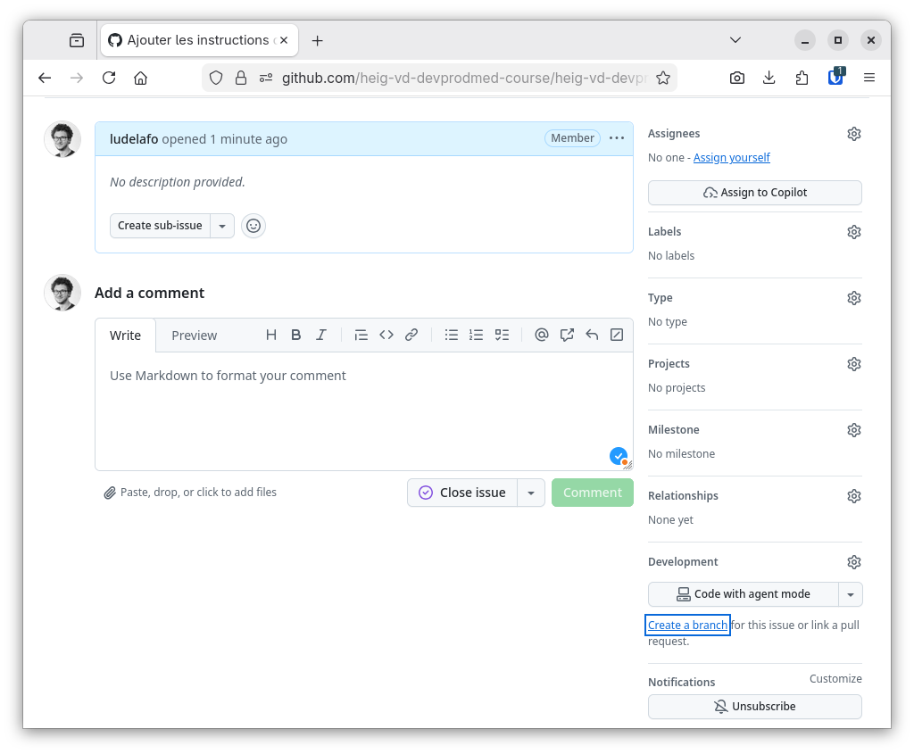
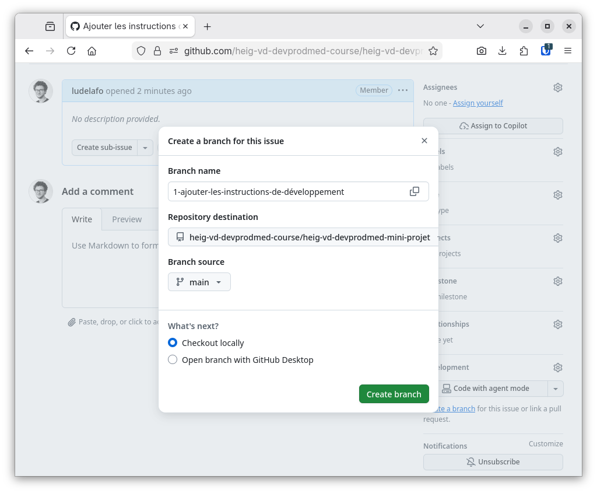
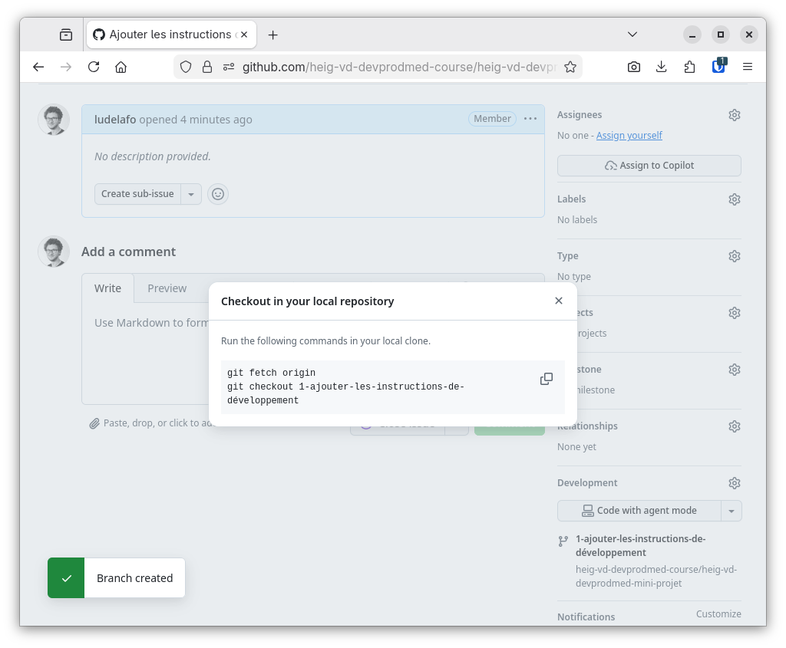
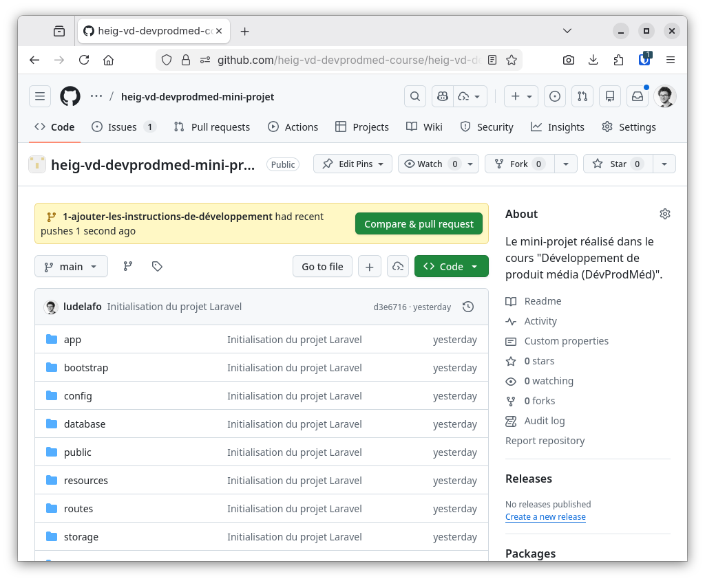
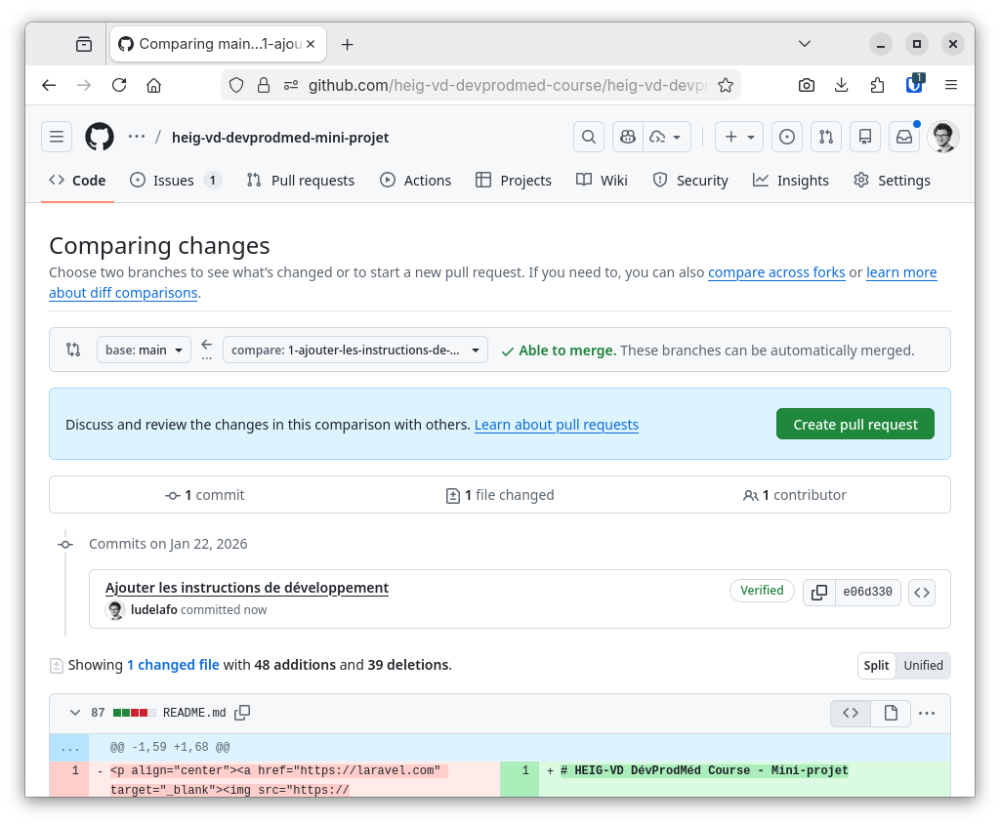
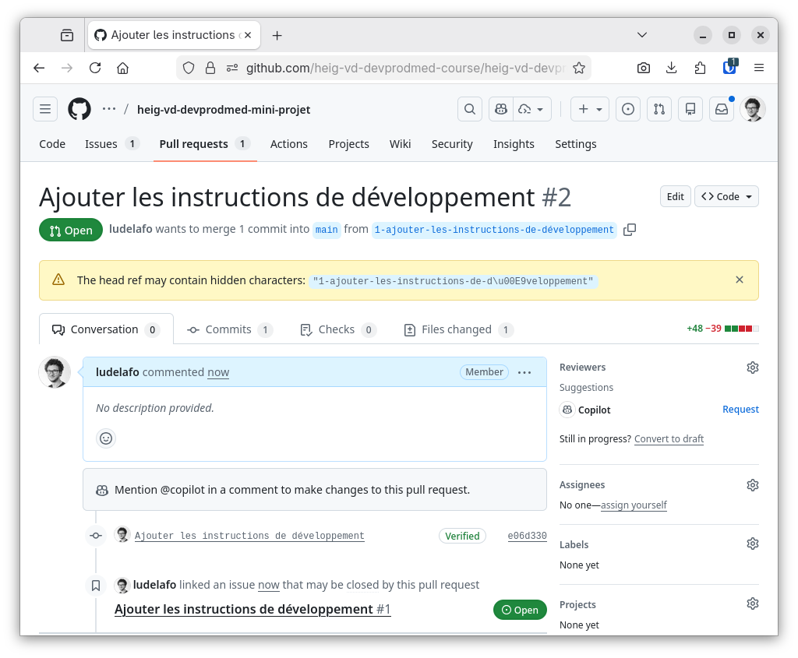
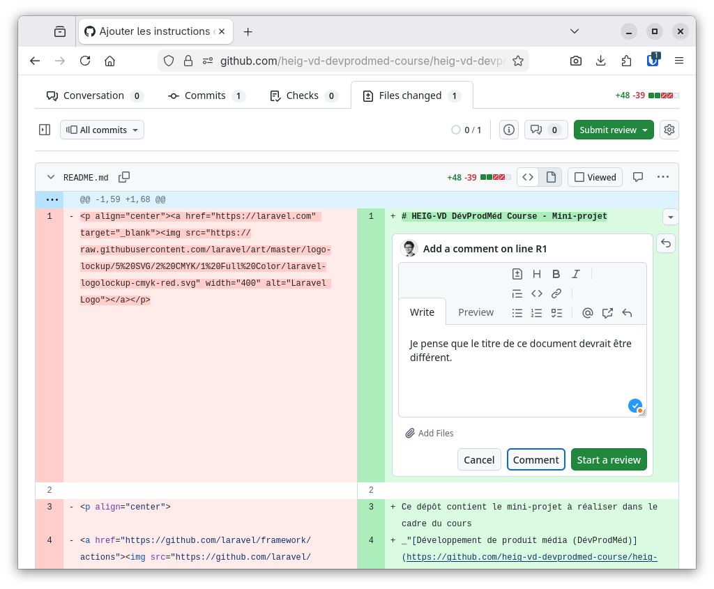
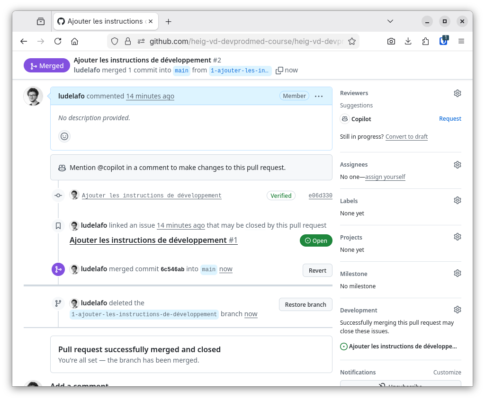

# Fonctions - Mini-projet

L. Delafontaine, avec l'aide de
[GitHub Copilot](https://github.com/features/copilot).

Ce travail est sous licence [CC BY-SA 4.0][licence].

> [!TIP]
>
> Toutes les informations relatives à ce contenu sont décrites dans le
> [contenu principal](../README.md).

## Table des matières

- [Table des matières](#table-des-matières)
- [Objectifs](#objectifs)
- [Utiliser un workflow de développement avec Git et GitHub](#utiliser-un-workflow-de-développement-avec-git-et-github)
- [Créer un fichier dédié aux constantes](#créer-un-fichier-dédié-aux-constantes)
  - [Créer une issue GitHub](#créer-une-issue-github)
  - [Créer une branche dédiée à cette issue](#créer-une-branche-dédiée-à-cette-issue)
  - [Récupérer la branche localement et basculer dessus](#récupérer-la-branche-localement-et-basculer-dessus)
  - [Effectuer les modifications nécessaires](#effectuer-les-modifications-nécessaires)
  - [Commit et push des modifications](#commit-et-push-des-modifications)
  - [Créer une pull request](#créer-une-pull-request)
  - [Valider la pull request](#valider-la-pull-request)
  - [Recommencer la boucle de développement](#recommencer-la-boucle-de-développement)
- [Créer un fichier dédié aux fonctions](#créer-un-fichier-dédié-aux-fonctions)
  - [Créer l'issue GitHub et basculer sur une branche dédiée localement](#créer-lissue-github-et-basculer-sur-une-branche-dédiée-localement)
  - [Effectuer les modifications nécessaires](#effectuer-les-modifications-nécessaires-1)
  - [Commit, push et créer une pull request](#commit-push-et-créer-une-pull-request)
  - [Valider la pull request, fusionner les modifications et supprimer la branche associée](#valider-la-pull-request-fusionner-les-modifications-et-supprimer-la-branche-associée)
  - [Récupérer les modifications fusionnées localement](#récupérer-les-modifications-fusionnées-localement-1)
  - [Trouver la bonne granularité pour les commits et les pull requests](#trouver-la-bonne-granularité-pour-les-commits-et-les-pull-requests)
- [Créer une fonction pour récupérer toutes les tâches](#créer-une-fonction-pour-récupérer-toutes-les-tâches)
  - [Créer l'issue GitHub et basculer sur une branche dédiée localement](#créer-lissue-github-et-basculer-sur-une-branche-dédiée-localement-1)
  - [Effectuer les modifications nécessaires](#effectuer-les-modifications-nécessaires-2)
  - [Commit, push et créer une pull request](#commit-push-et-créer-une-pull-request-1)
  - [Valider la pull request, fusionner les modifications et supprimer la branche associée](#valider-la-pull-request-fusionner-les-modifications-et-supprimer-la-branche-associée-1)
  - [Récupérer les modifications fusionnées localement](#récupérer-les-modifications-fusionnées-localement-2)
- [Créer une fonction pour récupérer une tâche par son identifiant](#créer-une-fonction-pour-récupérer-une-tâche-par-son-identifiant)
  - [Créer l'issue GitHub et basculer sur une branche dédiée localement](#créer-lissue-github-et-basculer-sur-une-branche-dédiée-localement-2)
  - [Effectuer les modifications nécessaires](#effectuer-les-modifications-nécessaires-3)
  - [Commit, push et créer une pull request](#commit-push-et-créer-une-pull-request-2)
  - [Valider la pull request, fusionner les modifications et supprimer la branche associée](#valider-la-pull-request-fusionner-les-modifications-et-supprimer-la-branche-associée-2)
  - [Récupérer les modifications fusionnées localement](#récupérer-les-modifications-fusionnées-localement-3)
- [Créer le squelette de la page de création de tâche](#créer-le-squelette-de-la-page-de-création-de-tâche)
  - [Créer le squelette de la page `create.php`](#créer-le-squelette-de-la-page-createphp)
  - [Référencer la page `create.php` dans le menu de navigation des autres pages](#référencer-la-page-createphp-dans-le-menu-de-navigation-des-autres-pages)
  - [Créer une fonction de validation d'une tâche](#créer-une-fonction-de-validation-dune-tâche)
  - [Utiliser la fonction `validateTask()` dans `create.php`](#utiliser-la-fonction-validatetask-dans-createphp)
  - [Afficher les erreurs de validation dans `create.php`](#afficher-les-erreurs-de-validation-dans-createphp)
  - [Valider la fonction `validateTask()` avec différents cas de test](#valider-la-fonction-validatetask-avec-différents-cas-de-test)
  - [Créer la pull request et valider les modifications](#créer-la-pull-request-et-valider-les-modifications)
- [Conclusion](#conclusion)
- [Solution](#solution)

## Objectifs

Lors de la séance précédente, vous avez appris à créer des tableaux associatifs
en PHP pour représenter des tâches.

Vous avez peut-être remarqué que certaines parties de votre code étaient
répétitives, notamment entre les différentes pages de votre mini-projet.

Pour éviter cette répétition et rendre votre code plus propre et plus facile à
maintenir, nous allons introduire l'utilisation de fonctions en PHP.

De plus, vous allez apprendre à organiser votre code en séparant les fichiers
publics (accessibles par les utilisateurs) et les fichiers de code source
(contenant la logique de votre application).

Nous profiterons pour utiliser quelques fonctionnalités offertes par GitHub pour
mieux suivre l'évolution de votre mini-projet à l'aide d'"issues" et de "pull
requests".

À l'issue de cette session, les personnes qui étudient devraient avoir pu :

- Séparer les fichiers publics et les fichiers de code source dans la structure
  du mini-projet.
- Organiser le code en utilisant des fonctions pour améliorer la lisibilité et
  la maintenabilité.
- Utiliser des fonctions pour accéder aux données des tâches.
- Utiliser les issues et les pull requests de GitHub pour suivre l'évolution du
  mini-projet.

## Utiliser un workflow de développement avec Git et GitHub

Afin de vous aider à séquencer votre travail, nous allons utiliser un workflow
de développement avec Git et GitHub.

Ce workflow vous permettra de suivre les étapes de développement de manière
structurée et de vous assurer que vous avez bien compris chaque étape avant de
passer à la suivante.

Il existe de multiples manières de travailler avec Git et GitHub, et il n'y a
pas de méthode unique qui soit meilleure que les autres. L'important est de
trouver une méthode qui vous convient et qui vous permet de travailler
efficacement.

Dans le contexte de ce cours, je (Ludovic) vous propose d'utiliser un workflow
de développement basé sur des branches Git à l'aide d'issues et de pull requests
sur GitHub. Ce workflow est largement utilisé dans l'industrie et vous permettra
de vous familiariser avec des pratiques courantes de développement collaboratif,
qui seront très utiles pour vos projets futurs, que ce soit en équipe ou en
solo.

Le workflow proposé est le suivant :

1. Création d'une issue GitHub pour chaque étape du projet.
2. Création d'une branche Git depuis la branche principale (`main`) pour chaque
   issue, directement depuis l'interface de GitHub.
3. Basculement sur la branche créée pour l'issue localement dans votre
   environnement de développement.
4. Réalisation des modifications nécessaires pour résoudre l'issue sur la
   branche locale.
5. Commit des modifications sur la branche locale.
6. Publication des modifications sur la branche distante sur GitHub.
7. Création d'une pull request pour fusionner la branche de l'issue dans la
   branche principale (`main`) depuis l'interface de GitHub.
8. Revue de code de la pull request, éventuellement avec des commentaires et des
   demandes de modifications.
9. Fusion de la pull request dans la branche principale (`main`) une fois
   qu'elle est approuvée.
10. Suppression de la branche de l'issue une fois qu'elle est fusionnée.
11. Répétition de ce processus pour chaque issue du projet.

Nous allons appliquer ce workflow pour les prochaines étapes du projet.

> [!NOTE]
>
> Nous allons volontairement appliquer ce workflow de manière très répétée dans
> les prochaines étapes du projet, afin de vous familiariser avec ce processus
> et de vous permettre de l'appliquer facilement dans vos projets futurs.
>
> Dans les prochaines séances, nous appliquerons ce workflow de manière plus
> naturelle et moins répétitive, en fonction des besoins du projet.

## Créer un fichier dédié aux constantes

Dans cette section, nous allons créer un fichier dédié aux constantes de notre
projet.

Cela nous permettra de centraliser les constantes utilisées dans notre projet,
ce qui facilitera leur gestion et leur modification.

### Créer une issue GitHub

Afin de nous aider à séquencer notre travail, nous allons créer une issue GitHub
pour cette étape du projet.

Une issue GitHub est un ticket de travail qui décrit une tâche à réaliser, un
bug à corriger ou une fonctionnalité à ajouter.

Bien que le nom "issue" puisse laisser penser qu'il s'agit uniquement de
problèmes ou de bugs, les issues sont en réalité utilisées pour organiser et
suivre tout type de travail sur un projet, y compris les nouvelles
fonctionnalités, les améliorations, les tâches de maintenance, etc.

Une issue permet de décrire clairement ce qui doit être fait, de discuter de la
solution à apporter, de suivre l'avancement du travail et de garder une trace de
ce qui a été réalisé. Elle permet de mettre au clair les objectifs de la tâche,
les étapes à suivre, les critères de réussite avant même de commencer à
travailler dessus.

> [!TIP]
>
> Vous pouvez considérer les issues comme un espace de planification et de suivi
> du travail, où vous pouvez vous vider le cerveau de toutes les
> tâches/idées/besoins à implémenter dans votre projet.

Pour créer une issue GitHub, rendez-vous sur la page de votre dépôt GitHub,
cliquez sur l'onglet **Issues**, puis cliquez sur le bouton **New issue**.

Donnez un titre à votre issue (par exemple : _"Créer un fichier dédié aux
constantes"_) et décrivez brièvement ce qui doit être fait dans le champ de
description.

> [!TIP]
>
> Il n'existe pas de convention claire pour la rédaction des titres et des
> descriptions d'issues.
>
> Un moyen simple de rédiger une issue est de commencer l'issue par un verbe
> d'action (Par exemple : "Créer", "Ajouter", "Corriger", "Améliorer", etc.)
> suivi d'une description concise de la tâche à réaliser.
>
> Cette convention permet de rendre les titres d'issues plus clairs et plus
> faciles à comprendre, en indiquant clairement l'action à réaliser et
> l'objectif de la tâche. De plus, cela facilite la lecture et la compréhension
> des issues, en particulier lorsqu'il y en a beaucoup dans un projet.

Une fois la description de l'issue rédigée, cliquez sur le bouton **Create**
pour créer l'issue.

Une nouvelle page devrait s'afficher avec les détails de l'issue que vous venez
de créer.

### Créer une branche dédiée à cette issue

Dans la page de l'issue que vous venez de créer, l'interface propose un panneau
latéral droit avec des actions/fonctionnalités liées à l'issue en cours. Dans la
section **Development** de ce panneau, cliquez sur le lien **Create a branch**.

<details>
<summary>Afficher la capture d'écran illustrant l'étape</summary>



</details>

Une nouvelle section s'affiche avec un champ de saisie pour le nom de la
branche. Par défaut, GitHub propose un nom de branche basé sur le titre de
l'issue (par exemple : `1-créer-un-fichier-dédié-aux-constantes`). Nous
recommandons de conserver ce nom de branche, car il est clair et explicite.

<details>
<summary>Afficher la capture d'écran illustrant l'étape</summary>



</details>

Sélectionnez l'option **Checkout locally** pour récupérer la branche localement
après sa création et cliquez sur le bouton **Create branch** pour créer la
branche Git dédiée à cette issue.

Une nouvelle modal s'ouvre pour vous proposer les commandes Git à exécuter pour
basculer sur la nouvelle branche. Copiez les commandes proposées pour les
utiliser dans le terminal intégré de Visual Studio Code.

<details>
<summary>Cliquer ici pour voir une capture d'écran illustrant l'étape</summary>



</details>

### Récupérer la branche localement et basculer dessus

Retournez dans le terminal intégré de Visual Studio Code dans votre
environnement de développement.

Exécutez les commandes copiées précédemment pour basculer sur la nouvelle
branche :

> [!NOTE]
>
> Utilisez les commandes proposées par GitHub, qui sont adaptées à votre
> situation. Les commandes suivantes sont données à titre d'exemple et peuvent
> être différentes dans votre cas.

```bash
git fetch origin
git checkout 1-créer-un-fichier-dédié-aux-constantes
```

La première commande récupère les dernières modifications du dépôt distant. La
seconde commande crée une nouvelle branche locale nommée
`1-créer-un-fichier-dédié-aux-constantes` et bascule dessus. La branche locale
est liée à la branche distante du même nom.

Vérifiez que vous êtes bien sur la nouvelle branche en exécutant la commande
suivante :

```bash
git branch
```

Le résultat devrait ressembler à ceci :

```text
* 1-créer-un-fichier-dédié-aux-constantes
    main
```

L'étoile (`*`) indique la branche courante. Vous êtes maintenant prêt·e à
travailler sur cette branche.

### Effectuer les modifications nécessaires

Maintenant que vous êtes sur la branche dédiée à cette issue, vous pouvez
effectuer les modifications nécessaires pour créer et utiliser le fichier dédié
aux constantes.

#### Créer le fichier `src/constants.php`

Commencez par créer un fichier `src/constants.php` dans le dossier `src` de
votre mini-projet.

La structure de votre mini-projet devrait ressembler à ceci :

```text
mini-projet/
├── public/
│   ├── css/
│   │   └── styles.css
│   ├── images/
│   │   └── logo.svg
│   ├── index.php
│   └── view.php
└── src/
    └── constants.php
```

> [!NOTE]
>
> **Pourquoi séparér les fichiers publics (dossier `public`) et les fichiers de
> code source (dossier `src`) ?**
>
> Séparer les fichiers publics et les fichiers de code source est une bonne
> pratique en développement web. Cela permet de mieux organiser le code, de
> protéger les fichiers sensibles et de faciliter la maintenance du projet.
>
> Les fichiers publics sont accessibles directement par les utilisateur·trices
> via le navigateur, tandis que les fichiers de code source contiennent la
> logique de l'application et ne doivent pas être accessibles directement. En
> séparant ces deux types de fichiers, vous pouvez mieux contrôler l'accès aux
> ressources de votre application et éviter les problèmes de sécurité.
>
> C'est la raison pour laquelle nous avons choisi de placer les fichiers
> `index.php` et `view.php` dans le dossier `public` au début de ce mini-projet,
> et de créer un dossier `src` pour y placer les fichiers de code source, comme
> le fichier `constants.php` que nous allons créer maintenant.

Puis définissez les constantes nécessaires dans le fichier `src/constants.php`.
Par exemple, vous pouvez définir une constante pour le nom de votre application
et la personne qui l'a créée :

> [!NOTE]
>
> Changez le nom de l'auteur·trice par le vôtre. Le mini-projet que nous
> réalisons dans ce cours vous appartient et vous pourrez l'utiliser comme bon
> vous semble dans le futur.

```php
<?php
const APP_NAME = "Liste de tâches de";
const APP_AUTHOR = "Ludovic";
```

Dans ce fichier, nous avons défini deux constantes : `APP_NAME` et `APP_AUTHOR`.
Ces constantes peuvent être utilisées dans d'autres fichiers de votre projet
pour afficher le nom de l'application et le nom de l'auteur·trice.

Afin de sauvegarder le travail effectué jusqu'à présent, nous allons créer un
commit Git pour enregistrer l'état actuel de notre projet. Dans le terminal, à
la racine de votre projet, exécutez les commandes suivantes :

```bash
# Ajouter les modifications à Git
git add .

# Créer un commit avec un message décrivant les modifications
git commit -m "Créer un fichier dédié aux constantes"

# Pousser les modifications vers le dépôt distant
git push
```

Vos modifications locales sont maintenant sauvegardées dans votre dépôt Git et
vous pouvez continuer à travailler sur votre projet en toute sécurité. De plus,
les modifications locales ont été poussées vers le dépôt distant, ce qui permet
de les partager avec d'autres personnes travaillant sur le même projet ou
d'avoir une sauvegarde en ligne de votre travail.

#### Importer le fichier `src/constants.php` dans les fichiers publics

Pour utiliser les constantes définies dans le fichier `src/constants.php`, vous
devez importer ce fichier dans les fichiers publics de votre projet, tels que
`public/index.php` et `public/view.php`.

Pour cela, utilisez la directive `require_once` avec la construction `__DIR__`
pour garantir que le chemin est correct, même si les fichiers sont déplacés ou
renommés :

```diff
diff --git a/mini-projet/public/index.php b/mini-projet/public/index.php
index c8365f5..5626f2c 100644
--- a/mini-projet/public/index.php
+++ b/mini-projet/public/index.php
@@ -1,6 +1,5 @@
 <?php
-const APP_NAME = "Liste de tâches de";
-const APP_AUTHOR = "Ludovic";
+require_once __DIR__ . '/../src/constants.php';

 $tasks = [
     [
```

```diff
diff --git a/mini-projet/public/view.php b/mini-projet/public/view.php
index 67aed10..4ccc1e8 100644
--- a/mini-projet/public/view.php
+++ b/mini-projet/public/view.php
@@ -1,6 +1,5 @@
 <?php
-const APP_NAME = "Liste de tâches de";
-const APP_AUTHOR = "Ludovic";
+require_once __DIR__ . '/../src/constants.php';

 $task =     [
     'id' => 1,
```

Remarquez que nous avons remplacé les définitions des constantes dans les
fichiers publics par l'importation du fichier `src/constants.php`. Cela permet
de centraliser la définition des constantes et de les réutiliser dans plusieurs
fichiers.

Lorsque vous utilisez `require_once`, PHP inclut le fichier spécifié une seule
fois, même si vous l'appelez plusieurs fois dans différents fichiers. Cela évite
les erreurs de redéfinition de constantes ou de fonctions. Toutes les choses
définies dans le fichier `src/constants.php` seront disponibles dans les
fichiers qui l'importent, ce qui permet de partager des informations et des
fonctionnalités entre différents fichiers de votre projet.

Dorénavant, si vous souhaitez modifier le nom de l'application ou
l'auteur·trice, vous n'aurez qu'à le faire dans le fichier `src/constants.php`,
et les modifications seront automatiquement reflétées dans tous les fichiers qui
importent ce fichier.

Afin de sauvegarder le travail effectué jusqu'à présent, nous allons créer un
commit Git pour enregistrer l'état actuel de notre projet. Dans le terminal, à
la racine de votre projet, exécutez les commandes suivantes :

```bash
# Ajouter les modifications à Git
git add .

# Créer un commit avec un message décrivant les modifications
git commit -m "Importer le fichier constants.php dans les fichiers publics"

# Pousser les modifications vers le dépôt distant
git push
```

Vos modifications locales sont maintenant sauvegardées dans votre dépôt Git et
vous pouvez continuer à travailler sur votre projet en toute sécurité. De plus,
les modifications locales ont été poussées vers le dépôt distant, ce qui permet
de les partager avec d'autres personnes travaillant sur le même projet ou
d'avoir une sauvegarde en ligne de votre travail.

### Commit et push des modifications

Une fois que vous avez effectué les modifications nécessaires pour la tâche en
cours, vous pouvez les enregistrer et les commiter sur votre branche locale.

Une fois les modifications commitées localement, vous pouvez les pousser sur la
branche distante sur GitHub pour les rendre disponibles en ligne.

Nous avons déjà réalisé ces étapes précédemment, mais voici un rappel des
commandes à exécuter dans le terminal intégré de Visual Studio Code à la racine
de votre projet :

```bash
# Ajouter les modifications à Git
git add .

# Créer un commit avec un message décrivant les modifications
git commit -m "Message décrivant les modifications"

# Pousser les modifications vers le dépôt distant
git push
```

Au travers des étapes précédentes, nous avons déjà créé deux commits pour
sauvegarder notre travail sur la branche dédiée à l'issue en cours. Vous pouvez
vérifier l'historique des commits en exécutant la commande suivante dans le
terminal :

```bash
git log
```

Appuyez sur la touche `q` pour quitter l'affichage de l'historique des commits.

### Créer une pull request

Une fois que vous avez poussé vos modifications sur la branche distante, vous
pouvez créer une pull request pour fusionner votre branche dans la branche
principale (`main`).

Dans la terminologie GitHub, une pull request (PR) est une demande de fusion de
modifications d'une branche vers une autre branche. Dans notre cas, nous allons
créer une PR pour fusionner la branche `1-créer-un-fichier-dédié-aux-constantes`
dans la branche `main`.

GitHub propose une interface conviviale pour visualiser et gérer les pull
requests.

Lorsque vous avez poussé vos modifications, GitHub affiche généralement une
notification proposant de créer une pull request illustrée par la capture
d'écran suivante.

<details>
<summary>Cliquer ici pour voir une capture d'écran illustrant l'étape</summary>



</details>

Vous pouvez également créer une pull request manuellement en suivant ces étapes
:

1. Accédez à votre dépôt GitHub privé pour le mini-projet.
2. Cliquez sur l'onglet **Pull requests**.
3. Cliquez sur le bouton **New pull request**.
4. Sélectionnez la branche source (_compare_)
   `1-créer-un-fichier-dédié-aux-constantes` et la branche de destination `main`
   (_base_).

   <details>
   <summary>Cliquer ici pour voir une capture d'écran illustrant l'étape</summary>

   

   </details>

5. Cliquez sur le bouton **"Create pull request"**.
6. Donnez un titre à la pull request. Par défaut, elle prend le message du
   dernier commit, qui peut ne pas représenter la totalité des modifications
   apportées. Je (Ludovic) recommande d'utiliser le titre de l'issue associée
   créée précédemment : _"Créer un fichier dédié aux constantes"_.
7. Ajoutez une description si nécessaire. Ici, comme le titre de la pull request
   est explicite, ce n'est pas obligatoire.
8. Cliquez sur le bouton **Create pull request** pour créer la pull request.

La pull request est maintenant créée et visible dans l'onglet **Pull requests**
du dépôt GitHub.

<details>
<summary>Cliquer ici pour voir une capture d'écran illustrant l'étape</summary>



</details>

> [!NOTE]
>
> Vous pouvez ignorer le message d'avertissement concernant les caractères
> cachés (_The head ref may contain hidden characters:
> `"1-cr\u00E9er-un-fichier-d\u00E9di\u00E9-aux-constantes"`_) si vous le voyez.
> Cela est dû aux caractères accentués dans le nom de la branche et n'affecte
> pas le fonctionnement de la pull request.

### Valider la pull request

La très grande force des pull requests réside dans le fait qu'elles permettent
de revoir les modifications avant de les fusionner dans la branche principale du
projet.

Une PR peut regrouper plusieurs commits, et il est possible de voir les
modifications apportées dans chaque commit, ainsi que les différences entre la
branche source et la branche de destination. Ici, nous avons créé deux commits
pour la branche dédiée à l'issue en cours, ce qui permet de regrouper plusieurs
modifications pour la même tâche.

Pour cela, rendez-vous dans l'onglet **"Files changed"** de la pull request.

<details>
<summary>Cliquer ici pour voir une capture d'écran illustrant l'étape</summary>



</details>

Vous pouvez y voir toutes les modifications apportées dans la branche source par
rapport à la branche de destination, y ajouter des commentaires, et même laisser
des suggestions de modifications si nécessaire.

Cela vous permettra de valider que les modifications sont correctes avant de les
fusionner.

Si des erreurs se sont glissées dans les modifications, vous pouvez toujours
retourner dans votre environnement de développement, corriger les erreurs, et
pousser les modifications vers la branche source avec de nouveaux commits. La
pull request sera automatiquement mise à jour avec les nouvelles modifications.

Itérez sur ce processus jusqu'à ce que vous soyez satisfait·e des modifications.

#### Faire valider la pull request

Une fois que vous êtes satisfait·e des modifications, il est temps de faire
valider la pull request envers quelqu'un d'autre.

Dans un projet professionnel, il est courant de demander à un·e collègue de
revoir et valider les modifications avant de les fusionner dans la branche
principale.

Cela permet de s'assurer que le code est de qualité et respecte les standards du
projet. De plus, cela permet de partager la connaissance du code entre les
membres de l'équipe.

Pour faire valider la pull request, vous pouvez retourner dans l'onglet
**Conversation** et ajouter un·e relecteur.trice en cliquant sur le bouton
**Reviewers** dans le menu à droite de la pull request.

La personne mise en relecteur.trice pourra ainsi revoir les modifications,
laisser des commentaires si nécessaire, et approuver la pull request si tout est
correct.

Comme votre projet fait partie de l'organisation Classroom du cours, vous pouvez
m'ajouter (Ludovic - `ludelafo`) comme relecteur.

Comme il s'agit de votre propre dépôt, vous pouvez également fusionner la pull
request vous-même une fois que vous êtes satisfait·e des modifications.

#### Fusionner la pull request et supprimer la branche associée

Une fois la pull request validée par vos soins (et optionnellement par Ludovic
dans le contexte de ce cours), il est temps de fusionner les modifications dans
la branche principale `main`.

Pour cela, cliquez sur le bouton vert **Merge pull request** dans l'onglet
**Conversation** de la pull request.

La fusion des modifications est maintenant effectuée et les modifications sont
intégrées dans la branche `main`.

Vous pouvez maintenant supprimer la branche source de la pull request en
cliquant sur le bouton **Delete branch**, car elle n'est plus nécessaire.

Félicitations ! Vous avez réussi à fusionner un changement dans la branche
principale du projet en utilisant une pull request.

<details>
<summary>Cliquer ici pour voir une capture d'écran illustrant l'étape</summary>



</details>

#### Valider que l'issue a bien été fermée

Une fois la pull request fusionnée, l'issue associée est automatiquement fermée
par GitHub.

Vous pouvez vérifier cela en retournant dans l'onglet **"Issues"** du dépôt
GitHub.

Vous devriez voir que l'issue _"Créer un fichier dédié aux constantes"_ est
marquée comme fermée. Si ce n'est pas le cas, vous pouvez fermer manuellement
l'issue en cliquant sur le bouton **Close issue** dans la page de l'issue.

#### Récupérer les modifications fusionnées localement

Après avoir fusionné la pull request sur GitHub, il est important de récupérer
les modifications fusionnées dans votre dépôt Git local.

Pour cela, retournez dans le terminal intégré de Visual Studio Code et exécutez
la commande suivante pour basculer sur la branche `main` :

```bash
git checkout main
```

Ensuite, exécutez la commande suivante pour récupérer les dernières
modifications de la branche `main` depuis le dépôt distant :

```bash
git pull
```

Cette commande met à jour votre branche `main` locale avec les modifications
fusionnées depuis GitHub.

Normalement, il ne devrait pas y avoir de conflits, car vous êtes seul·e à
travailler sur ce projet. Cependant, dans un contexte professionnel avec
plusieurs développeur·se·s, des conflits peuvent survenir si plusieurs personnes
modifient le même fichier en même temps.

Résolvez les conflits si nécessaire, puis vous serez prêt·e à continuer le
développement.

### Recommencer la boucle de développement

Pour chacune des prochaines tâches de développement, il est recommandé de suivre
le même workflow Git et GitHub en créant une issue, une branche, une pull
request, et en faisant valider les modifications avant de les fusionner.

Cela permet de garder un historique clair des modifications apportées au projet
et de s'assurer que le code est de qualité.

Il existe de nombreuses manières de gérer un workflow Git et GitHub. Celui-ci
est simple et efficace pour un projet de cette taille et vous prépare à des
environnements de développement professionnels.

## Créer un fichier dédié aux fonctions

Dans cette section, nous allons créer un fichier dédié aux fonctions de notre
projet.

### Créer l'issue GitHub et basculer sur une branche dédiée localement

En suivant le workflow Git et GitHub décrit précédemment, créez une issue pour
cette tâche, créez une branche dédiée à cette issue, et basculez dessus
localement dans votre environnement de développement.

Vous pouvez nommer l'issue _"Créer un fichier dédié aux fonctions"_.

### Effectuer les modifications nécessaires

Créez simplement un fichier `src/functions.php` dans le dossier `src` de votre
mini-projet. Vous n'avez pas besoin d'ajouter de code pour le moment, nous
ajouterons des fonctions dans ce fichier dans les prochaines étapes.

### Commit, push et créer une pull request

En suivant le workflow Git et GitHub décrit précédemment, enregistrez les
changements effectués et commitez les. Poussez les sur GitHub et créez une pull
request dans la branche principale `main`.

### Valider la pull request, fusionner les modifications et supprimer la branche associée

En suivant le workflow Git et GitHub décrit précédemment, validez la pull
request en vérifiant les modifications apportées, en laissant des commentaires
si nécessaire, et en approuvant la pull request si tout est correct.

Identifier le nombre de commits dans la pull request et vérifier que les
modifications apportées sont correctes. Si des erreurs sont détectées, vous
pouvez retourner dans votre environnement de développement, corriger les
erreurs, et pousser les modifications vers la branche source avec de nouveaux
commits.

Une fois la pull request validée, vous pouvez la fusionner dans la branche
principale `main` et supprimer la branche source de la pull request.

### Récupérer les modifications fusionnées localement

En suivant le workflow Git et GitHub décrit précédemment, n'oubliez pas de
récupérer les modifications fusionnées dans votre dépôt Git local en basculant
sur la branche `main` et en exécutant la commande `git pull`.

### Trouver la bonne granularité pour les commits et les pull requests

Nous avons créé une issue et une pull request pour l'ajout d'un simple fichier
`src/functions.php` vide.

Une des difficultés rencontrées lors du suivi du workflow Git et GitHub est de
trouver le juste équilibre entre le nombre de commits et la granularité des
modifications :

- Créer une issue "Réaliser le projet" et une seule pull request pour l'ensemble
  du projet aurait été plus simple, mais cela aurait rendu la relecture et la
  validation des modifications plus difficile, car il aurait été nécessaire de
  parcourir un grand nombre de modifications dans un seul commit.
- Créer une issue pour chaque modification mineure aurait été trop fastidieux et
  aurait entraîné un grand nombre de pull requests, ce qui aurait été difficile
  à gérer.

Il n'y a malheureusement de solution parfaite pour trouver le juste équilibre
entre le nombre de commits et la granularité des modifications. L'important est
de trouver un compromis qui permette de suivre efficacement l'évolution du
projet tout en facilitant la relecture et la validation des modifications, par
soi-même ou par d'autres personnes.

Dans les prochaines étapes du projet, nous allons continuer à créer des issues
et des pull requests pour chaque modification significative, tout en essayant de
regrouper les modifications mineures dans des commits cohérents. Cela permettra
de maintenir un historique clair et compréhensible du projet, tout en facilitant
la relecture et la validation des modifications.

## Créer une fonction pour récupérer toutes les tâches

Dans cette section, nous allons créer une fonction pour récupérer toutes les
tâches de notre projet. Cette fonction sera définie dans le fichier
`src/functions.php` que nous avons créé précédemment.

### Créer l'issue GitHub et basculer sur une branche dédiée localement

En suivant le workflow Git et GitHub décrit précédemment, créez une issue pour
cette tâche, créez une branche dédiée à cette issue, et basculez dessus
localement dans votre environnement de développement.

Vous pouvez nommer l'issue _"Créer une fonction pour récupérer toutes les
tâches"_.

### Effectuer les modifications nécessaires

Nous allons diviser le travail en plusieurs étapes pour créer la fonction
`getTasks()` qui retourne toutes les tâches.

#### Créer la fonction `getTasks()`

Ajoutez le contenu suivant dans le fichier `src/functions.php` pour définir la
fonction `getTasks()` qui retourne toutes les tâches :

```php
<?php
function getTasks(): array {
    $tasks = [
        [
            'id' => 1,
            'title' => 'Exemple de tâche 1',
            'type' => 'Personnel',
            'priority' => 'Haute',
            'description' => 'Description de la tâche 1.',
            'deadline' => '2027-01-24',
        ],
        [
            'id' => 2,
            'title' => 'Exemple de tâche 2',
            'type' => 'Autre',
            'priority' => 'Moyenne',
            'description' => null,
            'deadline' => '2027-04-01',
        ],
        [
            'id' => 3,
            'title' => 'Exemple de tâche 3',
            'type' => 'Personnel',
            'priority' => 'Haute',
            'description' => 'Description de la tâche 3.',
            'deadline' => '2027-10-10',
        ],
        [
            'id' => 4,
            'title' => 'Exemple de tâche 4',
            'type' => 'Travail',
            'priority' => 'Basse',
        ],
    ];

    return $tasks;
}
```

Ici, cette fonction `getTasks()` retourne un tableau associatif contenant toutes
les tâches :

- La fonction est déclarée avec le mot-clé `function`, suivi du nom de la
  fonction `getTasks()`.
- Elle ne prend aucun paramètre et retourne un tableau d'éléments de type
  `array`.
- Chaque tâche est représentée par un tableau associatif avec des clés suivantes
  :
  - `id`.
  - `title`.
  - `type`.
  - `priority`.
  - `description`.
  - `deadline`.

Pour le moment, cette liste de tâches est codée en dur dans la fonction. Dans
une future séance, nous utiliserons une base de données pour rendre
l'application plus dynamique.

Commitez les modifications apportées au fichier `src/functions.php` avec le
message de commit suivant : _"Créer une fonction pour récupérer toutes les
tâches"_.

#### Importer et utiliser la fonction `getTasks()` dans `index.php`

Dans le fichier `public/index.php`, importez le fichier `src/functions.php` afin
de pouvoir utiliser la fonction `getTasks()` pour récupérer toutes les tâches.

```diff
diff --git a/mini-projet/public/index.php b/mini-projet/public/index.php
index 5626f2c..47a0985 100644
--- a/mini-projet/public/index.php
+++ b/mini-projet/public/index.php
@@ -1,38 +1,8 @@
 <?php
 require_once __DIR__ . '/../src/constants.php';
+require_once __DIR__ . '/../src/functions.php';

-$tasks = [
-    [
-        'id' => 1,
-        'title' => 'Exemple de tâche 1',
-        'type' => 'Personnel',
-        'priority' => 'Haute',
-        'description' => 'Description de la tâche 1.',
-        'deadline' => '2027-01-24',
-    ],
-    [
-        'id' => 2,
-        'title' => 'Exemple de tâche 2',
-        'type' => 'Autre',
-        'priority' => 'Moyenne',
-        'description' => null,
-        'deadline' => '2027-04-01',
-    ],
-    [
-        'id' => 3,
-        'title' => 'Exemple de tâche 3',
-        'type' => 'Personnel',
-        'priority' => 'Haute',
-        'description' => 'Description de la tâche 3.',
-        'deadline' => '2027-10-10',
-    ],
-    [
-        'id' => 4,
-        'title' => 'Exemple de tâche 4',
-        'type' => 'Travail',
-        'priority' => 'Basse',
-    ],
-];
+$tasks = getTasks();
 ?>

 <!DOCTYPE html>
```

Ici, nous avons remplacé la liste de tâches codée en dur dans le fichier
`public/index.php` par un appel à la fonction `getTasks()` que nous avons
définie dans le fichier `src/functions.php`. Cela permet de centraliser la
logique de récupération des tâches dans une fonction réutilisable, ce qui rend
le code plus propre et plus facile à maintenir.

La fonction `getTasks()` est appelée et son résultat est stocké dans la variable
`$tasks`, qui est ensuite utilisée pour afficher la liste des tâches dans le
fichier `public/index.php` de la même manière qu'auparavant.

Commitez les modifications apportées au fichier `src/functions.php` avec le
message de commit suivant : _"Utiliser la fonction getTasks() pour récupérer les
tâches"_.

### Commit, push et créer une pull request

En suivant le workflow Git et GitHub décrit précédemment, enregistrez les
changements effectués et commitez les. Poussez les sur GitHub et créez une pull
request dans la branche principale `main`.

### Valider la pull request, fusionner les modifications et supprimer la branche associée

En suivant le workflow Git et GitHub décrit précédemment, validez la pull
request en vérifiant les modifications apportées, en laissant des commentaires
si nécessaire, et en approuvant la pull request si tout est correct.

Identifier le nombre de commits dans la pull request et vérifier que les
modifications apportées sont correctes. Si des erreurs sont détectées, vous
pouvez retourner dans votre environnement de développement, corriger les
erreurs, et pousser les modifications vers la branche source avec de nouveaux
commits.

Une fois la pull request validée, vous pouvez la fusionner dans la branche
principale `main` et supprimer la branche source de la pull request.

### Récupérer les modifications fusionnées localement

En suivant le workflow Git et GitHub décrit précédemment, n'oubliez pas de
récupérer les modifications fusionnées dans votre dépôt Git local en basculant
sur la branche `main` et en exécutant la commande `git pull`.

## Créer une fonction pour récupérer une tâche par son identifiant

Dans cette section, nous allons créer une fonction pour récupérer une tâche par
son identifiant. Cette fonction sera définie dans le fichier `src/functions.php`
que nous avons créé précédemment.

### Créer l'issue GitHub et basculer sur une branche dédiée localement

En suivant le workflow Git et GitHub décrit précédemment, créez une issue pour
cette tâche, créez une branche dédiée à cette issue, et basculez dessus
localement dans votre environnement de développement.

Vous pouvez nommer l'issue _"Créer une fonction pour récupérer une tâche par son
identifiant"_.

### Effectuer les modifications nécessaires

Nous allons diviser le travail en plusieurs étapes pour créer la fonction
`getTaskById()` qui retourne une tâche par son identifiant.

#### Créer la fonction `getTaskById()`

Ajoutez le contenu suivant dans le fichier `src/functions.php` pour définir la
fonction `getTaskById()` qui retourne une tâche par son identifiant :

```diff
diff --git a/mini-projet/src/functions.php b/mini-projet/src/functions.php
index 456adba..2261819 100644
--- a/mini-projet/src/functions.php
+++ b/mini-projet/src/functions.php
@@ -36,3 +36,15 @@ function getTasks(): array {

     return $tasks;
 }
+
+function getTaskById(int $id): ?array {
+    $tasks = getTasks();
+
+    foreach ($tasks as $task) {
+        if ($task['id'] === $id) {
+            return $task;
+        }
+    }
+
+    return null;
+}
```

Ici, cette fonction `getTaskById()` permet de récupérer une tâche spécifique en
fonction de son identifiant :

- La fonction est déclarée avec le mot-clé `function`, suivi du nom de la
  fonction `getTaskById()`.
- Elle prend un paramètre de type `int` représentant l'identifiant de la tâche,
  et retourne un tableau d'éléments de type `array` ou `null` si la tâche n'est
  pas trouvée (indiqué par le type de retour `?array`).
- Cette fonction utilise la fonction `getTasks()` pour récupérer toutes les
  tâches, puis parcourt le tableau des tâches à l'aide d'une boucle `foreach`.
- Si une tâche avec l'identifiant correspondant est trouvée, elle est retournée.
  Sinon, la fonction retourne `null`.

Prenez le temps nécessaire pour comprendre le fonctionnement de cette fonction.

Commitez les modifications apportées au fichier `src/functions.php` avec le
message de commit suivant : _"Créer une fonction pour récupérer une tâche par
son identifiant"_.

#### Importer et utiliser la fonction `getTaskById()` dans `view.php`

Dans le fichier `public/view.php`, importez le fichier `src/functions.php` afin
de pouvoir utiliser la fonction `getTaskById()` pour récupérer une tâche par son
identifiant.

```diff
diff --git a/mini-projet/public/view.php b/mini-projet/public/view.php
index 4ccc1e8..68b8e35 100644
--- a/mini-projet/public/view.php
+++ b/mini-projet/public/view.php
@@ -1,14 +1,10 @@
 <?php
 require_once __DIR__ . '/../src/constants.php';
+require_once __DIR__ . '/../src/functions.php';

-$task =     [
-    'id' => 1,
-    'title' => 'Exemple de tâche 1',
-    'type' => 'Personnel',
-    'priority' => 'Haute',
-    'description' => 'Description de la tâche 1.',
-    'deadline' => '2027-01-24',
-];
+$taskId = 1;
+
+$task = getTaskById($taskId);
 ?>
```

Ici, nous avons remplacé la tâche codée en dur dans le fichier `public/view.php`
par un appel à la fonction `getTaskById()` que nous avons définie dans le
fichier `src/functions.php`. Cela permet de centraliser la logique de
récupération d'une tâche dans une fonction réutilisable, ce qui rend le code
plus propre et plus facile à maintenir.

La fonction `getTaskById()` est appelée et son résultat est stocké dans la
variable `$task`, qui est ensuite utilisée pour afficher la tâche dans le
fichier `public/view.php` de la même manière qu'auparavant.

Pour le moment, nous avons défini l'identifiant de la tâche à récupérer dans la
variable `$taskId`. Dans une future séance, nous verrons comment récupérer cet
identifiant depuis l'URL de la page, afin de rendre l'application plus dynamique
et permettre aux utilisateur.trices de visualiser différentes tâches en fonction
de l'identifiant passé dans l'URL.

Commitez les modifications apportées au fichier `src/functions.php` avec le
message de commit suivant : _"Utiliser la fonction getTaskById() pour récupérer
une tâche par son identifiant"_.

#### Gérer le cas où la tâche n'est pas trouvée

Dans le cas où la tâche n'est pas trouvée, la fonction `getTaskById()` devrait
retourner `null`. Nous devons donc gérer ce cas dans le fichier
`public/view.php` pour éviter les erreurs d'affichage.

Avant d'implémenter la gestion du cas où la tâche n'est pas trouvée, nous allons
d'abord vérifier que la fonction `getTaskById()` fonctionne correctement en
testant l'affichage de la tâche avec l'identifiant `1`, qui existe dans la liste
des tâches.

Modifiez la variable `$taskId` dans le fichier `public/view.php` pour tester
différents identifiants de tâches, y compris des identifiants qui n'existent pas
dans la liste des tâches, afin de vérifier que la fonction `getTaskById()`
retourne bien `null` pour les identifiants non existants.

Que ce passe-t-il lorsque vous testez un identifiant qui n'existe pas ? Observez
le comportement de l'application et notez les erreurs ou les messages affichés.

Afin de gérer le cas où la tâche n'est pas trouvée, nous allons ajouter une
condition pour vérifier si la variable `$task` est `null`. Si c'est le cas, nous
allons rediriger l'utilisateur·trice vers la page d'accueil. Dans d'autres
contextes, nous pourrions afficher un message d'erreur ou une page spécifique
pour indiquer que la tâche n'a pas été trouvée mais dans cette première version
de l'application, nous allons simplement rediriger vers la page d'accueil : une
tâche qui n'existe pas n'a pas de sens dans le contexte de notre application et
nous redirigerons donc l'utilisateur·trice vers la page d'accueil pour qu'elle
puisse choisir une tâche existante.

Pour cela, nous allons utiliser la fonction `header()` de PHP pour effectuer une
redirection HTTP vers la page d'accueil. Ajoutez le code suivant dans le fichier
`public/view.php` après l'appel à la fonction `getTaskById()` :

```diff
diff --git a/mini-projet/public/view.php b/mini-projet/public/view.php
index 68b8e35..1a7fa0e 100644
--- a/mini-projet/public/view.php
+++ b/mini-projet/public/view.php
@@ -5,6 +5,11 @@ require_once __DIR__ . '/../src/functions.php';
 $taskId = 1;

 $task = getTaskById($taskId);
+
+if ($task === null) {
+    header('Location: ./index.php');
+    exit;
+}
 ?>

 <!DOCTYPE html>
```

La fonction `header('Location: ./index.php');` envoie un en-tête HTTP au
navigateur pour indiquer qu'il doit rediriger l'utilisateur·trice vers la page
d'accueil `index.php`. L'appel à `exit;` est utilisé pour arrêter l'exécution du
script après la redirection, afin d'éviter que le reste du code soit exécuté
inutilement.

Grâce à cette modification, si la fonction `getTaskById()` retourne `null`,
l'utilisateur·trice sera redirigé·e vers la page d'accueil, ce qui permet de
gérer le cas où la tâche n'est pas trouvée de manière élégante.

Essayez par vous-même de tester différents identifiants de tâches, y compris des
identifiants qui n'existent pas, pour vérifier que la redirection fonctionne
correctement.

Commitez les modifications apportées au fichier `src/functions.php` avec le
message de commit suivant : _"Rediriger vers la page d'accueil si la tâche n'est
pas trouvée"_.

### Commit, push et créer une pull request

En suivant le workflow Git et GitHub décrit précédemment, enregistrez les
changements effectués et commitez les. Poussez les sur GitHub et créez une pull
request dans la branche principale `main`.

### Valider la pull request, fusionner les modifications et supprimer la branche associée

En suivant le workflow Git et GitHub décrit précédemment, validez la pull
request en vérifiant les modifications apportées, en laissant des commentaires
si nécessaire, et en approuvant la pull request si tout est correct.

Identifier le nombre de commits dans la pull request et vérifier que les
modifications apportées sont correctes. Si des erreurs sont détectées, vous
pouvez retourner dans votre environnement de développement, corriger les
erreurs, et pousser les modifications vers la branche source avec de nouveaux
commits.

Une fois la pull request validée, vous pouvez la fusionner dans la branche
principale `main` et supprimer la branche source de la pull request.

### Récupérer les modifications fusionnées localement

En suivant le workflow Git et GitHub décrit précédemment, n'oubliez pas de
récupérer les modifications fusionnées dans votre dépôt Git local en basculant
sur la branche `main` et en exécutant la commande `git pull`.

## Créer le squelette de la page de création de tâche

Dans cette section, nous allons créer le squelette d'une page pour permettre aux
utilisateur.trices de créer une nouvelle tâche.

Pour le moment, la page restera très simple et ne contiendra qu'un titre
indiquant qu'il s'agit de la page de création d'une tâche. Nous ajouterons les
formulaires et la logique de création de tâche dans une prochaine séance mais
nous allons pouvoir tester quelques fonctionnalités à l'aide de cette page.

Essayez d'appliquer le workflow Git et GitHub décrit précédemment par vous-même
afin de valider vos compétences et de vous familiariser avec le processus de
développement.

> [!WARNING]
>
> Le workflow de développement Git et GitHub est l'un des aspects les plus
> importants de votre cursus. Il est donc fortement recommandé de le maîtriser
> dès maintenant.

### Créer le squelette de la page `create.php`

Dans le fichier `public/create.php`, ajoutez le code suivant pour créer le
squelette de la page de création d'une tâche :

```php
<?php
require_once __DIR__ . '/../src/constants.php';
?>

<!DOCTYPE html>
<html lang="fr">

<head>
    <meta charset="utf-8">
    <meta name="viewport" content="width=device-width, initial-scale=1">
    <meta name="color-scheme" content="light dark">
    <link rel="stylesheet" href="https://unpkg.com/@digicreon/mucss/dist/mu.css">
    <link rel="stylesheet" href="./css/styles.css">

    <title>Créer une nouvelle tâche | <?= APP_NAME; ?> <?= APP_AUTHOR; ?></title>
    <meta name="description" content="Créer une nouvelle tâche pour <?= APP_AUTHOR; ?>.">
</head>

<body class="container">
    <header>
        <nav>
            <ul>
                <li><strong><?= APP_NAME; ?> <?= APP_AUTHOR; ?></strong></li>
            </ul>
            <ul>
                <li><a href="./index.php">Accueil</a></li>
                <li><a href="./create.php">Nouvelle tâche</a></li>
            </ul>
        </nav>
        <nav aria-label="breadcrumb">
            <ul>
                <li><a href="./index.php">Accueil</a></li>
                <li>Nouvelle tâche</li>
            </ul>
        </nav>
    </header>
    <main>
        <h1>Créer une nouvelle tâche</h1>

        <p><em>Contenu à venir...</em></p>
    </main>
    <footer>
        <center>
            <small>
                Un projet réalisé dans le cadre du cours <a href="https://github.com/heig-vd-progserv-course/heig-vd-progserv1-course">ProgServ1</a> enseigné à la <a href="https://heig-vd.ch">HEIG-VD</a>.
            </small>
        </center>
    </footer>
</body>

</html>
```

Ce squelette de page contient les éléments suivants :

- L'importation du fichier `src/constants.php` pour utiliser les constantes
  définies dans ce fichier.
- La structure HTML de base avec les balises `<html>`, `<head>` et `<body>`.
- L'inclusion des fichiers CSS pour le style de la page.
- Un en-tête avec un menu de navigation et un fil d'Ariane pour faciliter la
  navigation dans l'application.
- Un titre principal `<h1>` indiquant qu'il s'agit de la page de création d'une
  nouvelle tâche.

N'oubliez pas de commiter les modifications apportées et de suivre le workflow
Git et GitHub décrit précédemment !

### Référencer la page `create.php` dans le menu de navigation des autres pages

Dans les fichiers `public/index.php` et `public/view.php`, ajoutez un lien vers
la page `create.php` dans le menu de navigation pour permettre aux
utilisateur.trices d'accéder facilement à la page de création d'une nouvelle
tâche :

```diff
diff --git a/mini-projet/public/index.php b/mini-projet/public/index.php
index 47a0985..bff33ad 100644
--- a/mini-projet/public/index.php
+++ b/mini-projet/public/index.php
@@ -27,6 +27,7 @@ $tasks = getTasks();
             </ul>
             <ul>
                 <li><a href="./index.php">Accueil</a></li>
+                <li><a href="./create.php">Nouvelle tâche</a></li>
             </ul>
         </nav>
     </header>
```

```diff
diff --git a/mini-projet/public/view.php b/mini-projet/public/view.php
index 1a7fa0e..eecdc5e 100644
--- a/mini-projet/public/view.php
+++ b/mini-projet/public/view.php
@@ -34,6 +34,7 @@ if ($task === null) {
             </ul>
             <ul>
                 <li><a href="./index.php">Accueil</a></li>
+                <li><a href="./create.php">Nouvelle tâche</a></li>
             </ul>
         </nav>
         <nav aria-label="breadcrumb">
```

N'oubliez pas de commiter les modifications apportées et de suivre le workflow
Git et GitHub décrit précédemment !

### Créer une fonction de validation d'une tâche

Dans une future séance, nous allons créer un formulaire pour permettre aux
utilisateur.trices d'ajouter une nouvelle tâche. Pour cela, nous allons devoir
valider les données saisies par l'utilisateur·trice avant de les enregistrer
dans la base de données.

Pour valider les données d'une tâche, nous allons créer une fonction dédiée à la
validation des tâches dans le fichier `src/functions.php`.

Cette fonction sera appelée `validateTask` qui prendra en paramètre les
propriétés d'une tâche et qui retournera un tableau contenant les erreurs de
validation si elles existent, ou un tableau vide si la tâche est valide.

Ajoutez la fonction suivante dans le fichier `src/functions.php` :

```php
function validateTask(
    ?string $title,
    ?string $type,
    ?string $priority,
    ?string $description,
    ?string $deadline,
): array {
    // Par défaut, il n'y a pas d'erreurs
    $errors = [];

    // Validation des données
    if (empty($title)) {
        array_push($errors, "Le nom est obligatoire.");
    } else if (strlen($title) < 2) {
        array_push($errors, "Le nom doit contenir au minimum 2 caractères.");
    } else if (strlen($title) > 50) {
        array_push($errors, "Le nom doit contenir au maximum 50 caractères.");
    }

    if (empty($type)) {
        array_push($errors, "Le type est obligatoire.");
    } else if (!in_array($type, ["personal", "work", "other"])) {
        array_push($errors, "Le type n'est pas valide.");
    }

    if (empty($priority)) {
        array_push($errors, "La priorité est obligatoire.");
    } else if (!in_array($priority, ["low", "medium", "high"])) {
        array_push($errors, "La priorité n'est pas valide.");
    }

    if (!empty($description)) {
        if (strlen($description) < 10) {
            array_push($errors, "La description doit contenir au minimum 10 caractères.");
        } else if (strlen($description) > 500) {
            array_push($errors, "La description doit contenir au maximum 500 caractères.");
        }
    }

    if ($deadline !== null && $deadline !== '') {
        $deadlineTimestamp = strtotime($deadline);

        if ($deadlineTimestamp === false) {
            array_push($errors, "La date limite n'est pas valide.");
        } else if ($deadlineTimestamp < strtotime('today')) {
            array_push($errors, "La date limite ne peut pas être dans le passé.");
        }
    }

    return $errors;
}
```

Ici, cette fonction `validateTask()` permet de valider les données d'une tâche
et de retourner un tableau d'erreurs si nécessaire :

- La fonction est déclarée avec le mot-clé `function`, suivi du nom de la
  fonction `validateTask()`.
- Elle prend en paramètre les propriétés d'une tâche : `title`, `type`,
  `priority`, `description`, et `deadline`. Tous ces paramètres sont de type
  `?string`, ce qui signifie qu'ils peuvent être des chaînes de caractères ou
  `null`. Cela peut être utile pour gérer les cas où certaines propriétés d'une
  tâche ne sont pas fournies.
- Au travers de différentes conditions, la fonction vérifie si les propriétés de
  la tâche sont valides selon les critères définis. Si une propriété n'est pas
  valide, un message d'erreur correspondant est ajouté au tableau `$errors`.
- La fonction retourne le tableau `$errors` contenant les messages d'erreur si
  des erreurs de validation sont présentes, ou un tableau vide si la tâche est
  valide.

Ici, les validations suivantes sont effectuées :

- Le nom de la tâche est obligatoire, doit contenir au minimum 2 caractères et
  au maximum 50 caractères.
- Le type de la tâche est obligatoire et doit être l'une des valeurs suivantes :
  - `personal`.
  - `work`.
  - `other`.
- La priorité de la tâche est obligatoire et doit être l'une des valeurs
  suivantes :
  - `low`.
  - `medium`.
  - `high`.
- La description de la tâche est facultative, mais si elle est fournie, elle
  doit contenir au minimum 10 caractères et au maximum 500 caractères.
- La date limite de la tâche est facultative, mais si elle est fournie, elle
  doit être une date valide et ne peut pas être dans le passé. Pour cela, nous
  utilisons la fonction
  [`strtotime()`](https://www.php.net/manual/fr/function.strtotime.php) pour
  convertir la date limite en un timestamp et vérifier si elle est valide et si
  elle est dans le futur.

N'oubliez pas de commiter les modifications apportées et de suivre le workflow
Git et GitHub décrit précédemment !

### Utiliser la fonction `validateTask()` dans `create.php`

Dans le fichier `create.php`, nous pouvons utiliser la fonction `validateTask()`
pour valider les données de la tâche :

```diff
diff --git a/mini-projet/public/create.php b/mini-projet/public/create.php
index fc9c808..dfb989e 100644
--- a/mini-projet/public/create.php
+++ b/mini-projet/public/create.php
@@ -1,5 +1,22 @@
 <?php
 require_once __DIR__ . '/../src/constants.php';
+require_once __DIR__ . '/../src/functions.php';
+
+$title = '';
+$type = '';
+$priority = '';
+$description = '';
+$deadline = '';
+
+$errors = validateTask(
+    $title,
+    $type,
+    $priority,
+    $description,
+    $deadline,
+);
 ?>
```

Ici, nous avons importé le fichier `src/functions.php` pour pouvoir utiliser la
fonction `validateTask()`. Nous avons également défini des variables pour les
propriétés d'une tâche et nous avons appelé la fonction `validateTask()` avec
ces variables. Le résultat de la validation est stocké dans la variable
`$errors`, qui contiendra un tableau d'erreurs si des erreurs de validation sont
présentes, ou un tableau vide si la tâche est valide.

N'oubliez pas de commiter les modifications apportées et de suivre le workflow
Git et GitHub décrit précédemment !

### Afficher les erreurs de validation dans `create.php`

Maintenant que nous avons validé les données de la tâche avec la fonction
`validateTask()`, nous pouvons afficher les erreurs de validation dans la page
`create.php`. Pour cela, nous allons vérifier si la variable `$errors` contient
des erreurs et les afficher dans une liste HTML :

```diff
diff --git a/mini-projet/public/create.php b/mini-projet/public/create.php
index 87a61fd..cf410c2 100644
--- a/mini-projet/public/create.php
+++ b/mini-projet/public/create.php
@@ -52,6 +52,17 @@ $errors = validateTask(
     <main>
         <h1>Créer une nouvelle tâche</h1>

+        <?php if (!empty($errors)) { ?>
+            <p style="color: red;">Le formulaire contient des erreurs :</p>
+            <ul>
+                <?php foreach ($errors as $error) { ?>
+                    <li><?= $error ?></li>
+                <?php } ?>
+            </ul>
+        <?php } else { ?>
+            <p style="color: green;">La tâche a été créée avec succès.</p>
+        <?php } ?>
+
         <p><em>Contenu à venir...</em></p>
     </main>
     <footer>
```

Ici, nous avons ajouté un bloc conditionnel pour vérifier si la variable
`$errors` contient des erreurs. Si c'est le cas, nous affichons un message
d'erreur et une liste des erreurs. Sinon, nous affichons un message de succès
indiquant que la tâche a été créée avec succès.

N'oubliez pas de commiter les modifications apportées et de suivre le workflow
Git et GitHub décrit précédemment !

### Valider la fonction `validateTask()` avec différents cas de test

Pour valider la fonction `validateTask()`, nous pouvons créer plusieurs cas de
test pour vérifier son comportement dans différentes situations.

#### Cas de test 1 : Tâche valide

Afin de tester la fonction `validateTask()` avec une tâche valide, nous pouvons
définir les variables suivantes dans le fichier `create.php` :

```php
$title = 'Nouvelle tâche';
$type = 'personal';
$priority = 'medium';
$description = 'Description de la nouvelle tâche.';
$deadline = '2027-12-31';
```

Sauvegardez le fichier et exécutez-le dans votre navigateur. Un message de
succès devrait s'afficher, indiquant que la tâche a été créée avec succès.

#### Cas de test 2 : Tâche avec des erreurs de validation

Pour tester la fonction `validateTask()` avec une tâche contenant des erreurs de
validation, nous pouvons définir les variables suivantes dans le fichier
`create.php` :

```php
$title = '';
$type = 'autre';
$priority = 'facile';
$description = null;
$deadline = '2000-01-01';
```

Sauvegardez le fichier et exécutez-le dans votre navigateur. Un message d'erreur
devrait s'afficher, indiquant que le formulaire contient des erreurs, ainsi
qu'une liste des erreurs de validation.

#### Trouver d'autres cas de test

Vous pouvez également créer d'autres cas de test pour valider la fonction
`validateTask()` avec différentes combinaisons de valeurs pour les propriétés
d'une tâche. Est-ce que votre fonction gère correctement les cas où certaines
propriétés sont manquantes ou invalides ? Essayez de modifier les valeurs des
variables et observez le comportement de la fonction.

### Créer la pull request et valider les modifications

N'oubliez pas de commiter les modifications apportées et de suivre le workflow
Git et GitHub décrit précédemment pour créer une pull request et valider les
modifications.

## Conclusion

Dans cette séance, vous avez appris à créer des fonctions en PHP pour manipuler
des tâches.

Ces fonctions, dans un fichier `functions.php` séparé, ont été importées et
utilisées dans les autres fichiers publiques comme le fichier `index.php afin de
garder une structure de projet propre.

Grâce à ce fichier dédié, vous avez tout au même endroit, ce qui facilite leur
réutilisation et leur maintenance.

Nous avons créer les fonctions suivantes pour nous aider à manipuler les tâches
:

- `getTasks()` : pour récupérer toutes les tâches.
- `getTaskById()` : pour récupérer une tâche par son identifiant.
- `validateTask()` : pour valider les données d'une tâche avant de
  l'enregistrer.

Pour le moment, la liste des tâches reste codée en dur et la tâche validée n'est
pas réellement enregistrée, mais nous verrons dans les prochaines séances
comment utiliser une base de données pour rendre l'application plus dynamique et
permettre aux utilisateur.trices d'ajouter, modifier et supprimer des tâches.

Lors de la prochaine séance, nous allons continuer à développer notre projet en
créant des formulaires HTML pour permettre aux utilisateur.trices d'ajouter,
modifier et supprimer des tâches.

Nous vous invitons maintenant à passer aux exemples de code et aux exercices de
la séance comme indiqué dans le [contenu principal](../README.md).

## Solution

> [!NOTE]
>
> La solution est fournie à titre indicatif uniquement. Il est fortement
> recommandé de développer votre propre version du mini-projet avant de
> consulter la solution.

La solution du mini-projet est accessible dans un dépôt GitHub dédié à l'adresse
suivante :
<https://github.com/heig-vd-progserv-course/heig-vd-progserv1-course-mini-project-solution>.

Afin d'utiliser cette solution de manière efficace pour votre apprentissage,
nous vous recommandons de suivre les étapes suivantes :

1. Essayez de développer votre propre version du mini-projet en suivant les
   instructions et les étapes décrites dans ce contenu avant de consulter la
   solution. Cela vous permettra de mettre en pratique les concepts et les
   compétences que vous avez appris et de mieux comprendre les différentes
   étapes du développement d'une application PHP.
2. Clonez le dépôt GitHub de la solution localement sur votre ordinateur en
   utilisant la commande `git clone` avec l'URL du dépôt de la solution.
3. Explorez le code de la solution pour comprendre comment les différentes
   fonctionnalités ont été implémentées et comment les concepts appris ont été
   appliqués dans la solution.
4. Comparez votre propre version du mini-projet avec la solution pour identifier
   les différences et les similitudes, et pour comprendre les différentes
   approches possibles pour résoudre les problèmes rencontrés lors du
   développement de votre application PHP.

<!-- URLs -->

[licence]:
	https://github.com/heig-vd-progserv-course/heig-vd-progserv1-course/blob/main/LICENSE.md
