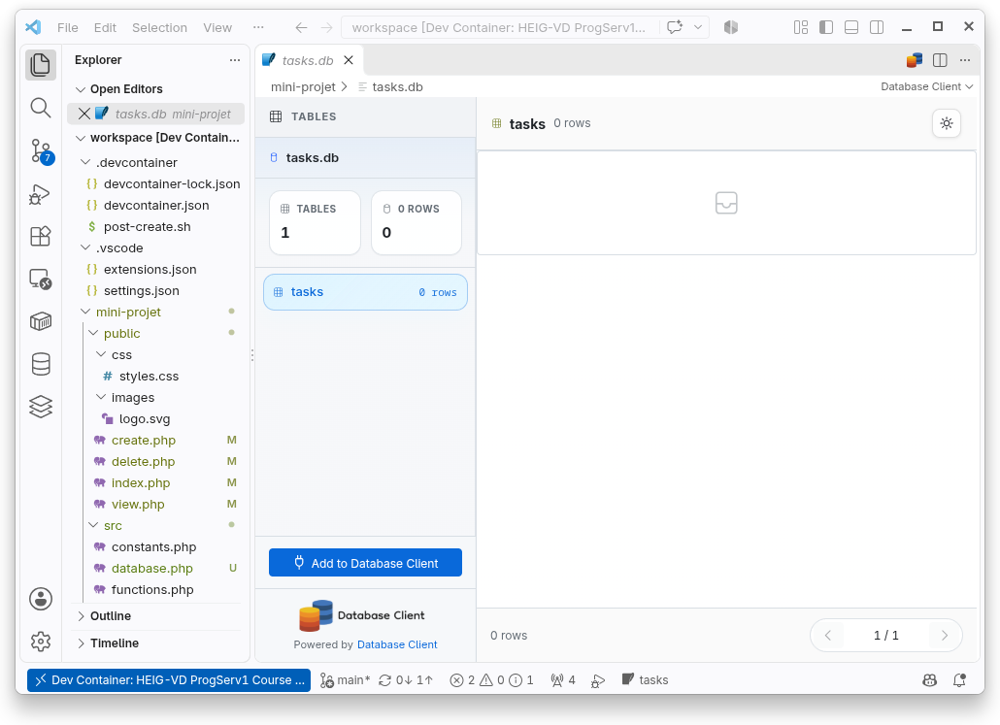
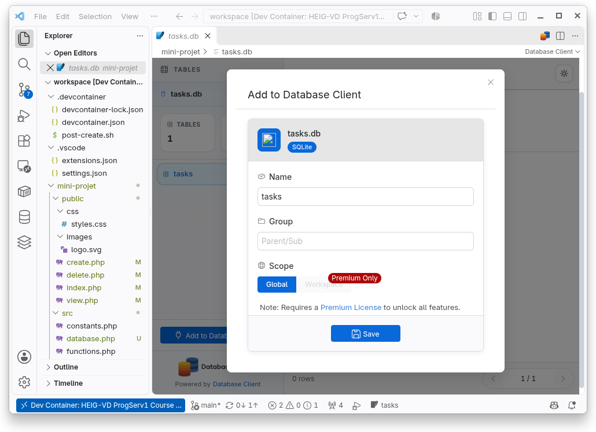
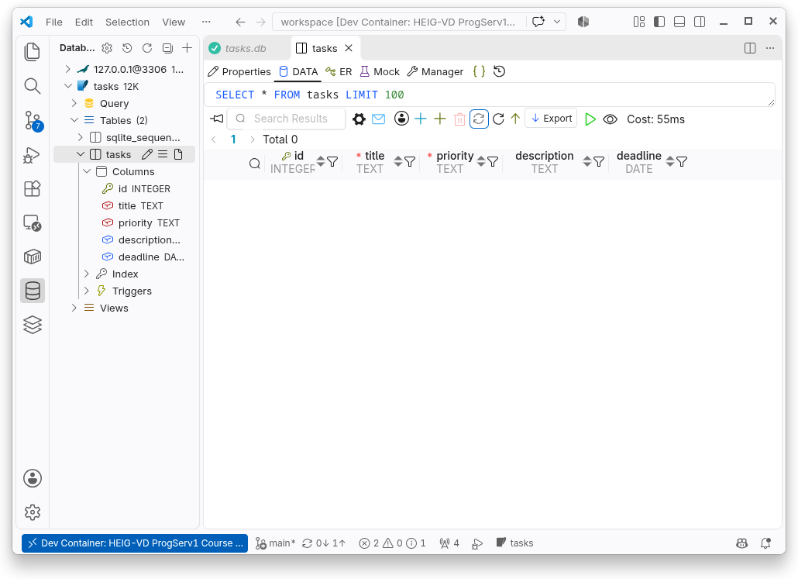

# Bases de données et PDO - Mini-projet

L. Delafontaine, avec l'aide de
[GitHub Copilot](https://github.com/features/copilot).

Ce travail est sous licence [CC BY-SA 4.0][licence].

> [!TIP]
>
> Toutes les informations relatives à ce contenu sont décrites dans le
> [contenu principal](../README.md).

## Table des matières

- [Table des matières](#table-des-matières)
- [Objectifs](#objectifs)
- [Intégrer PDO et créer la base de données](#intégrer-pdo-et-créer-la-base-de-données)
  - [Créer le fichier `database.php`](#créer-le-fichier-databasephp)
  - [Créer la base de données pour les tâches](#créer-la-base-de-données-pour-les-tâches)
  - [Importer la base de données dans les pages de l'application](#importer-la-base-de-données-dans-les-pages-de-lapplication)
  - [Visualiser le contenu de la base de données](#visualiser-le-contenu-de-la-base-de-données)
- [Mettre à jour les fonctionnalités de l'application pour utiliser la base de données](#mettre-à-jour-les-fonctionnalités-de-lapplication-pour-utiliser-la-base-de-données)
  - [Mettre à jour la fonction `getTasks()` pour récupérer les tâches depuis la base de données](#mettre-à-jour-la-fonction-gettasks-pour-récupérer-les-tâches-depuis-la-base-de-données)
  - [Mettre à jour la page d'accueil pour passer la connexion à la base de données à la fonction `getTasks()`](#mettre-à-jour-la-page-daccueil-pour-passer-la-connexion-à-la-base-de-données-à-la-fonction-gettasks)
  - [Mettre à jour la fonction `addTask()` pour ajouter une tâche dans la base de données](#mettre-à-jour-la-fonction-addtask-pour-ajouter-une-tâche-dans-la-base-de-données)
  - [Mettre à jour la page de création pour passer la connexion à la base de données à la fonction `addTask()`](#mettre-à-jour-la-page-de-création-pour-passer-la-connexion-à-la-base-de-données-à-la-fonction-addtask)
  - [Mettre à jour la fonction `getTaskById()` pour récupérer une tâche spécifique depuis la base de données](#mettre-à-jour-la-fonction-gettaskbyid-pour-récupérer-une-tâche-spécifique-depuis-la-base-de-données)
  - [Mettre à jour la page de visualisation pour passer la connexion à la base de données à la fonction `getTaskById()`](#mettre-à-jour-la-page-de-visualisation-pour-passer-la-connexion-à-la-base-de-données-à-la-fonction-gettaskbyid)
  - [Utiliser les bons textes pour la priorité des tâches](#utiliser-les-bons-textes-pour-la-priorité-des-tâches)
  - [Mettre à jour la fonction `deleteTask()` pour supprimer une tâche de la base de données](#mettre-à-jour-la-fonction-deletetask-pour-supprimer-une-tâche-de-la-base-de-données)
  - [Mettre à jour la page de suppression pour passer la connexion à la base de données à la fonction `deleteTask()`](#mettre-à-jour-la-page-de-suppression-pour-passer-la-connexion-à-la-base-de-données-à-la-fonction-deletetask)
- [Tester le fonctionnement de l'application avec la base de données](#tester-le-fonctionnement-de-lapplication-avec-la-base-de-données)
- [Se protéger contre les attaques XSS](#se-protéger-contre-les-attaques-xss)
  - [Illustrer le problème des attaques XSS](#illustrer-le-problème-des-attaques-xss)
  - [Corriger le problème des attaques XSS](#corriger-le-problème-des-attaques-xss)
  - [Valider que la protection contre les attaques XSS fonctionne](#valider-que-la-protection-contre-les-attaques-xss-fonctionne)
- [Mettre en pratique tout ce que nous avons appris avec la page d'édition](#mettre-en-pratique-tout-ce-que-nous-avons-appris-avec-la-page-dédition)
- [Valider que tout est fonctionnel](#valider-que-tout-est-fonctionnel)
- [Conclusion](#conclusion)
- [Solution](#solution)

## Objectifs

Jusqu'à présent, vous avez créé une application PHP composée de plusieurs
fonctionnalités distinctes qui permet de gérer des tâches.

Mais pour le moment, les données de l'application sont fixes et sont définies en
dur dans le code, ce qui n'est pas très dynamique.

Lors de la création d'une tâche, les données ne sont pas persistées (=
conservées) et que vous perdez toutes les données lorsque vous rechargez la
page.

Dans cette séance, vous allez apprendre à persister les données dans une base de
données SQLite à l'aide de PDO (PHP Data Objects).

Cela permettra de stocker les données des tâches et de les rendre disponibles
même après le rechargement de la page dans toutes les pages de l'application.

Pour cela, il sera nécessaire de créer une base de données SQLite avec une table
pour stocker les données des tâches. Ensuite, vous pourrez insérer, récupérer et
supprimer des données de cette table.

Vous allez également apprendre à utiliser PDO pour interagir avec la base de
données.

## Intégrer PDO et créer la base de données

Dans cette section, nous allons intégrer PDO dans un projet PHP et créer une
base de données SQLite pour stocker les données des tâches.

> [!WARNING]
>
> N'oubliez pas de créer une issue et sa branche dédiée pour cette nouvelle
> fonctionnalité !

### Créer le fichier `database.php`

Afin de ne pas mélanger le code de la base de données avec le code de
l'application, nous allons créer un fichier dédié qui contiendra la connexion à
la base de données. Ce fichier sera inclus dans le fichier `functions.php` pour
que les fonctions puissent y accéder.

Créez un nouveau fichier `src/database.php` dans le dossier de votre projet.

La structure de votre mini-projet devrait ressembler à ceci :

```text
mini-projet/
├── public/
│   ├── css/
│   │   └── styles.css
│   ├── images/
│   │   └── logo.svg
│   ├── create.php
│   ├── delete.php
│   ├── index.php
│   └── view.php
└── src/
    ├── constants.php
    ├── database.php
    └── functions.php
```

Ce fichier contiendra la connexion à la base de données SQLite. Il permettra de
se connecter à la base de données et de créer la table pour stocker les données
des tâches.

Pensez à commiter et pousser les modifications que vous avez faites jusqu'à
présent avant de continuer. Dès le premier push, créez une pull request pour que
votre travail puisse être visible par les autres personnes du dépôt de code.
Donnez lui le même nom que l'issue correspondante.

### Créer la base de données pour les tâches

Maintenant que nous avons créé le fichier `database.php`, nous pouvons créer la
base de données SQLite et la table pour stocker les données des tâches.

Pour cela, vous allez utiliser la classe `PDO` pour créer la base de données et
la table.

Complétez le fichier `database.php` avec le code suivant :

```php
<?php
// Chemin vers le fichier de base de données SQLite
const DATABASE_FILE = __DIR__ . '/../database.db';

// Création d'une instance de PDO pour se connecter à la base de données
$pdo = new PDO("sqlite:" . DATABASE_FILE);

// On définit la requête SQL pour créer la table `tasks` si elle n'existe pas déjà
$sql = "CREATE TABLE IF NOT EXISTS tasks (
    id INTEGER PRIMARY KEY AUTOINCREMENT,
    title TEXT NOT NULL,
    priority TEXT NOT NULL,
    description TEXT,
    deadline DATE
);";

// On prépare la requête SQL
$stmt = $pdo->prepare($sql);

// On exécute la requête SQL
$stmt->execute();
```

La constante `DATABASE_FILE` contient le chemin vers le fichier de base de
données SQLite. Si le fichier n'existe pas, il sera créé automatiquement. La
notation `__DIR__ . '/../database.db'` permet de créer le fichier dans le
dossier parent que celui du fichier `database.php`.

Ensuite, nous utilisons la classe `PDO` pour créer une instance de PDO qui se
connecte à la base de données SQLite. La chaîne de connexion `sqlite:` indique
que nous voulons utiliser SQLite comme moteur de base de données.

Nous n'avons pas encore étudié en détail la programmation orientée objet (POO)
en PHP. Pour le moment, il est juste nécessaire de retenir que PDO est une
classe qui permet de se connecter à une base de données et d'exécuter des
requêtes SQL sur celle-ci. Nous étudierons la POO en détail dans un prochain
cours.

Une fois la connexion à la base de données établie, nous définissons une requête
SQL pour créer la table `tasks` si elle n'existe pas déjà. La table `tasks`
contient les colonnes suivantes :

- `id` : identifiant unique de la tâche (clé primaire, auto-incrémentée).
- `title` : titre de la tâche (obligatoire, de type texte).
- `priority` : priorité de la tâche (obligatoire, de type texte).
- `description` : description de la tâche (facultatif, de type texte).
- `deadline` : date limite de la tâche (facultatif, de type date).

C'est cette table qui permettra de stocker les données des tâches dans la base
de données.

Pensez à commiter et pousser les modifications que vous avez faites jusqu'à
présent avant de continuer.

### Importer la base de données dans les pages de l'application

Maintenant que nous avons un fichier `database.php` qui contient la connexion à
la base de données, nous allons l'importer dans toutes les pages publiques de
notre application :

```diff
diff --git a/mini-projet/public/create.php b/mini-projet/public/create.php
index 5704434..0084228 100644
--- a/mini-projet/public/create.php
+++ b/mini-projet/public/create.php
@@ -1,5 +1,6 @@
 <?php
 require_once __DIR__ . '/../src/constants.php';
+require_once __DIR__ . '/../src/database.php';
 require_once __DIR__ . '/../src/functions.php';

 $title = $_POST["title"] ?? '';
```

```diff
diff --git a/mini-projet/public/delete.php b/mini-projet/public/delete.php
index 9abf0b8..877208c 100644
--- a/mini-projet/public/delete.php
+++ b/mini-projet/public/delete.php
@@ -1,5 +1,6 @@
 <?php
 require_once __DIR__ . '/../src/constants.php';
+require_once __DIR__ . '/../src/database.php';
 require_once __DIR__ . '/../src/functions.php';

 $taskId = $_GET['id'] ?? null;
```

```diff
diff --git a/mini-projet/public/index.php b/mini-projet/public/index.php
index 96f22ed..df52d46 100644
--- a/mini-projet/public/index.php
+++ b/mini-projet/public/index.php
@@ -1,5 +1,6 @@
 <?php
 require_once __DIR__ . '/../src/constants.php';
+require_once __DIR__ . '/../src/database.php';
 require_once __DIR__ . '/../src/functions.php';

 $tasks = getTasks();
```

```diff
diff --git a/mini-projet/public/view.php b/mini-projet/public/view.php
index 4988900..d77206c 100644
--- a/mini-projet/public/view.php
+++ b/mini-projet/public/view.php
@@ -1,5 +1,6 @@
 <?php
 require_once __DIR__ . '/../src/constants.php';
+require_once __DIR__ . '/../src/database.php';
 require_once __DIR__ . '/../src/functions.php';

 $taskId = $_GET['id'] ?? null;
```

Sauvegardez les modifications et rechargez la page d'accueil de votre
application. Une nouvelle base de données SQLite `database.db` devrait être
créée dans le dossier racine de votre projet :

```text
mini-projet/
├── public/
│   ├── css/
│   │   └── styles.css
│   ├── images/
│   │   └── logo.svg
│   ├── create.php
│   ├── delete.php
│   ├── index.php
│   └── view.php
├── src/
│   ├── constants.php
│   ├── database.php
│   └── functions.php
└── database.db
```

Cette base de données contient la table `tasks` qui permettra de stocker les
données des tâches.

### Visualiser le contenu de la base de données

L'environnement de développement vous a mis à disposition de façon automatique
l'extension Database Client, permettant de visualiser le contenu de la base de
données.

Pour cela, ouvrez le fichier `database.db` dans Visual Studio Code. La base de
données devrait s'ouvrir dans un nouvel onglet.

<details>
<summary>Afficher la capture d'écran illustrant l'étape</summary>



</details>

Une fois la base de données ouverte, cliquez sur "Add to Database Client" pour
ajouter la base de données à l'extension Database Client.

Choisissez un nom pour la base de données (ou laissez le nom par défaut) et
cliquez sur "Save".

<details>
<summary>Afficher la capture d'écran illustrant l'étape</summary>



</details>

Une fois la base de données ajoutée à l'extension Database Client, vous pouvez
visualiser le contenu de la table `tasks` en cliquant sur "Tables" puis sur
"tasks".

Actuellement, il n'y a aucune données dans la table `tasks`, mais vous pouvez
voir les colonnes de la table et leurs types de données.

En utilisant l'icône "Refresh" (`↻`) dans l'extension Database Client, vous
pouvez actualiser la vue de la table pour voir les nouvelles données qui seront
ajoutées à la table `tasks` lorsque vous créerez de nouvelles tâches dans
l'application.

<details>
<summary>Afficher la capture d'écran illustrant l'étape</summary>



</details>

Vous avez maintenant accès à la base de données SQLite et vous pouvez visualiser
le contenu de la table `tasks` dans l'extension Database Client !

## Mettre à jour les fonctionnalités de l'application pour utiliser la base de données

Dans cette section, nous allons mettre à jour les fonctionnalités de
l'application pour utiliser la base de données SQLite que nous avons créée dans
la section précédente.

### Mettre à jour la fonction `getTasks()` pour récupérer les tâches depuis la base de données

Dans le fichier `src/functions.php`, mettez à jour la fonction `getTasks()` pour
qu'elle récupère les tâches depuis la base de données SQLite au lieu de
retourner les tâches créées en dur :

```php
function getTasks(PDO $pdo): array {
    $sql = "SELECT * FROM tasks ORDER BY title ASC";

    $stmt = $pdo->prepare($sql);

    $stmt->execute();

    $tasks = $stmt->fetchAll();

    return $tasks;
}
```

Vous remarquez que nous avons ajouté un paramètre `$pdo` à la fonction
`getTasks()`. Cela permet de passer l'instance de PDO qui contient la connexion
à la base de données SQLite.

Nous définissons une requête SQL `SELECT` pour récupérer toutes les tâches de la
table `tasks` et les trier par ordre alphabétique du titre.

Nous préparons la requête SQL avec la méthode `prepare()` de l'objet `$pdo`,
puis nous exécutons la requête avec la méthode `execute()`. Enfin, nous
récupérons toutes les tâches avec la méthode `fetchAll()` et nous les
retournons.

Le processus de préparer la requête SQL (`prepare()`) avant de l'exécuter
(`execute()`) est une bonne pratique pour éviter les attaques par injection SQL.
Cela permet de séparer la requête SQL des données qui y sont insérées.

La méthode `fetchAll()` retourne un tableau associatif contenant toutes les
lignes de la table `tasks`. Chaque ligne est représentée par un tableau
associatif où les clés sont les noms des colonnes de la table, équivalente à la
structure initiale des tâches créées en dur :

```php
$tasks = [
    [
        'id' => 1,
        'title' => 'Exemple de tâche 1',
        'priority' => 'Haute',
        'description' => 'Description de la tâche 1.',
        'deadline' => '2027-01-24',
    ],
    [
        'id' => 2,
        'title' => 'Exemple de tâche 2',
        'priority' => 'Moyenne',
        'description' => null,
        'deadline' => '2027-04-01',
    ],
    [
        'id' => 3,
        'title' => 'Exemple de tâche 3',
        'priority' => 'Haute',
        'description' => 'Description de la tâche 3.',
        'deadline' => '2027-10-10',
    ],
    [
        'id' => 4,
        'title' => 'Exemple de tâche 4',
        'priority' => 'Basse',
    ],
];
```

Avec cette fonction mise à jour, nous pouvons maintenant récupérer les tâches
depuis la base de données SQLite au lieu de retourner les tâches créées en dur.

### Mettre à jour la page d'accueil pour passer la connexion à la base de données à la fonction `getTasks()`

Maintenant que nous avons mis à jour la fonction `getTasks()` pour qu'elle
récupère les tâches depuis la base de données SQLite, nous devons mettre à jour
la page d'accueil pour passer l'instance de PDO à la fonction `getTasks()`.

Dans le fichier `public/index.php`, mettez à jour l'appel à la fonction
`getTasks()` pour lui passer l'instance de PDO `$pdo` :

```diff
diff --git a/mini-projet/public/index.php b/mini-projet/public/index.php
index df52d46..1bd84dd 100644
--- a/mini-projet/public/index.php
+++ b/mini-projet/public/index.php
@@ -3,7 +3,7 @@ require_once __DIR__ . '/../src/constants.php';
 require_once __DIR__ . '/../src/database.php';
 require_once __DIR__ . '/../src/functions.php';

-$tasks = getTasks();
+$tasks = getTasks($pdo);
 ?>

 <!DOCTYPE html>
```

En effet, comme nous importons le fichier `database.php` dans la page d'accueil,
nous avons accès à l'instance de PDO `$pdo` qui contient la connexion à la base
de données SQLite. Nous devons donc passer cette instance à la fonction
`getTasks()` pour qu'elle puisse récupérer les tâches depuis la base de données.

Sauvegardez les modifications et rechargez la page d'accueil de votre
application.

L'application devrait maintenant récupérer les tâches depuis la base de données
SQLite au lieu de retourner les tâches créées en dur. Comme il n'y a pas encore
de tâches dans la base de données, la liste des tâches devrait être vide.

### Mettre à jour la fonction `addTask()` pour ajouter une tâche dans la base de données

Dans le fichier `src/functions.php`, mettez à jour la fonction `addTask()` pour
qu'elle ajoute une nouvelle tâche dans la base de données SQLite au lieu de
simplement afficher les données à l'écran :

```php
function addTask(
    PDO $pdo,
    string $title,
    string $priority,
    ?string $description,
    ?string $deadline,
): ?int {
    $sql = "INSERT INTO tasks (
        title,
        priority,
        description,
        deadline
    ) VALUES (
        :title,
        :priority,
        :description,
        :deadline
    )";

    $stmt = $pdo->prepare($sql);

    $stmt->bindValue(':title', $title);
    $stmt->bindValue(':priority', $priority);
    $stmt->bindValue(':description', $description);
    $stmt->bindValue(':deadline', $deadline);

    $stmt->execute();

    return $pdo->lastInsertId();
}
```

Cette fonction prend en paramètres l'instance de PDO `$pdo` qui contient la
connexion à la base de données SQLite, ainsi que les données de la tâche à
ajouter, comme présents initialement.

Son type de retour a été modifié pour retourner un entier ou `null`. L'entier
correspond à l'identifiant de la tâche qui vient d'être ajoutée dans la base de
données, et `null` correspond à une erreur lors de l'ajout de la tâche dans la
base de données.

Une requête SQL `INSERT INTO` est définie pour insérer une nouvelle tâche dans
la table `tasks`.

Cette requête contient des paramètres nommés (par exemple `:title`, `:priority`,
etc.) qui sont des espaces réservés pour les valeurs réelles qui seront insérées
dans la table.

La requête est préparée avec la méthode `prepare()` de l'objet `$pdo`, puis les
valeurs des paramètres sont liées aux valeurs réelles avec la méthode
`bindValue()`.

Nous lions donc les valeurs des paramètres de la requête SQL aux valeurs réelles
des données de la tâche :

- `:title` est lié à la variable `$title`.
- `:priority` est lié à la variable `$priority`.
- `:description` est lié à la variable `$description`.
- `:deadline` est lié à la variable `$deadline`.

La méthode `execute()` est ensuite appelée pour exécuter la requête SQL avec les
valeurs réelles et insérer la nouvelle tâche dans la table `tasks`.

Comme pour la fonction `getTasks()`, le processus de préparer la requête SQL
(`prepare()`) avant de l'exécuter (`execute()`) est une bonne pratique pour
éviter les attaques par injection SQL. Cela permet de séparer la requête SQL des
données qui y sont insérées.

Finalement, la fonction retourne l'identifiant de la tâche qui vient d'être
ajoutée dans la base de données avec la méthode `lastInsertId()` de l'objet

### Mettre à jour la page de création pour passer la connexion à la base de données à la fonction `addTask()`

Tout comme nous avons mis à jour la fonction `getTasks()` pour qu'elle récupère
les tâches depuis la base de données SQLite, nous devons mettre à jour la page
de création pour passer l'instance de PDO à la fonction `addTask()` :

```diff
diff --git a/mini-projet/public/create.php b/mini-projet/public/create.php
index 0084228..3464747 100644
--- a/mini-projet/public/create.php
+++ b/mini-projet/public/create.php
@@ -20,12 +20,20 @@ if ($_SERVER["REQUEST_METHOD"] === "POST") {

     // S'il n'y a pas d'erreurs, ajoute la tâche à la base de données
     if (empty($errors)) {
-        addTask(
+        $newTaskId = addTask(
+            $pdo,
             $title,
             $priority,
             $description,
             $deadline,
         );
+
+        if ($newTaskId !== null) {
+            header('Location: ./view.php?id=' . $newTaskId);
+            exit;
+        } else {
+            array_push($errors, "Une erreur est survenue lors de l'ajout de la tâche.");
+        }
     }
 }
 ?>
@@ -73,8 +81,6 @@ if ($_SERVER["REQUEST_METHOD"] === "POST") {
                         <li><?= $error ?></li>
                     <?php } ?>
                 </ul>
-            <?php } else { ?>
-                <p style="color: green;">La tâche a été créée avec succès.</p>
             <?php } ?>
         <?php } ?>
```

Ici, nous récupérons l'identifiant de la tâche qui vient d'être ajoutée dans la
base de données avec la variable `$newTaskId`.

Si l'identifiant n'est pas `null`, nous redirigeons l'utilisateur·trice vers la
page de visualisation de la tâche nouvellement créée avec l'identifiant de la
tâche dans l'URL.

Si l'identifiant est `null`, cela signifie qu'une erreur est survenue lors de
l'ajout de la tâche dans la base de données, et nous ajoutons un message
d'erreur à la liste des erreurs.

Comme la page de création redirige l'utilisateur·trice vers la page de
visualisation de la tâche nouvellement créée, le message de succès n'est plus
nécessaire et a été supprimé.

Sauvegardez les modifications et rechargez la page de création de votre
application. Créez une nouvelle tâche et vérifiez que vous êtes redirigé·e vers
la page de visualisation de la tâche nouvellement créée.

Une erreur devrait s'afficher car nous n'avons pas encore mis à jour la page de
visualisation pour récupérer la tâche depuis la base de données SQLite mais
retournez à la page d'accueil et vérifiez que la tâche a bien été ajoutée dans
la liste des tâches.

Bravo, votre application commence à utiliser la base de données SQLite pour
stocker les données des tâches ! Elle devient de plus en plus dynamique et
fonctionnelle !

### Mettre à jour la fonction `getTaskById()` pour récupérer une tâche spécifique depuis la base de données

Dans le fichier `functions.php`, mettez à jour la fonction `getTaskById()` pour
qu'elle récupère une tâche spécifique depuis la base de données SQLite au lieu
de retourner les tâches créées en dur :

```php
function getTaskById(PDO $pdo, int $id): array|bool {
    $stmt = $pdo->prepare("SELECT * FROM tasks WHERE id = :id");

    $stmt->bindValue(':id', $id);

    $stmt->execute();

    $task = $stmt->fetch();

    return $task;
}
```

Cette fonction prend en paramètres l'instance de PDO `$pdo` qui contient la
connexion à la base de données SQLite, ainsi que l'identifiant de la tâche à
récupérer.

Le type de retour a été modifié pour retourner un tableau associatif ou `false`.

Une requête SQL `SELECT` est définie pour récupérer la tâche spécifique de la
table `tasks` avec l'identifiant correspondant.

De la même manière que pour les fonctions précédentes, la requête est préparée
avec la méthode `prepare()` de l'objet `$pdo`, puis l'identifiant de la tâche
est lié à la valeur réelle avec la méthode `bindValue()`.

La méthode `execute()` est ensuite appelée pour exécuter la requête SQL avec la
valeur réelle et récupérer la tâche spécifique de la table `tasks`.

La méthode `fetch()` est utilisée pour récupérer la tâche spécifique sous forme
de tableau associatif. Si la tâche existe, elle est retournée, sinon `false` est
retourné. C'est la raison pour laquelle le type de retour de la fonction a été
modifié pour inclure `bool`.

### Mettre à jour la page de visualisation pour passer la connexion à la base de données à la fonction `getTaskById()`

Dans le fichier `view.php`, mettez à jour le code pour passer la connexion à la
base de données à la fonction `getTaskById()` :

```diff
diff --git a/mini-projet/public/view.php b/mini-projet/public/view.php
index d77206c..71526b2 100644
--- a/mini-projet/public/view.php
+++ b/mini-projet/public/view.php
@@ -10,7 +10,7 @@ if ($taskId === null || !is_numeric($taskId)) {
     exit;
 }

-$task = getTaskById($taskId);
+$task = getTaskById($pdo, $taskId);

 if ($task === null) {
     header('Location: ./index.php');
```

Sauvegardez les modifications et rechargez la page de visualisation de votre
application. La tâche que vous avez créée précédemment devrait maintenant
s'afficher correctement.

Si vous créez une nouvelle tâche, vous devriez également pouvoir la visualiser
correctement une fois créée maintenant que la page de visualisation récupère
correctement la tâche depuis la base de données SQLite.

### Utiliser les bons textes pour la priorité des tâches

Vous avez peut-être remarqué que la priorité des tâches est affichée en anglais
avec les clés "low", "medium" et "high" dans la liste des tâches et sur la page
de visualisation.

En effet, les valeurs données à la priorité des tâches sont celles définies dans
le formulaire de création de tâche dans chaque option du champ `<select>`. Ces
valeurs sont utilisées pour stocker la priorité dans la base de données.

Il est de bonne pratique d'utiliser des valeurs en anglais dans les options des
champs `<select>`, car cela permet de standardiser les valeurs et de faciliter
la traduction dans d'autres langues si nécessaire.

Pour afficher correctement la priorité des tâches en français, nous allons
utiliser un tableau associatif pour faire correspondre les valeurs en anglais
aux textes en français.

Dans le fichier `src/constants.php`, ajoutez le tableau associatif suivant pour
faire correspondre les valeurs de priorité aux textes en français :

```php
const TASK_PRIORITIES = [
    'low' => 'Basse',
    'medium' => 'Moyenne',
    'high' => 'Haute',
];
```

Puis mettez à jour le code dans les fichiers `index.php` et `view.php` pour
utiliser ce tableau associatif pour afficher la priorité des tâches en français
:

```diff
diff --git a/mini-projet/public/index.php b/mini-projet/public/index.php
index 1bd84dd..9bc94e8 100644
--- a/mini-projet/public/index.php
+++ b/mini-projet/public/index.php
@@ -51,7 +51,7 @@ $tasks = getTasks($pdo);
                     <h2><?= $task['title'] ?></h2>

                     <p>
-                        <span class="badge badge-contrast"><?= $task['priority'] ?></span>
+                        <span class="badge badge-contrast"><?= TASK_PRIORITIES[$task['priority']] ?></span>
                         <?php if (!empty($task['deadline'])) { ?>
                             <span class="badge badge-secondary"><?= $task['deadline'] ?></span>
                         <?php } ?>
```

```diff
diff --git a/mini-projet/public/view.php b/mini-projet/public/view.php
index 71526b2..84639fb 100644
--- a/mini-projet/public/view.php
+++ b/mini-projet/public/view.php
@@ -56,7 +56,7 @@ if ($task === null) {
             <h1><?= $task['title'] ?></h1>

             <p>
-                <span class="badge badge-contrast"><?= $task['priority'] ?></span>
+                <span class="badge badge-contrast"><?= TASK_PRIORITIES[$task['priority']] ?></span>
                 <?php if (!empty($task['deadline'])) { ?>
                     <span class="badge badge-secondary"><?= $task['deadline'] ?></span>
                 <?php } ?>
```

De cette manière, la priorité des tâches sera affichée en français dans la liste
des tâches et sur la page de visualisation.

Sauvegardez les modifications et rechargez la page d'accueil et la page de
visualisation de votre application. La priorité des tâches devrait maintenant
être affichée en français.

Nous pouvons passer à la suppression d'une tâche de la base de données.

### Mettre à jour la fonction `deleteTask()` pour supprimer une tâche de la base de données

Dans le fichier `functions.php`, mettez à jour la fonction `deleteTask()` pour
qu'elle supprime une tâche de la base de données SQLite au lieu de simplement
afficher les données à l'écran :

```php
function deleteTask(PDO $pdo, int $id): bool {
    $sql = "DELETE FROM tasks WHERE id = :id";

    $stmt = $pdo->prepare($sql);

    $stmt->bindValue(':id', $id);

    $stmt->execute();

    $success = $stmt->rowCount() === 1;

    return $success;
}
```

Cette fonction prend en paramètres l'instance de PDO `$pdo` qui contient la
connexion à la base de données SQLite, ainsi que l'identifiant de la tâche à
supprimer.

Une requête SQL `DELETE` est définie pour supprimer la tâche spécifique de la
table `tasks` avec l'identifiant correspondant.

La requête est préparée avec la méthode `prepare()` de l'objet `$pdo`, puis
l'identifiant de la tâche est lié à la valeur réelle avec la méthode
`bindValue()` avant d'exécuter la requête avec la méthode `execute()`.

La fonction `rowCount()` est utilisée pour vérifier si une ligne a été supprimée
de la table. Si une ligne a été supprimée, cela signifie que la tâche a été
supprimée avec succès, et la fonction retourne `true`.

Pourquoi vérifier le nombre de lignes affectées par la requête SQL ?

Parce que si l'identifiant de la tâche n'existe pas dans la table, aucune ligne
ne sera supprimée et la fonction retournera `0`.

Si nous avons bien supprimé une tâche, la fonction retournera `1` et cela
indique que la requête SQL a été exécutée correctement.

A l'inverse, si nous omettons la clause `WHERE` dans la requête SQL, toutes les
lignes de la table seront supprimées et la fonction retournera le nombre total
de lignes supprimées, qui n'est pas égal à `1` et cela indique un problème plus
grave dans la requête SQL.

### Mettre à jour la page de suppression pour passer la connexion à la base de données à la fonction `deleteTask()`

Dans le fichier `delete.php`, mettez à jour le code pour passer la connexion à
la base de données à la fonction `deleteTask()` :

```diff
diff --git a/mini-projet/public/delete.php b/mini-projet/public/delete.php
index 877208c..66a324a 100644
--- a/mini-projet/public/delete.php
+++ b/mini-projet/public/delete.php
@@ -10,7 +10,7 @@ if ($taskId === null || !is_numeric($taskId)) {
     exit;
 }

-$task = getTaskById($taskId);
+$task = getTaskById($pdo, $taskId);

 if ($task === null) {
     header('Location: ./index.php');
@@ -21,7 +21,7 @@ $error = null;

 // Gestion de la soumission du formulaire
 if ($_SERVER["REQUEST_METHOD"] === "POST") {
-    $success = deleteTask($taskId);
+    $success = deleteTask($pdo, $taskId);

     if ($success) {
         header('Location: ./index.php');
```

L'instance de PDO `$pdo` est passée à la fonction `deleteTask()` pour qu'elle
puisse supprimer la tâche de la base de données SQLite.

Le reste du code de la page de suppression reste inchangé : en cas de succès,
l'utilisateur·trice est redirigé·e vers la page d'accueil, et en cas d'échec, un
message d'erreur est affiché.

## Tester le fonctionnement de l'application avec la base de données

Nous avons maintenant une application pleinement fonctionnelle qui utilise la
base de données SQLite pour stocker les données des tâches. Nous pouvons :

- Créer des tâches.
- Visualiser la liste des tâches.
- Visualiser une tâche spécifique.
- Supprimer une tâche.

Notre application est maintenant dynamique et persiste les données dans la base
de données SQLite !

Il reste quelques améliorations possibles pour rendre l'application encore plus
robuste et fonctionnelle.

## Se protéger contre les attaques XSS

Notre application est quasi complète. Un des derniers points à aborder est de se
protéger contre les attaques XSS (Cross-Site Scripting).

Une attaque XSS est une faille de sécurité qui permet à un·e attaquant·e
d'injecter du code JavaScript malveillant dans une page web. Cela peut se
produire lorsque les données issues de la base de données sont affichées dans
une page web sans être correctement échappées.

### Illustrer le problème des attaques XSS

Pour illustrer ce point, essayez d'ajouter une tâche avec le nom suivant :
`<script>alert('Oh no');</script>` dans la page d'ajout d'une tâche
(<http://localhost:8080/mini-projet/public/create.php>).

Lorsque vous soumettez le formulaire, vous devriez être redirigé·e vers la page
de visualisation de la tâche que vous venez d'ajouter. Jusqu'ici, tout va bien.

Une alerte JavaScript devrait s'afficher avec le message "Oh no". En effet, les
données stockées dans la base de données peuvent être exécutées par le
navigateur web à l'aide de JavaScript lorsqu'elles sont affichées dans la page
de visualisation de la tâche.

Ceci est ce qu'on appelle une attaque XSS. Nous reviendrons sur ce point dans un
prochain cours, mais il s'agit d'une faille de sécurité qui exécute du code
JavaScript malveillant dans le navigateur des utilisateur·trices qui consultent
la page de visualisation de la tâche.

Ainsi, toute personne qui accède à la page de visualisation de la tâche que vous
venez d'ajouter verra l'alerte JavaScript s'afficher.

Bien qu'ici l'attaque soit relativement inoffensive (une simple alerte
JavaScript), dans une application réelle, une attaque XSS pourrait être utilisée
pour voler des données sensibles, comme les cookies de session, ou pour
rediriger les utilisateur·trices vers des sites malveillants.

### Corriger le problème des attaques XSS

Afin de se protéger contre les attaques XSS, la règle est simple : dès qu'une
donnée qui peut avoir été créée par un·e utilisateur·trice est affichée dans une
page, elle doit être échappée avec la fonction `htmlspecialchars()`
(<https://www.php.net/manual/fr/function.htmlspecialchars.php>).

Dans cette section, nous allons mettre à jour le code de toutes les pages
existantes pour échapper les données issues des utilisateur·trices ou de la base
de données avant de les afficher :

```diff
diff --git a/mini-projet/public/create.php b/mini-projet/public/create.php
index 0074f8b..0e0e0cb 100644
--- a/mini-projet/public/create.php
+++ b/mini-projet/public/create.php
@@ -89,7 +89,7 @@ if ($_SERVER["REQUEST_METHOD"] === "POST") {
                 <input
                     type="text"
                     name="title"
-                    value="<?= $title ?>"
+                    value="<?= htmlspecialchars($title) ?>"
                     required
                     minlength="2"
                     maxlength="200" />
@@ -107,7 +107,7 @@ if ($_SERVER["REQUEST_METHOD"] === "POST") {
                 <textarea
                     name="description"
                     minlength="10"
-                    maxlength="1000"><?= $description ?></textarea>
+                    maxlength="1000"><?= htmlspecialchars($description) ?></textarea>
             </label>

             <label>Date limite (optionnelle)
@@ -115,7 +115,7 @@ if ($_SERVER["REQUEST_METHOD"] === "POST") {
                     type="date"
                     name="deadline"
                     min="<?= date('Y-m-d') ?>"
-                    value="<?= $deadline ?>" />
+                    value="<?= htmlspecialchars($deadline) ?>" />
             </label>

             <button class="btn btn-primary" type="submit">Créer la nouvelle tâche</button>
```

```diff
diff --git a/mini-projet/public/delete.php b/mini-projet/public/delete.php
index 142bfec..638c560 100644
--- a/mini-projet/public/delete.php
+++ b/mini-projet/public/delete.php
@@ -60,7 +60,7 @@ if ($_SERVER["REQUEST_METHOD"] === "POST") {
         <nav aria-label="breadcrumb">
             <ul>
                 <li><a href="./index.php">Accueil</a></li>
-                <li><a href="./view.php?id=<?= $task['id'] ?>"><?= $task['title'] ?></a></li>
+                <li><a href="./view.php?id=<?= htmlspecialchars($task['id']) ?>"><?= htmlspecialchars($task['title']) ?></a></li>
                 <li>Supprimer la tâche</li>
             </ul>
         </nav>
@@ -72,11 +72,11 @@ if ($_SERVER["REQUEST_METHOD"] === "POST") {
             <p style="color: red;"><?= $error ?></p>
         <?php } ?>

-        <p>Souhaitez-vous vraiment supprimer la tâche <strong><?= $task['title'] ?></strong> ? Cette action est irréversible.</p>
+        <p>Souhaitez-vous vraiment supprimer la tâche <strong><?= htmlspecialchars($task['title']) ?></strong> ? Cette action est irréversible.</p>

-        <form action="./delete.php?id=<?= $task['id'] ?>" method="POST">
+        <form action="./delete.php?id=<?= htmlspecialchars($task['id']) ?>" method="POST">
             <button class="btn btn-error" type="submit">Supprimer la tâche</button>
-            <a class="btn btn-secondary full-width" href="./view.php?id=<?= $task['id'] ?>">
+            <a class="btn btn-secondary full-width" href="./view.php?id=<?= htmlspecialchars($task['id']) ?>">
                 Revenir à la page de visualisation
             </a>
         </form>
```

```diff
diff --git a/mini-projet/public/index.php b/mini-projet/public/index.php
index 9694745..5dbd360 100644
--- a/mini-projet/public/index.php
+++ b/mini-projet/public/index.php
@@ -51,18 +51,18 @@ $tasks = getTasks($pdo);
                     <h2><?= $task['title'] ?></h2>

                     <p>
-                        <span class="badge badge-contrast"><?= TASK_PRIORITIES[$task['priority']] ?></span>
+                        <span class="badge badge-contrast"><?= htmlspecialchars(TASK_PRIORITIES[$task['priority']]) ?></span>
                         <?php if (!empty($task['deadline'])) { ?>
-                            <span class="badge badge-secondary"><?= $task['deadline'] ?></span>
+                            <span class="badge badge-secondary"><?= htmlspecialchars($task['deadline']) ?></span>
                         <?php } ?>
                     </p>

                     <?php if (!empty($task['description'])) { ?>
-                        <p><?= $task['description'] ?></p>
+                        <p><?= htmlspecialchars($task['description']) ?></p>
                     <?php } ?>

                     <footer>
-                        <a class="btn btn-primary btn-sm" href="./view.php?id=<?= $task['id'] ?>">
+                        <a class="btn btn-primary btn-sm" href="./view.php?id=<?= htmlspecialchars($task['id']) ?>">
                             Visualiser la tâche
                         </a>
                     </footer>
```

```diff
diff --git a/mini-projet/public/view.php b/mini-projet/public/view.php
index 65fa6e7..c696b6b 100644
--- a/mini-projet/public/view.php
+++ b/mini-projet/public/view.php
@@ -46,28 +46,28 @@ if ($task === null) {
         <nav aria-label="breadcrumb">
             <ul>
                 <li><a href="./index.php">Accueil</a></li>
-                <li><?= $task['title'] ?></li>
+                <li><?= htmlspecialchars($task['title']) ?></li>
             </ul>
         </nav>
     </header>
     <main>

         <article>
-            <h1><?= $task['title'] ?></h1>
+            <h1><?= htmlspecialchars($task['title']) ?></h1>

             <p>
-                <span class="badge badge-contrast"><?= TASK_PRIORITIES[$task['priority']] ?></span>
+                <span class="badge badge-contrast"><?= TASK_PRIORITIES[htmlspecialchars($task['priority'])] ?></span>
                 <?php if (!empty($task['deadline'])) { ?>
-                    <span class="badge badge-secondary"><?= $task['deadline'] ?></span>
+                    <span class="badge badge-secondary"><?= htmlspecialchars($task['deadline']) ?></span>
                 <?php } ?>
             </p>

             <?php if (!empty($task['description'])) { ?>
-                <p><?= $task['description'] ?></p>
+                <p><?= htmlspecialchars($task['description']) ?></p>
             <?php } ?>

             <footer>
-                <a class="btn btn-error btn-sm" href="./delete.php?id=<?= $task['id'] ?>">
+                <a class="btn btn-error btn-sm" href="./delete.php?id=<?= htmlspecialchars($task['id']) ?>">
                     Supprimer la tâche
                 </a>
             </footer>
```

Dans ce code, nous avons utilisé la fonction `htmlspecialchars()` pour échapper
les données de la tâche avant de les afficher dans notre application.

Grâce à ce mécanisme, nous nous protégeons contre les attaques XSS en empêchant
l'exécution de code JavaScript malveillant dans le navigateur des
utilisateur·trices.

### Valider que la protection contre les attaques XSS fonctionne

Pour valider que la protection contre les attaques XSS fonctionne, essayez
d'ajouter une tâche avec le nom suivant : `<script>alert('Oh no');</script>`
dans la page d'ajout d'une tâche
(<http://localhost:8080/mini-projet/public/create.php>).

Vérifiez ensuite la page de visualisation de la tâche que vous venez d'ajouter.
Vous devriez voir le texte `<script>alert('Oh no');</script>` affiché à l'écran
au lieu d'une alerte JavaScript. Cela signifie que le code JavaScript
malveillant n'a pas été exécuté et que la protection contre les attaques XSS
fonctionne correctement.

Bravo ! Vous avez maintenant une application PHP fonctionnelle qui utilise une
base de données SQLite pour stocker les tâches et qui est protégée contre les
attaques XSS.

## Mettre en pratique tout ce que nous avons appris avec la page d'édition

Vous avez maintenant une application PHP fonctionnelle qui utilise une base de
données SQLite pour stocker les tâches et qui est protégée contre les attaques
par injection SQL et les attaques XSS.

Votre application permet de créer, visualiser et supprimer des tâches.
Cependant, il manque encore une fonctionnalité importante : la possibilité
d'éditer une tâche existante.

Sans cette fonctionnalité, les utilisateur·trices ne peuvent pas modifier les
détails d'une tâche après l'avoir créée. Cela limite considérablement l'utilité
de l'application, car les tâches peuvent changer au fil du temps et il est
important de pouvoir les mettre à jour sans avoir à les supprimer et à les
recréer avec de nouvelles informations.

Avant de commencez, reprenez le document
[Activités en classe](https://heig-vd-progserv-course.github.io/heig-vd-progserv1-course/01-contenus-du-cours/05-bases-de-donnees-et-pdo/05-bases-de-donnees-et-pdo-impressions.pdf)
pour la seconde partie de la séance.

Prenez le temps de réfléchir à la manière dont vous allez structurer la page
d'édition, comment vous allez récupérer les données de la tâche à éditer, et
comment vous allez mettre à jour ces données dans la base de données.

**Vous avez déjà toutes les connaissances et les compétences nécessaires pour
implémenter cette fonctionnalité. Faites vous confiance.**

Une fois vos réflexions validées, vous pouvez passer à l'implémentation de la
page d'édition de la tâche. Cette page permettra aux utilisateur·trices de
modifier les détails d'une tâche existante.

Vous avez accès à la solution ci-dessous mais **ne la consultez qu'une fois que
vous avez terminé votre implémentation** pour valider votre travail et comparer
votre solution avec celle proposée.

Si vous arrivez à implémenter la page d'édition de la tâche, c'est la preuve que
vous avez bien compris les concepts et les compétences nécessaires pour
développer une application PHP fonctionnelle avec une base de données SQLite.

À vous de jouer !

<details>
<summary>Solution pour la page d'édition</summary>

<details>
<summary>Avez-vous bien réaliser votre propre solution ? Êtes-vous sûr·e de votre travail ?</summary>

Créez un fichier `edit.php` dans le dossier `public` de votre projet. Ce fichier
contiendra le code pour la page d'édition de la tâche :

```php
<?php
require_once __DIR__ . '/../src/constants.php';
require_once __DIR__ . '/../src/database.php';
require_once __DIR__ . '/../src/functions.php';

$taskId = $_GET['id'] ?? null;

if ($taskId === null || !is_numeric($taskId)) {
    header('Location: ./index.php');
    exit;
}

$task = getTaskById($pdo, $taskId);

if ($task === null) {
    header('Location: ./index.php');
    exit;
}

$title = $task['title'];
$priority = $task['priority'];
$description = $task['description'] ?? '';
$deadline = $task['deadline'] ?? '';
$errors = [];

if ($_SERVER["REQUEST_METHOD"] === "POST") {
    $title = $_POST["title"] ?? '';
    $description = $_POST["description"] ?? '';
    $deadline = $_POST["deadline"] ?? '';
    $priority = $_POST["priority"] ?? '';

    $errors = validateTask(
        $title,
        $priority,
        $description,
        $deadline,
    );

    if (empty($errors)) {
        $success = updateTask(
            $pdo,
            $taskId,
            $title,
            $priority,
            $description,
            $deadline,
        );

        if ($success) {
            header('Location: ./view.php?id=' . $taskId);
            exit;
        }

        array_push($errors, "Une erreur est survenue lors de la mise à jour de la tâche.");
    }
}
?>

<!DOCTYPE html>
<html lang="fr">

<head>
    <meta charset="utf-8">
    <meta name="viewport" content="width=device-width, initial-scale=1">
    <meta name="color-scheme" content="light dark">
    <link rel="stylesheet" href="https://unpkg.com/@digicreon/mucss/dist/mu.css">
    <link rel="stylesheet" href="./css/styles.css">

    <title>Modifier la tâche | <?= APP_NAME ?> <?= APP_AUTHOR ?></title>
    <meta name="description" content="Modifier une tâche pour <?= APP_AUTHOR ?>.">
</head>

<body class="container">
    <header>
        <nav>
            <ul>
                <li><strong>Liste de tâches</strong></li>
            </ul>
            <ul>
                <li><a href="./index.php">Accueil</a></li>
                <li><a href="./create.php">Nouvelle tâche</a></li>
            </ul>
        </nav>
        <nav aria-label="breadcrumb">
            <ul>
                <li><a href="./index.php">Accueil</a></li>
                <li><a href="./view.php?id=<?= htmlspecialchars($task['id']) ?>"><?= htmlspecialchars($task['title']) ?></a></li>
                <li>Modifier la tâche</li>
            </ul>
        </nav>
    </header>
    <main>
        <h1>Modifier la tâche</h1>

        <?php if (!empty($errors)) { ?>
            <p style="color: red;">Le formulaire contient des erreurs :</p>
            <ul>
                <?php foreach ($errors as $error) { ?>
                    <li><?= $error ?></li>
                <?php } ?>
            </ul>
        <?php } ?>

        <form action="./edit.php?id=<?= htmlspecialchars($task['id']) ?>" method="POST">
            <label>Title
                <input
                    type="text"
                    name="title"
                    value="<?= htmlspecialchars($title) ?>"
                    minlength="2"
                    maxlength="200"
                    required />
            </label>

            <label>Priorité
                <select name="priority" required>
                    <option value="low" <?= $priority === "low" ? "selected" : "" ?>>Basse</option>
                    <option value="medium" <?= $priority === "medium" ? "selected" : "" ?>>Moyenne</option>
                    <option value="high" <?= $priority === "high" ? "selected" : "" ?>>Haute</option>
                </select>
            </label>

            <label>Description (optionnelle)
                <textarea
                    name="description"
                    minlength="10"
                    maxlength="1000"><?= htmlspecialchars($description) ?></textarea>
            </label>

            <label>Date limite (optionnelle)
                <input
                    type="date"
                    name="deadline"
                    min="<?= date('Y-m-d') ?>"
                    value="<?= htmlspecialchars($deadline) ?>" />
            </label>

            <button class="btn btn-primary" type="submit">Mettre à jour la tâche</button>
            <a class="btn btn-secondary full-width" href="./view.php?id=<?= htmlspecialchars($taskId) ?>" role="button">Revenir à la page de visualisation</a>
        </form>
    </main>
    <footer>
        <center>
            <small>
                Un projet réalisé dans le cadre du cours <a href="https://github.com/heig-vd-progserv-course/heig-vd-progserv1-course">ProgServ1</a> enseigné à la <a href="https://heig-vd.ch">HEIG-VD</a>.
            </small>
        </center>
    </footer>
</body>

</html>
```

Modifiez le fichier `functions.php` pour ajouter une fonction `updateTask()` qui
permet de mettre à jour une tâche existante dans la base de données SQLite :

```diff
diff --git a/mini-projet/src/functions.php b/mini-projet/src/functions.php
index d2137c3..3e3a2af 100644
--- a/mini-projet/src/functions.php
+++ b/mini-projet/src/functions.php
@@ -112,3 +112,33 @@ function deleteTask(PDO $pdo, int $id): bool {

     return $success;
 }
+
+function updateTask(
+    PDO $pdo,
+    int $id,
+    string $title,
+    string $priority,
+    ?string $description,
+    ?string $deadline,
+): bool {
+    $sql = "UPDATE tasks SET
+        title = :title,
+        priority = :priority,
+        description = :description,
+        deadline = :deadline
+    WHERE id = :id";
+
+    $stmt = $pdo->prepare($sql);
+
+    $stmt->bindValue(':id', $id);
+    $stmt->bindValue(':title', $title);
+    $stmt->bindValue(':priority', $priority);
+    $stmt->bindValue(':description', $description);
+    $stmt->bindValue(':deadline', $deadline);
+
+    $stmt->execute();
+
+    $success = $stmt->rowCount() === 1;
+
+    return $success;
+}
```

Puis dans la page `view.php`, ajoutez un lien vers la page d'édition de la tâche
:

```diff
diff --git a/mini-projet/public/view.php b/mini-projet/public/view.php
index c696b6b..4a0e5fc 100644
--- a/mini-projet/public/view.php
+++ b/mini-projet/public/view.php
@@ -67,6 +67,9 @@ if ($task === null) {
             <?php } ?>

             <footer>
+                <a class="btn btn-primary btn-sm" href="./edit.php?id=<?= htmlspecialchars($task['id']) ?>">
+                    Modifier la tâche
+                </a>
                 <a class="btn btn-error btn-sm" href="./delete.php?id=<?= htmlspecialchars($task['id']) ?>">
                     Supprimer la tâche
                 </a>
```

</details>
</details>

## Valider que tout est fonctionnel

Votre application devrait maintenant être fonctionnelle. Vous devriez être
capable d'ajouter une nouvelle tâche, de visualiser la liste de tous les tâches,
de visualiser les détails d'une tâche, de modifier une tâche, et de supprimer
une tâche.

Si vous avez suivi toutes les étapes du mini-projet, vous devriez avoir une
application fonctionnelle qui utilise une base de données SQLite pour stocker
les tâches et permettre de persister les données entre les rafraîchissements de
la page.

## Conclusion

Dans cette séance, nous avons mis à jour le mini-projet PHP pour utiliser une
base de données pour stocker les tâches.

Nous avons créé une base de données SQLite et une table `tasks` pour y stocker
les tâches.

Cette base de données nous permet de pouvoir stocker les tâches de manière
persistante, ce qui signifie que les données des tâches ne seront pas perdues
lors du rafraîchissement de la page ou de la fermeture du navigateur.

Les opérations standard de création, de lecture, de mise à jour et de
suppression (CRUD) des tâches ont été implémentées en utilisant des requêtes SQL
pour interagir avec la base de données.

Nous avons maintenant une application PHP fonctionnelle qui permet de gérer une
liste de tâches avec une persistance des données grâce à l'utilisation d'une
base de données SQLite.

Avec cette séance, nous arrivons au terme de ce mini-projet. Vous avez
maintenant une bonne base pour continuer à développer votre application PHP et à
explorer les différentes fonctionnalités que vous pouvez ajouter pour rendre
votre application encore plus complète et intéressante.

Bravo ! Vous pouvez être fier·e de ce que vous avez accompli jusqu'à présent.

N'hésitez pas à explorer davantage les fonctionnalités de votre application ou à
ajouter de nouvelles fonctionnalités pour continuer à apprendre et à vous amuser
avec PHP, HTML/CSS et les bases de données !

Vous pouvez maintenant déployer votre application en suivant le document
[Déployer un site ou une application web sur Internet](../../06.02-deployer-un-site-ou-une-application-web-sur-internet/README.md)
pour la rendre accessible à d'autres personnes sur Internet.

Nous vous invitons maintenant à passer aux exemples de code et aux exercices de
la séance comme indiqué dans le [contenu principal](../README.md).

## Solution

> [!NOTE]
>
> La solution est fournie à titre indicatif uniquement. Il est fortement
> recommandé de développer votre propre version du mini-projet avant de
> consulter la solution.

La solution du mini-projet est accessible dans un dépôt GitHub dédié à l'adresse
suivante :
<https://github.com/heig-vd-progserv-course/heig-vd-progserv1-course-mini-project-solution>.

Afin d'utiliser cette solution de manière efficace pour votre apprentissage,
nous vous recommandons de suivre les étapes suivantes :

1. Essayez de développer votre propre version du mini-projet en suivant les
   instructions et les étapes décrites dans ce contenu avant de consulter la
   solution. Cela vous permettra de mettre en pratique les concepts et les
   compétences que vous avez appris et de mieux comprendre les différentes
   étapes du développement d'une application PHP.
2. Clonez le dépôt GitHub de la solution localement sur votre ordinateur en
   utilisant la commande `git clone` avec l'URL du dépôt de la solution.
3. Explorez le code de la solution pour comprendre comment les différentes
   fonctionnalités ont été implémentées et comment les concepts appris ont été
   appliqués dans la solution.
4. Comparez votre propre version du mini-projet avec la solution pour identifier
   les différences et les similitudes, et pour comprendre les différentes
   approches possibles pour résoudre les problèmes rencontrés lors du
   développement de votre application PHP.

<!-- URLs -->

[licence]:
	https://github.com/heig-vd-progserv-course/heig-vd-progserv1-course/blob/main/LICENSE.md
